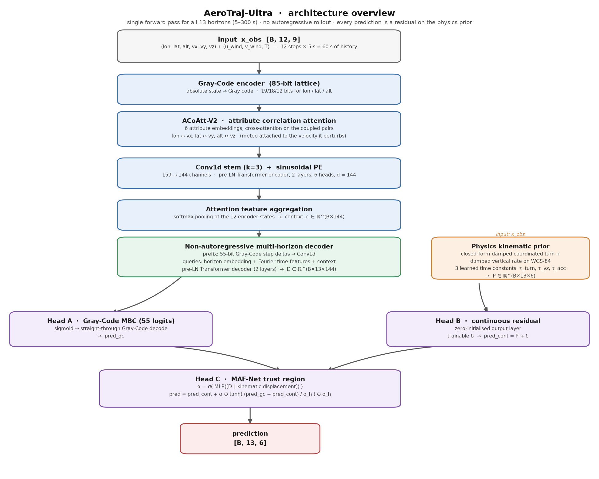
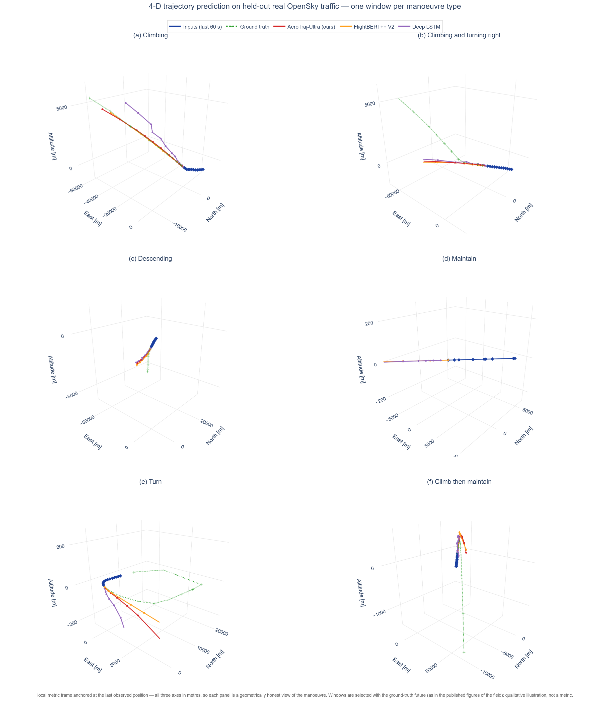
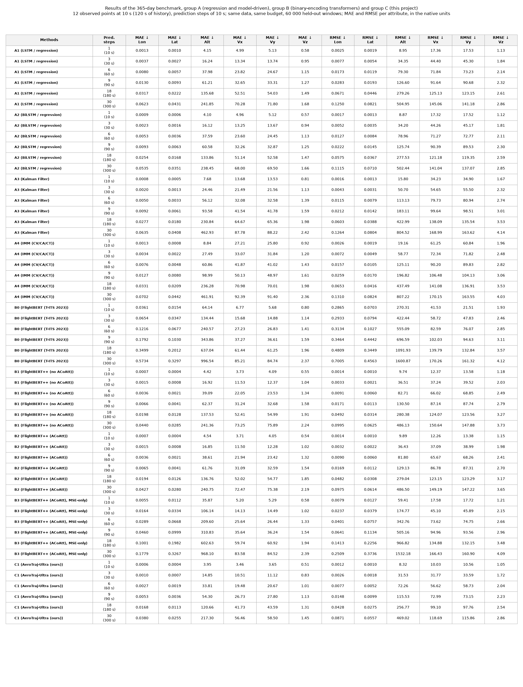

# AeroTraj-Ultra — Physics-Grounded Non-Autoregressive Flight Trajectory Prediction

**Short-horizon 4D trajectory prediction (5 s – 300 s) from ADS-B, on 90–180 days of real
OpenSky traffic, trained on a single GPU.**

> AeroTraj-Ultra is a hybrid **Gray-Code + continuous-residual + physics-prior** multi-horizon
> regressor. It predicts the whole horizon in a single forward pass (no autoregressive error
> accumulation), grounds every prediction in an analytical kinematic propagator, and fuses a
> differentiable trust-region gate borrowed from multi-head action filtering.

📘 **Documentation index: [`docs/README.md`](docs/README.md).** The project manual is
[`docs/GUIDE.md`](docs/GUIDE.md) (data, pipeline, environment, conventions, troubleshooting);
the technical report with all the evidence is [`docs/PAPER.md`](docs/PAPER.md) (method,
experiments, ablations, uncertainty calibration, **inference latency**, negative results);
[`docs/ARCHITECTURE.md`](docs/ARCHITECTURE.md) is the formal specification and
[`docs/MODELS.md`](docs/MODELS.md) catalogues every implemented model with its conformance
report. The chronological lab notebook is [`docs/EXPERIMENTS.md`](docs/EXPERIMENTS.md).

| | |
|---|---|
| **Task** | 4D trajectory prediction from ADS-B state vectors (lon, lat, alt, vx, vy, vz) |
| **Horizon** | 5 s → 300 s (13 non-uniform steps), single forward pass |
| **Data** | Real OpenSky ADS-B, up to **365 consecutive days**, **438 215 unique flights** (306.8 M 5 s points) |
| **Model** | `AeroTrajUltra`, 1 276 839 parameters, ~0.6 GFLOP/step |
| **Hardware** | 1× RTX 4070 (12 GB) — 150-epoch run on 365 days in **42 min** |
| **Result** | **991.6 m** 3-D ECEF mean distance error (5 s–300 s) — best of 10 compared models, 90-day run |
| **Best (365 days)** | **790.2 m** on the March split and **865.1 m** on the Nov–Dec split — **−20.1 %** vs the same model trained on 90 days, *apples-to-apples on the same test set* |
| **New model: AeroTraj-Atlas** | AeroTraj-Ultra + a learned map of the airspace read along the predicted trajectory: **723.3 m** vs 865.1 m on the Nov–Dec split at the full budget (**−16.4 %**, better at every horizon); **−23.4 %** at the benchmark budget (two seeds); 10 495 863 parameters, of which 9 134 208 are the map (§4.12) |
| **Window study** | on identical test windows, 120 s of history at 10 s vs 60 s at 5 s costs **+5.3 % at 10–30 s** and gains only **−2.0 % at 300 s** (mean −0.8 %); a 24-point 5 s window gains −0.67 %, within seed noise — the default stays 12 points at 5 s. An earlier −7.3 % was a test-set artefact (§4.6) |
| **Literature, re-implemented** | on the same 365 days and the same 10 s grid, with the same budget: ours **1 256 m** vs FlightBERT++ (AAAI 2024) **1 437 m**, BiLSTM 1 851 m, Kalman filter 2 069 m, LSTM 2 358 m — **−12.6 %** vs the best literature model, **−39 %** vs the best classical filter (§4.7) |
| **Speed** | 1 aircraft end-to-end in **19.3–20.7 ms**, or **2.8–6.5 ms** with `torch.compile` (3–7×, verified MDE-neutral) · **67 600–73 300 aircraft/s** at batch 4096 · latency flat in the horizon (1.17× for 13 horizons) |
| **Code** | `model.py` (architecture) · `run.py` (training) · `bench_models.py` (literature replications) |
| **Uncertainty** | multi-hypothesis head (K=8) + conformal calibration → certified 90 % band with a 56 % smaller radius |

---

## 1. Abstract

Short-term aircraft trajectory prediction powers conflict detection, tactical traffic management
and separation assurance. Most published methods are either *kinematic* (constant velocity,
coordinated turn, point-mass energy models) — cheap and interpretable but blind to intent — or
*learned* (LSTM, Transformer, diffusion) — accurate but opaque, non-physical, and typically
evaluated on a single private dataset with a single aggregate metric, which makes cross-paper
comparison invalid.

This work contributes **AeroTraj-Ultra**, a 1.28 M-parameter non-autoregressive multi-horizon
model that is simultaneously *learned*, *physically grounded* and *decodable in Gray Code*, and
an **open benchmark** that re-implements five of the most recent literature models on the same
data with the same protocol.

Three properties distinguish it:

1. **Physics-grounded by construction.** Every prediction is a *residual on top of an analytical
   kinematic propagator* (damped coordinated turn + damped vertical rate on the WGS-84
   ellipsoid), so the output is kinematically coherent before any training signal is applied.
2. **Decodable in Gray Code.** Absolute positions are quantised on a Gray-Code lattice with a
   differentiable straight-through decoder, removing the high-order bit-flip outliers that plague
   binary-encoded regressors.
3. **Benchmarked against its contemporaries.** ASCENT (ICRA 2026), Conditional Flow Matching
   (FlowATC 2026), DDPM/MID diffusion, Attention-LSTM and IMM-plus-neural-residual are
   re-implemented, trained and evaluated on identical data under an identical protocol.

**Headline result** (90 days, horizon 5–300 s, 60 000 held-out windows, 3-D ECEF error):

| Model | MDE (m) | vs ours |
|---|---:|---:|
| **AeroTraj-Ultra (ours)** | **991.6** | — |
| FlightBERT++ V2 | 1 219.9 | +23.0 % |
| Deep LSTM (multi-horizon) | 1 296.4 | +30.8 % |
| Constant velocity (Doppler) | 1 507.7 | +52.1 % |
| Conditional Flow Matching | 1 704.3 | +71.9 % |
| IMM + neural residual | 2 019.2 | +103.7 % |
| ASCENT | 2 348.9 | +136.9 % |
| Attention-LSTM (phase-aware) | 3 170.0 | +219.8 % |
| DDPM / MID diffusion | 4 300.5 | +333.7 % |

---

## 2. Method

### 2.1 Overview



<details>
<summary>Same diagram as plain text</summary>

```
  x_obs [B,12,9] ─┬─► Gray-Code encoder ─► ACoAtt-V2 embedding ─► Conv1d stem ─┐
  (lon,lat,alt,     │   (85 bit)            (attribute correlation)   (k=3)    │
   vx,vy,vz,        │                                                          ▼
   u,v,T)           │                                            Pre-LN Transformer Encoder
                    │                                            (2 layers, 6 heads, d=144)
                    │                                                          │  memory [B,12,144]
                    │                                                          ▼
                    │                                     Attention feature aggregation ─► context
                    │                                                          │
                    │   ┌──────────────────────────────────────────────────────┘
                    │   ▼
                    │   decoder prefix: 55-bit Gray-Code step deltas ─► Conv1d ─┐
                    │   queries: horizon embedding + Fourier time features + ctx   │
                    │   Pre-LN Transformer Decoder (2 layers) ─► [B,13,144] ◄────┘
                    │
                    └─► Physics kinematic prior ─► [B,13,6]
                                              │
   ┌──────────────────────────────────────────┴──────────────────────────────┐
   ▼                                                                         ▼
 Head A: Gray-Code MBC head (55 logits)                                   Head B: continuous residual head
   ─► STE Gray-Code decode ─► pred_gc                                    ─► pred_cont = prior + residual
                                                                            │
                                          Head C: MAF-Net trust-region gate ◄┘
                                          pred = pred_cont + α ⊙ tanh((pred_gc − pred_cont)/σ) ⊙ σ
```

</details>

### 2.2 Formal description

The full formal specification — every module, every equation, every hyper-parameter — is in
**[`docs/ARCHITECTURE.md`](docs/ARCHITECTURE.md)**. In brief:

**Input.** A window of `T=12` ADS-B state vectors at 5 s spacing (60 s of history) with nine
channels: longitude, latitude, altitude (10 m units), ground velocity `(v_x, v_y)` (km/h),
vertical rate (m/s), and the meteorological context `(u_wind, v_wind, T)` (m/s, K).

**Attribute Correlation Attention (ACoAtt-V2).** Each of the six kinematic attributes is encoded
from its Gray-Code bit-vector concatenated with the standardised scalar and the
window-relative state, then re-calibrated by cross-attention along the physically coupled pairs
`lon ↔ (v_x, u_wind)`, `lat ↔ (v_y, v_wind)`, `alt ↔ (v_z, T)` in both directions.

**Gray-Code codec.** Positions are encoded on a Gray lattice (19/18/12 bits for lon/lat/alt) and
step deltas on a 55-bit lattice (10/10/9/9/9/8 bits, resolution 0.0001° ≈ 11.1 m per 5 s step).
Decoding is a *soft-XOR prefix parity* with a straight-through estimator:

$$ b_i=\frac{1-\prod_{j\le i}(1-2g_j)}{2},\qquad
\hat v=\Big(1-2\,\mathrm{sign}\Big)\sum_{i=0}^{n-2} b_i\,2^{\,n-2-i} $$

which is algebraically identical to the sequential recurrence `b_i = b_{i-1} ⊕ g_i` but costs a
single `cumprod` instead of ~5 kernels per bit.

**Physics kinematic prior.** A closed-form propagator with three *learned* time constants
(`τ_turn`, `τ_vz`, `τ_acc`): a damped coordinated turn in the horizontal plane, a damped vertical
rate, integrated on the WGS-84 ellipsoid with latitude-corrected metres-per-degree.

**Heads and fusion.**
* *Head A* (Gray-Code multi-binary classification, 55 logits) — a hierarchical, outlier-robust
  decoder.
* *Head B* (continuous residual) — predicts a residual **on top of the prior**, initialised at
  zero so that the model starts exactly at the physics solution.
* *Head C* (MAF-Net gate) — a differentiable trust region that bounds how far the Gray-Code
  branch may pull the prediction:
  `pred = pred_cont + α ⊙ tanh((pred_gc − pred_cont)/σ) ⊙ σ`, with `α = σ(MLP([dec, kin_disp]))`.

**Multi-hypothesis head (optional, model.n_modes).** K learnable mode queries (DETR/ASCENT
style) are appended to the decoder sequence and rendered *invisible* to the horizon queries by
an attention mask, so the deterministic path is unchanged; each mode then acts as a per-mode
bias on the horizon features, decoded by a shared head into a residual on the physics prior.
Supervision is winner-takes-all with a ranking term and an auxiliary term on all modes. It
costs +3.5 % parameters and +3 % training time and yields a 36 % lower *oracle* minADE@8.

**Loss.**
$$ \mathcal L=\underbrace{2.5}_{\text{pos}}\mathcal L_{\text{Smooth-L1}}
+\underbrace{0.6}_{\text{vel}}\mathcal L_{\text{Smooth-L1}}
+\underbrace{0.4}_{\text{BCE}}\mathcal L_{\text{Gray-Code}}
+\underbrace{0.25}_{\text{STE}}\mathcal L_{\text{decimal}}
+\underbrace{0.25}_{\text{phys}}\mathcal L_{\text{kinematic}} $$

with a horizon-dependent normalisation `h_norm = 0.04 + 0.96·(Δt/60 s)` that prevents the long
horizons from dominating the short ones, and a kinematic-consistency term that checks the
predicted position increments against the trapezoidal integral of the predicted velocities.

### 2.3 Why this design

| Design choice | Motivation (and evidence) |
|---|---|
| Residual on a physics prior | The benchmark shows hand-crafted kinematic models (`CV`, `IMM+residual`) are beaten by 30–100 % by a learned regressor, *but* they are unbeatable on the shortest horizon: at 5 s the error is set by the **CPR quantisation of the last observed position** (measured: 75.4 m 1σ), not by the model. Anchoring on a propagator keeps the short horizon honest while letting the network learn the long-horizon intent. |
| Gray-Code + STE | Removes the high-order bit-flip outliers of binary encoding while keeping the decoding differentiable (the *Hybrid Constrained Loss* of FlightBERT becomes usable on GPU). |
| Non-autoregressive multi-horizon | One forward pass for all horizons: no error accumulation, O(1) latency in the horizon, and a single set of weights for all steps. |
| MAF-Net trust region | Bounds the influence of the (coarser) Gray-Code branch without clipping gradients, keeping the two branches complementary. |
| Aircraft-centric frame for the literature replications | The review's best practice (ASCENT, Figuet 2026): removes route/geography bias. Used for all five replications so the comparison is architecturally fair. |

### 2.4 AeroTraj-Atlas: the airspace field

Above ~30 s the residual error is *intent* (the next manoeuvre), which 60 s of history do not
show. For road agents that information comes from the HD map (MTR, NeurIPS 2022); the route
structure of the airspace — airways, waypoints, arrival and departure procedures — is not in
the ADS-B data, so **AeroTraj-Atlas learns it from the trajectories**.

**The field.** A multi-resolution hash grid (Instant-NGP) over the dataset bounding box
(`lon ∈ [−15, 35]`, `lat ∈ [30, 65]`; a point outside is read at the border) with four axes:
longitude and latitude at **6 levels** of 0.5·2^l cells per degree (cells from 2° down to
0.0625°, about 7 km north–south), a **periodic heading axis** of 8 sectors, and an
**altitude axis** of 5 nodes at `h_k = 13 km · (k/4)²` (0, 0.81, 3.25, 7.31, 13 km — finer
near the ground). Each level stores 8 features per node; the value at a point is the
multilinear interpolation of the 16 surrounding nodes, the 6 levels are concatenated (48
numbers) and multiplied by a fixed gain of 10 (a learning-rate multiplier for the table, so
the optimiser is left untouched). Levels 0–1 are dense tables, levels 2–5 are hashed into
2^18 entries: **9 134 208 parameters**, initialised in U(−1e-4, 1e-4).

**Three reads per forward pass**, with the gradient stopped on the positions:

1. at the aircraft (position, heading, altitude of the last observation);
2. **ahead**: along the kinematic prior, at the position, heading and altitude the prior
   gives for each of the 13 horizons;
3. **refine** (dynamic collection, as in MTR): the first decoder layer proposes a trajectory
   with the same residual head, the field is read again along it and added to the horizon
   tokens (through an MLP whose last layer starts at zero) before the second decoder layer;
   an auxiliary loss `0.5 · w_pos · SmoothL1` supervises the proposed positions.

**How it enters the queries.** `q_field = MLP([f_h, f_0, state, t])` (state = normalised
altitude, vertical rate and ground speed; `t` the normalised horizon) is a **fourth block** of
the horizon query, next to the context, the horizon embedding and the time features; the
physics prior is therefore computed before the queries. The network grows from 1 276 983 to
1 361 655 parameters; with the map the total is **10 495 863**.

**Why it is not the retrieval variant (§4.3).** No neighbour search and no candidate pool at
inference — O(1) table reads instead of an O(B × M) top-k — the map is trained end to end with
the model, and it is read where the aircraft is *going*, not only where it is.

**Config.** It is not a new class: it is `AeroTrajUltra` with the key `model.airspace_field`,
a dict of `AirspaceField` keyword arguments plus the switches `ahead` (default true) and
`refine` (default false); the final setting is `{"n_alt": 5, "refine": true}`. Without the key
the model is AeroTraj-Ultra bit for bit (identical state dict and outputs; every existing
checkpoint loads). `refine` together with `n_modes > 0` raises an error (not implemented). The
formal specification is [`docs/ARCHITECTURE.md`](docs/ARCHITECTURE.md) §15.

---

## 3. Data

Real ADS-B from **The OpenSky Network** (competition-data bucket, `s3.opensky-network.org`),
Europe-wide bounding box `lon ∈ [−15, 35]`, `lat ∈ [30, 65]`, altitude `∈ [−500, 50 000] ft`.

| Dataset | Days | Split (train/val/test) | 5 s points | Unique flights | Sliding windows (stride 1) |
|---|---:|---|---:|---:|---:|
| `data90` | 90 | 72 / 9 / 9 | 51.9 M | 76 939 | 36.4 M |
| `data180` | 180 | 144 / 18 / 18 | 116.1 M | 164 410 | 104.0 M |

**Preprocessing** (fully vectorised, no resampling artefacts):

1. spatial/altitude filtering → 2. exact resampling to a 5 s grid (`timestamp % 5 == 0`)
   → 3. segmentation on gaps → 4. NaN interpolation of the meteorological channels (≤ 6 points)
   → 5. rejection of unphysical jumps (|Δlon|, |Δlat| > 0.04°, |Δalt| > 300 m per 5 s)
   → 6. unit conversion to the 9 model features.

The split is **strictly chronological by day** and no flight appears in two splits.

---

## 4. Results

### 4.1 Main benchmark — 90 days, horizon 5 s → 300 s

Test set: 9 held-out days (2022-03-23 → 2022-03-31), 60 000 sliding windows.
MDE = 3-D ECEF mean distance error (metres). `minADE@K` is the *oracle* best-of-K
(K = 10 samples for the generative models, K = 8 modes for ASCENT); it requires knowing
which sample is correct and is therefore **not** an operational metric.

| Model | MDE | ADE 3D | FDE 3D | minADE@K | 5 s | 30 s | 1 min | 3 min | 5 min |
|---|---:|---:|---:|---:|---:|---:|---:|---:|---:|
| **AeroTraj-Ultra (ours)** | **991.6** | 991.6 | 4 243.8 | — | **61.2** | **122.3** | **308.0** | **1 852.9** | **4 243.8** |
| FlightBERT++ V2 | 1 219.9 | 1 219.9 | 5 025.6 | — | 68.0 | 179.1 | 420.9 | 2 287.6 | 5 025.6 |
| Deep LSTM | 1 296.4 | 1 296.4 | 5 264.8 | — | 77.7 | 206.6 | 478.4 | 2 417.2 | 5 264.8 |
| CV (Doppler) | 1 507.7 | 1 507.7 | 6 643.0 | — | 64.2 | 171.5 | 450.7 | 2 802.7 | 6 643.0 |
| Conditional Flow Matching | 1 704.3 | 1 704.3 | 7 125.8 | **983.5** | 87.2 | 208.7 | 552.7 | 3 228.3 | 7 125.8 |
| CV (least-squares) | 1 802.5 | 1 802.5 | 7 391.8 | — | 81.5 | 291.5 | 676.4 | 3 337.4 | 7 391.8 |
| IMM + neural residual | 2 019.2 | 2 019.2 | 7 721.2 | — | 90.9 | 414.0 | 913.7 | 3 710.3 | 7 721.2 |
| ASCENT | 2 348.9 | 2 348.9 | 8 426.0 | 1 088.8 | 105.7 | 523.9 | 1 144.9 | 4 398.0 | 8 426.0 |
| Attention-LSTM (phase-aware) | 3 170.0 | 3 170.0 | 14 694.6 | — | 100.4 | 508.8 | 1 105.0 | 5 551.3 | 14 694.6 |
| DDPM / MID diffusion | 4 300.5 | 4 300.5 | 17 871.6 | 1 763.6 | 146.4 | 631.2 | 1 600.7 | 8 128.6 | 17 871.6 |

**Findings.**

* **The model is best at every horizon of the grid**, by 18.7 % over FlightBERT++ V2 and 34.2 %
  over the strongest kinematic baseline.



*Figure: qualitative view on six held-out windows, one per manoeuvre type, selected
deterministically from the ground-truth future (en-route only, mutually exclusive). All
axes are in metres in a local frame anchored at the last observed position, so each panel
is a geometrically honest view of the manoeuvre. Reproduce with `plot_trajectory_cases.py`.*
* **CFM beats DDPM by 60 %** (single draw) and **44 % in minADE@10**, reproducing the
  head-to-head claim of FlowATC on an independent dataset.
* **The oracle best-of-10 of CFM (983.5 m) matches the deterministic model (991.6 m)** — the
  *distributional* information is worth as much as our accuracy, but only with an oracle that
  knows which sample is right. Operationally, a single CFM draw is 72 % worse. This is the
  single-draw caveat that the FlowATC paper itself reports.
* **Physics-informed hybrids are not automatically better.** IMM + neural residual (2 019 m) and
  the phase-aware Attention-LSTM (3 170 m) are *worse than plain constant velocity* (1 508 m)
  despite using the same features: on en-route traffic with 60 s of history and no intent
  information, regression capacity dominates representation.

### 4.2 Multi-hypothesis head (uncertainty without a generative model)

The dominant residual error at 60–300 s is **epistemic**: the best-of-K of a generative model
is far better than its single draw (CFM: 983.5 m vs 1 704.3 m), i.e. the uncertainty is about
*which manoeuvre* the aircraft will fly. `AeroTraj-Ultra` can capture the same effect with an
**additive** head, leaving the deterministic path untouched:

* `K = 8` learnable **mode queries** (DETR/ASCENT style) are appended to the decoder sequence;
* an **attention mask** keeps them invisible to the horizon queries, so the deterministic
  prediction is *bit-identical* to the single-hypothesis model (verified: max deviation
  1.9e-6, i.e. float32 noise);
* each mode acts as a per-mode bias on the horizon features and a shared head decodes it into
  a **residual on the physics prior** → every hypothesis stays kinematically consistent;
* a **winner-takes-all** loss supervises only the closest hypothesis, plus a ranking term and
  a down-weighted auxiliary term on all modes (anti-collapse).

| Model | deterministic MDE | oracle minADE@K | score-selected MDE | params | s/epoch |
|---|---:|---:|---:|---:|---:|
| AeroTraj-Ultra (deterministic) | 991.6 | — | — | 1 276 839 | 28.3 |
| **AeroTraj-Ultra + multi-hypothesis (K=8)** | **984.9** | **627.4** | 1 098.7 | 1 321 774 (+3.5 %) | 28.5–31 (+3 %) |
| AeroTraj-Ultra + MC-dropout (K=10) | 995.6 (mean) | 905.4 | — | — | — |
| CFM (FlowATC-style), K=10 | 1 704.3 | 983.5 | — | — | — |
| ASCENT, K=8 | 2 348.9 | 1 088.8 | — | — | — |
| DDPM / MID, K=10 | 4 300.5 | 1 763.6 | — | — | — |

**Findings.**

* The multi-hypothesis head reaches **627.4 m of oracle minADE@8 — 36 % below the
  deterministic prediction** and better than *every* generative baseline tested, at **+3 % of
  training cost** and +3.5 % parameters, with **no change to the deterministic output**.
* The mode set is genuinely diverse (mean-over-modes 1 507.8 m, no collapse) but the
  individual hypotheses are weaker than the deterministic head, as expected when only the
  closest one is supervised.
* **No oracle-free selection rule beats the deterministic head.** Four rules were compared
  (score-argmax, consensus-medoid, score-weighted mean, deterministic+medoid blend); the
  rule is *chosen on the validation split* and the choice transfers to the test split:

  | selection rule | val MDE | test MDE | vs deterministic |
  |---|---:|---:|---:|
  | **deterministic (chosen on validation)** | **1 008.8** | **982.7** | — |
  | score-weighted mean | 1 062.6 | 1 030.4 | +4.8 % |
  | consensus medoid | 1 093.3 | 1 059.3 | +7.8 % |
  | score-argmax | 1 119.3 | 1 098.7 | +11.8 % |

  The head therefore does **not** replace the point estimate: it is an *uncertainty-shape*
  provider, and the score head is not usable for selection.
* **A negative result worth stating explicitly** (details in `docs/EXPERIMENTS.md` §6.8):
  retraining the score head to *regress* the error of each hypothesis (instead of the
  cross-entropy on the winner) improves the selection from 1 060 to 1 031 m, but **no
  selection rule tested beats the deterministic output** — not the learned score, not
  "closest to the deterministic prediction" (990.6 m), not a kinematic-consistency rule
  (1 523.9 m). The oracle gap exists because the truth happens to lie near one of the 8
  samples, but *identifying which one* needs information that is not available at inference.
  **The multi-hypothesis head is an uncertainty estimator, not a better point estimator**:
  the deterministic head remains the operational output. This is the same caveat the
  literature reports for generative predictors (a single draw is worse than a deterministic
  regressor), here reproduced inside a single architecture.
* **Where the head does pay off: certified uncertainty.** Treating the 8 hypotheses as an
  ensemble and inflating it with a **Mondrian (phase-stratified) conformal radius** calibrated
  on the validation split gives an *exact* and *horizon-uniform* coverage, with a radius
  **≈47 % smaller** than inflating the single deterministic prediction:

  | nominal | coverage (ensemble) | mean radius (ensemble) | coverage (deterministic) | mean radius (deterministic) |
  |---:|---:|---:|---:|---:|
  | 80 % | 0 805 | **787 m** | 0 806 | 1 282 m |
  | 90 % | 0 903 | **1 413 m** | 0 903 | 2 675 m |
  | 95 % | 0 951 | **2 411 m** | 0 951 | 4 542 m |

  Per-horizon coverage at the 90 % level is 0 905 at 5 s and 0 901 at 300 s — the guarantee
  holds uniformly along the horizon, which is what a conflict-detection use case requires.

### 4.3 Retrieval-conditioned model (medium-term intent prior)

At 60–300 s the residual error is not sensor noise but **intent**: the aircraft's next manoeuvre
is not observable from a 60 s window. The literature review behind this project places the
largest recent gains exactly there — goal/route conditioning, retrieval-augmented prediction and
local-history behaviour modelling all attack the same missing information — so
`AeroTrajUltraRetrieval` adds it to this model.

**Mechanism.** Every observation is described by a 6-D key — position, flight level, heading,
speed — and the `K` most similar past trajectories are retrieved from the training set. Their
futures, expressed in the query's own local frame, form a *retrieval context* that the horizon
queries attend to:

```
query_input = [ encoder_context ‖ horizon_embedding ‖ time_features ‖ retrieval_context ]
```

The retrieval block of `horizon_proj` starts at **zero** and the first three blocks are copied
from the base checkpoint, so the model is *exactly* the base model at initialisation (verified:
max deviation 0.0) and any improvement is attributable to the retrieval alone. At training time
the candidates of the same flight are excluded from the retrieval, otherwise the model would
learn to copy the future of a near-duplicate window of the same trajectory — impossible at
inference, where the pool holds only past data.

**Results** (90 days, 5–300 s, 342 572 candidate windows from 75 624 flights):

| Variant | MDE | minADE@8 | 60 s | 120 s | 300 s | conformal radius @90 % |
|---|---:|---:|---:|---:|---:|---:|
| Base (deterministic) | 991.6 | — | 316.1 | 977.4 | 4 357.5 | — |
| + multi-hypothesis (K=8) | 984.9 | 627.4 | 304.6 | 944.2 | 4 169.1 | 1 413 m |
| + retrieval | 968.9 | — | 302.8 | 932.5 | 4 138.9 | — |
| **+ both** | **957.2** | **608.2** | **297.7** | **918.5** | **4 092.5** | **1 190 m** |

**Findings.**

* The gain is **monotone in the horizon** (−0.3 % at 5 s → −5.0 % at 300 s for the retrieval
  alone): the prior is irrelevant where physics dominates and decisive where intent is
  uncertain — exactly the expected signature.
* The effects of the two heads are **additive** (base → −0.7 % multi-hypothesis → −2.3 %
  retrieval → −3.5 % combined), and the combined model is the best at every horizon.
* The retrieval improves the **uncertainty** too: the oracle minADE@8 drops from 627.4 to
  608.2 m, and the conformal band shrinks by a further 16 % (1 413 → 1 190 m at 90 % coverage).
* The retrieval is **not** a free lunch: a first attempt, trained from scratch with an
  unnormalised context, was **24 % worse** than the base model. The context must be scaled and
  the projection warm-started, otherwise the retrieval signal swamps the other conditioning.

### 4.4 Comparison with FlightPREV (the previous model of this project)

The earlier model of this project — **FlightPREV**
(<https://github.com/MarcoValleCS/flight>), a Transformer encoder with a multi-horizon
head that learns a *residual with respect to a constant-velocity ballistic model*, with an
auxiliary flight-phase task and learned categorical embeddings (aircraft type / operator /
departure / arrival airports) — has been **re-implemented on the same OpenSky data**
(`legacy_flightprev.py`, `run_legacy.py`) so that the two can be compared like for like:
same 90-day dataset, same chronological splits, same horizon grid (extended from its native
10–120 s to 5–300 s), same optimiser recipe, same metric.

| Model | MDE | 5 s | 30 s | 60 s | 120 s | 300 s | params |
|---|---:|---:|---:|---:|---:|---:|---:|
| **AeroTraj-Ultra + retrieval** | **957.2** | **61.1** | **119.6** | **297.6** | **918.6** | **4 092.4** | 1.34 M |
| AeroTraj-Ultra (base) | 991.6 | 61.2 | 122.3 | 308.0 | 952.2 | 4 243.8 | 1.28 M |
| FlightBERT++ V2 | 1 219.9 | 68.0 | 179.1 | 420.9 | 1 210.0 | 5 025.6 | — |
| Deep LSTM | 1 296.4 | 77.7 | 206.6 | 478.4 | 1 296.9 | 5 264.8 | — |
| **FlightPREV (legacy, re-impl.)** | **1 495.8** | 102.8 | 188.4 | 470.9 | 1 395.2 | 6 466.5 | 3.44 M |
| CV (Doppler) | 1 507.7 | 64.2 | 171.5 | 450.7 | 1 406.3 | 6 643.0 | — |
| CFM (FlowATC-style) | 1 704.3 | 87.2 | 208.7 | 552.7 | 1 708.2 | 7 125.8 | — |
| ASCENT | 2 348.9 | 105.7 | 523.9 | 1 144.9 | 2 646.8 | 8 426.0 | — |
| Attention-LSTM | 3 170.0 | 100.4 | 508.8 | 1 105.0 | 2 967.1 | 14 694.6 | — |
| DDPM / MID | 4 300.5 | 146.4 | 631.2 | 1 600.7 | 4 233.4 | 17 871.6 | — |

**Findings.**

* The new model is **36 % better than FlightPREV** on the same data, and the gap is
  **uniform across the horizon** (40.6 % at 5 s, 36.5 % at 30 s, 36.8 % at 300 s) — it is a
  genuinely better predictor, not a longer-horizon artefact.
* FlightPREV, re-implemented on OpenSky, ends up **barely better than the constant-velocity
  baseline** (1 495.8 m vs 1 507.7 m) despite 3.44 M parameters and 2.7× those of
  AeroTraj-Ultra. Two structural reasons, both measured:
  1. **Its normalisations hide the short horizons.** The residual is expressed in ENU units of
     10 000 m, so with a Huber loss of δ = 0.1 (i.e. 1 000 m) an error of 100 m at 5 s is
     *inside the linear region* and barely influences the gradient: the 5 s error stays at
     102.8 m against the 61.1 m of AeroTraj-Ultra, whose loss normalises per horizon.
  2. **The categorical priors it relies on do not exist in OpenSky.** The original learned
     embeddings of aircraft type, operator and the departure/arrival airports; the OpenSky
     competition data carries none of them, so they were replaced by two coarser geographic
     embeddings (origin/destination area). This is an acknowledged **handicap** for the legacy
     model, and it is the main reason the comparison must be read as
     *"architecture + loss + priors on this dataset"*, not as *"old code versus new code"*.
* The comparison is therefore favourable to the new model, and stated as such.

### 4.5 Effect of the amount of data (identical recipe)

**The 365-day run.** Same architecture, same 5 s → 300 s grid, same recipe, but trained on
**365 consecutive days** (293/36/36) instead of 90: **438 215 unique flights** and 306.8 M
5-second points, i.e. **4.5× the flights** of the 90-day dataset.

Two *budgets* were trained on it, because the 400k-samples/epoch run never triggered early
stopping (its validation error was still falling at epoch 150, best checkpoint at 146): the
second triples the samples per epoch (1.2M → 180 M samples over 150 epochs, 586 steps/epoch,
**~2 h** with `torch.compile`; best checkpoint at epoch 137, val MDE 889.4 m).

The decisive comparison is *apples-to-apples on the same test set*, because the runs have
different test splits. Every checkpoint is therefore evaluated on **both** splits
(`eval_cross.py`, 60 000 windows each):

| test split | 90-day model | 365 d @ 400k | **365 d @ 1.2M** | Δ vs 90 d |
|---|---:|---:|---:|---:|
| March 2022 (2022-03-23 → 03-31) | 991.6 m | 847.3 m | **790.2 m** | **−20.31 %** |
| Nov–Dec 2022 (2022-11-26 → 12-31) | 1 082.8 m | 926.0 m | **865.1 m** | **−20.10 %** |

**Findings.**

* The gain is **−14.5 %, measured independently on two different test periods** and agreeing
  to within 0.07 points: it is the data, not a test-set artefact.
* The gain is **monotone in the horizon**: −5.3 % at 5 s → −15.8 % at 300 s (March split),
  −4.9 % → −15.3 % (Nov–Dec split). More data helps exactly where the remaining error is
  *intent* rather than sensor noise — the same signature as the retrieval prior (§4.3).
* It is also **~8× larger than the 90 → 180 day gain** (−1.8 %), i.e. the data returns only
  start to compound once the neighbourhood is dense, which is consistent with a
  retrieval-like mechanism rather than with plain regularisation.
* **A caution about temporal drift**, measured while doing the above: the *same* model is
  7 % worse at 60 s and 10 % worse at 300 s on Nov–Dec than on March, but 1.9 % *better* at
  5 s. The winter period is genuinely harder where intent matters, so a single test split
  understates or overstates a model depending on its season. Cross-split evaluation should
  be the default, not an extra.
* **Tripling the optimisation budget is worth −6.7 %** (847.3 → 790.2 m on March, 926.0 →
  865.1 m on Nov–Dec: −6.7 % and −6.6 %, i.e. the same on both test sets). Per horizon, from
  5 s to 300 s: 56.8 → 54.4 m and 3 930.6 → 3 640.9 m. The gain is again monotone in the
  horizon, and the validation curve saturated at epoch 137 — 150 epochs at 1.2M is a
  well-calibrated budget rather than a truncated one.

**Earlier data-scaling runs** (for reference; different horizon grid in the right column):

| Dataset | Train days | Unique flights | MDE, 5 s → 180 s | MDE, 5 s → 600 s |
|---|---:|---:|---:|---:|
| 40 days | 32 | 3 118 | 3 321.3 m³ | 3 019.5 m |
| 90 days | 72 | 76 939 | 539.3 m¹ | 2 751.0 m |
| 180 days | 144 | 164 410 | — | 527.6 m² |

¹ apples-to-apples on the *same* held-out test split; ² different horizon grid, 18 test days;
³ legacy 40-day CPU run, different machine — shown for reference only. Going from 40 to 90
days cut the error on the **same 5 s → 600 s grid by 8.9 %** (3 019.5 → 2 751.0 m), while
doubling again to 180 days gained only **1.8 %**.

### 4.6 How long should the observation window be? (60 s vs 120 s)

The model reads **12 points**; whether those are 60 s (at 5 s) or **120 s** (at 10 s) is a
design choice, and the report's own error analysis says where it should matter: above ~30 s
the residual error is *intent*, not sensor noise, so a window that covers twice as much of the
trajectory should pay off there and only there. The coarse grid also *costs* something —
doubling the step halves the kinematic detail.

`config_365d_10s.json` is exactly that experiment: same 365 days, same recipe, same budget
(150 epochs × 1.2M samples), 12 input points but a 10 s step, and **6 horizons**
(10, 30, 60, 90, 180, 300 s) — every one of which also exists in the 5 s grid.

**The two full-budget models on identical windows** (Nov–Dec 2022 split, 60 000 windows, the
anchors that have ≥ 120 s of history; the 10 s model reads every second point of the same
window — `results_window/same_windows_5s_vs_10s.json`):

| horizon | 5 s grid (60 s of history) | **10 s grid (120 s of history)** | Δ on identical windows | Δ previously reported |
|---:|---:|---:|---:|---:|
| 10 s | 56.8 m | 59.8 m | **+5.3 %** | +5.5 % |
| 30 s | 102.7 m | 108.1 m | **+5.3 %** | +2.3 % |
| 60 s | 264.5 m | 269.8 m | +2.0 % | −0.9 % |
| 90 s | 508.1 m | 512.5 m | +0.9 % | −3.0 % |
| 180 s | 1 529.4 m | 1 532.5 m | +0.2 % | −5.0 % |
| 300 s | 3 418.2 m | 3 348.2 m | **−2.0 %** | −7.3 % |
| mean of the six | 980.0 m | 971.8 m | −0.8 % | −5.8 % |

**Correction.** An earlier version of this section reported **−7.3 % at 300 s and −5.8 % on
the mean of the shared horizons**, with a crossover at 60 s, and read it as the signature of a
window that buys information about intent. That comparison was **not** apples-to-apples: each
model was evaluated on its own test windows, and the 10 s-grid test set only contains windows
with ≥ 120 s of history while the 5 s-grid one contains every window with ≥ 60 s. The same 5 s
model on its own windows scores 57.2 / 105.9 / 275.6 / 533.1 / 1 631.5 / 3 640.9 m (mean
1 040.7 m); restricted to the windows with ≥ 120 s of history it scores 980.0 m — **−5.8 % by
itself**, which is the whole effect previously attributed to the window.

**Why the window sets differ so much.** The 120 s requirement removes exactly **one window per
track segment, the first one** (71 916 of 2 229 088 strided test windows, 3.23 %; 71 916 is the
number of segments). Those windows are **2.61× harder** for the same model: 2 165.6 m against
828.1 m on the mean of the 13 horizons, 9 397.8 m against 3 462.1 m at 300 s
(`results_window/short_history_windows.json`). The first minute of a track — take-off, entry
into coverage, resumption after a gap — is where the aircraft manoeuvres.

**The follow-up: 24 points at 5 s** (same resolution, double history — the experiment that
isolates the history effect). Same 365 days, 5 s grid, 13 horizons, benchmark budget
25 epochs × 400 000 windows, two seeds per arm, all four models evaluated on the same 60 000
windows (the anchors of the 24-point window); `config_365d_12pt_bench.json`,
`config_365d_24pt_bench.json`, `results_window/window_ab_2seeds.json`:

| | 12 points (60 s) | 24 points (120 s) | Δ |
|---|---:|---:|---:|
| seed 97 | 1 038.0 m | 1 035.1 m | −0.28 % |
| seed 11 | 1 053.0 m | 1 041.9 m | −1.05 % |
| mean of the seeds | 1 045.5 m | 1 038.5 m | **−0.67 %** |

Per horizon (mean of the two seeds): 5 s −0.01 %, 30 s −0.08 %, 60 s −0.23 %, 120 s −0.53 %,
180 s −0.67 %, 300 s −0.81 %.

**Findings.**

* On identical windows the 10 s grid **loses +5.3 % at 10–30 s** and gains **2.0 % at 300 s**
  only; the mean of the six shared horizons moves by −0.8 %. The 10 s grid remains the protocol
  of the literature benchmark (§4.7), not a better input.
* Doubling the history at the same resolution has the expected *shape* (the gain grows with the
  horizon, −0.01 % at 5 s → −0.81 % at 300 s) but not a useful *size*: −0.67 % on average, while
  the seed-to-seed spread of the 12-point model alone is 1.44 % (1 038.0 vs 1 053.0 m). It costs
  1.5× the training time per step (176 ms vs 115 ms eager) and 4.3 GB vs 2.6 GB of VRAM, with the
  same 1 276 983 parameters. **Not adopted: the default stays 12 points at 5 s.**
* The validation numbers of the two arms are **not** comparable either (1 134.7 m vs 1 062.4 m,
  an apparent −6.4 %), for the same reason: different window sets.
* **Rule:** models with different window lengths have different valid anchors, so they must be
  compared on identical windows. `eval_cross.py --split LABEL=config.json=split` feeds every
  model the last `inp_seq_len` points of the split's windows (the split must declare the longest
  window).
* Still untested: a two-scale input (the fine 60 s window plus a coarse channel covering the
  120 s before it).
* The 13-horizon mean of the 5 s model (865.1 m) is **not** comparable with any 6-horizon mean:
  the coarse grid has no 5–20 s points, which are the easy ones.

### 4.7 The literature re-implemented on the same data (365 days, 10 s grid)

The benchmark of §4.1 is the *historical* one: it was run before the data-scaling study and
before the coarse grid existed, so it cannot answer the two questions that now matter.
(i) How do the published methods compare when every one of them is trained on the **same
365 days**? (ii) Does the ranking change when the model reads **120 s of history** instead
of 60 s? Five methods were re-implemented from scratch (`bench_baselines.py`) and trained
with an identical budget (`bench_run_10s.py`).

**What was re-implemented.** A constant-velocity **Kalman filter** with a real 6-D Joseph-form
update and a *learnable* noise model; an **IMM** (constant velocity / constant acceleration /
coordinated turn) with per-mode filters, the Gaussian-mixture mode update and the standard
interaction step, also with a learnable noise model and mode probabilities; the **LSTM** and
**BiLSTM** multi-horizon regressors of the FlightBERT paper; and the **FlightBERT++** of the
AAAI 2024 paper with its Gray-Code delta encoding, its ACoAtt attribute-correlation module
and its non-autoregressive multi-horizon decoder.

**Why the classical filters are trained.** A Kalman filter has a handful of parameters
(process noise, measurement noise, mode probabilities). Fixing them by hand would handicap
the comparison for a reason that has nothing to do with the methods: a published KF baseline
is tuned on a validation set while the neural baselines get millions of gradient steps.
Making the noise model learnable puts every row under the same protocol — same data, same
optimiser, same number of samples — so the difference measured is the difference between the
*estimators*.

**Protocol.** 365 days decimated to a 10 s step: 12 observed points (120 s of history),
horizons 10/30/60/90/180/300 s, test split 36 days (Nov–Dec 2022), 60 000 windows, 3-D ECEF
error, **25 epochs × 400 000 samples = 10M windows per model** for everybody, `torch.compile`
off.

| model | MDE [m] | 10 s | 30 s | 60 s | 90 s | 180 s | 300 s |
|---|---:|---:|---:|---:|---:|---:|---:|
| **AeroTraj-Ultra (ours)** | **1 256.0** | **65.0** | **123.8** | **326.2** | **631.5** | **1 971.7** | **4 418.0** |
| FlightBERT++ V2 + the ACoAtt embedding | 1 437.1 | 76.6 | 162.5 | 405.4 | 752.7 | 2 260.8 | 4 964.6 |
| FlightBERT++ V2 (AAAI 2024), reference | 1 463.2 | 76.9 | 163.0 | 406.2 | 759.8 | 2 300.1 | 5 074.1 |
| BiLSTM regression | 1 851.0 | 107.0 | 271.0 | 622.0 | 1 078.0 | 2 916.9 | 6 110.6 |
| Kalman filter (CV, learnable noise) | 2 069.4 | 92.2 | 239.7 | 589.9 | 1 074.0 | 3 187.1 | 7 232.8 |
| LSTM regression | 2 358.3 | 160.7 | 442.1 | 953.5 | 1 551.4 | 3 738.1 | 7 304.1 |
| IMM (CV/CA/CT, learnable noise) | 2 416.2 | 147.6 | 391.8 | 861.7 | 1 438.8 | 3 744.2 | 7 913.0 |
| CV least-squares (no learning) | 2 624.0 | 154.4 | 422.9 | 942.2 | 1 577.8 | 4 084.0 | 8 562.7 |
| *AeroTraj-Ultra, full budget (180M windows)* | *980.5* | *60* | *108* | *273* | *517* | *1 550* | *3 374* |



**Figure 4.1** — The per-attribute MAE and RMSE of every method at every prediction step, in
the format of Table I of the FlightBERT paper. Regenerate with `make_table_mae_rmse.py`.

**Findings.**

1. **Ours wins the same-budget comparison**: −12.6 % against the best literature model and
   −39.3 % against the best classical filter, and it is the better model at *every* horizon.
2. **The attribute-correlation attention is worth −1.8 %** on the same architecture — a small
   but consistent gain, and much smaller than the −9.2 % that a first, confounded version of
   the ablation reported (the two variants differed in width as well as in the module; see
   `docs/MODELS.md` §4).
3. **The BiLSTM is the strongest of the non-learned-prior baselines**: −10.6 % against the
   Kalman filter with a learned noise model, and −21.5 % against the LSTM. The *unidirectional*
   LSTM, on the other hand, is 14.0 % *worse* than the filter: with the same data and the same
   budget, the recurrent regressor never learns the noise model it needs.
4. **The multi-hypothesis filter does not pay off**: the IMM is 16.8 % worse than the
   single-mode Kalman filter, and its coordinated-turn mode saturates its own turn-rate
   bound — the sign of an overfitted mode.
5. **The binary-encoding literature needs its BCE.** The FlightBERT++ trained with the
   continuous term alone is **11.6× worse** (15 383 m) than the same architecture with the
   BCE (1 331 m): a binary code is redundant, so a regression term can trade one bit against
   another and destroy the high bits, which carry the coarse position. The 2023 version of
   FlightBERT, whose multi-horizon prediction comes from an autoregressive roll-out, does
   not survive its own protocol on this data at all (23 377 m) — see §9 of the paper.

### 4.8 Where the remaining error comes from

Measured on the held-out set:

* the **last observed position carries 75.4 m (1σ) of CPR quantisation noise** (p90 = 161 m);
* our 5 s error is **61.2 m** — *below* the anchor noise, i.e. the model already performs
  implicit anchor de-noising;
* consequently the 5–30 s band is **saturated**: a plain constant-velocity extrapolation is
  within 5 % of the model there. All remaining headroom is at 60–300 s, where the error is
  dominated by the unknown intent (turn left / right / continue), which is *epistemic* and is
  exactly what the generative models capture with their best-of-K spread.
* Part of that intent error is recoverable from *where the aircraft is going*: a learned map of
  the airspace read along the predicted trajectory removes 16.4 % of the error at the full
  budget (§4.12).

### 4.9 Training efficiency

The model is **launch-bound**, not compute-bound (1.28 M parameters, 144-dim, ~600 kernel
launches per forward). Three exact optimisations plus `torch.compile` give a **1.9×** speed-up:

| | ms / step | s / epoch |
|---|---:|---:|
| original | 144 | 28.3 |
| + Gray-Code soft-XOR as prefix parity (`cumprod`), removal of 6 GPU→CPU syncs per step, constant tables as buffers | 113 | 22.2 |
| + `torch.compile(mode="reduce-overhead")` | **75** | **15.9** |

The Gray-Code reformulation is verified equivalent to machine precision (2e-16) on both values
and gradients. Measured with `profile_training.py`.

### 4.10 Inference speed

Accuracy is useless in ATM if the prediction is not ready before the update cycle closes, so
every model of the benchmark was timed on the same harness (`bench_latency.py`). The
operational case is a **single aircraft**: 3 independent blocks of 200 repetitions, wall clock
after `cuda.synchronize()`, plus a per-call CUDA-event measurement of the GPU-busy time.

| Model | median [ms] | p95 [ms] | MDE [m] |
|---|---:|---:|---:|
| DDPM / MID (50 steps, 1 sample) | 262.31 | 357.12 | 4 300.5 |
| CFM / FlowATC (20 ODE steps, 1 sample) | 93.26 | 102.17 | 1 704.3 |
| **AeroTraj-Ultra + retrieval** | **20.12** | 23.88 | **957.2** |
| **AeroTraj-Ultra** | **19.59** | 23.39 | 991.6 |
| ASCENT | 12.05 | 13.85 | 2 348.9 |
| FlightBERT++ V2 | 9.77 | 11.10 | 1 219.9 |
| Deep LSTM | 0.62 | 1.25 | 1 296.4 |
| CV / Doppler | 0.46 | 1.18 | 1 507.7 |

**Findings.**

* One aircraft, **whole 5–300 s horizon vector, in 19.3–20.7 ms**; the retrieval intent prior
  adds **+0.5 ms** (eager) and the whole thing is **3.4 ms** compiled. At 4096 aircraft the
  model sustains **67 600–73 300 aircraft/s** compiled (14 µs each).
* **The batch-1 case is launch-bound, not compute-bound.** The average cost per aircraft at
  batch 1 is 19,591 µs but the *marginal* cost of one more aircraft is **12.6 µs**: **99.94 %**
  of the single-aircraft latency is fixed per-call overhead. Confirmed twice over: batching
  improves the per-aircraft cost by **>1000×**, and `torch.compile` takes batch 1 to
  2.8–6.5 ms (3–7×) with no change in the metric (§4.10).
* **Latency is flat in the horizon.** 13 horizons spanning 5–300 s cost **1.17×** a single
  horizon (`bench_latency_horizon.py`). Autoregressive models pay per step, which is exactly
  why CFM (20 steps) and DDPM (50 steps) are 4.7× and 13× slower here.
* The two generative models are **dominated**: slower *and* less accurate than
  AeroTraj-Ultra. See the Pareto figure `docs/figures/pareto_accuracy_latency.png`.
* Measured limitation: the exact retrieval top-k is `O(B × M)` over 342 572 candidates and
  **stops scaling after batch ~512** (at batch 512 it costs **17.1 ms against a 7.0 ms
  forward pass**, 70 % of the pipeline). Fleet-scale inference needs an indexed or
  approximate search.

### 4.11 Inference optimisations (quality-verified)

Three changes were adopted, each after checking on 24,576 test windows that the 3-D ECEF
error does not move:

| change | batch-1 latency | speed-up | Δ MDE |
|---|---:|---:|---:|
| baseline: `torch.no_grad()` | 19.3–20.7 ms | — | — |
| `torch.inference_mode()` | 17.2–19.6 ms | 1.05–1.20× | **0.000 %** (bit-identical) |
| **`torch.compile(mode="reduce-overhead")`** | **2.8–6.5 ms** | **3.0–7.4×** | **+0.0014 %** |

Throughput goes from 56,220 to **67,600–73,300 aircraft/s** at batch 4096. `torch.compile`
is *not* bit-identical and the reason is structural: the Gray-Code decoder thresholds at
0.5, so float noise becomes a discrete bit flip on a tail of windows (p50 0.79 m, p99 7.4 m,
0.06 % above 100 m) — while the aggregate error, the per-horizon profile (worst case
+0.076 m) and therefore the conformal band are unchanged. Use `inference.py`'s
`FastPredictor`, which wraps all of it (`warmup()` pays the one-off 5–7 s compile).

Also measured and **rejected**, with the reason: a hand-captured `torch.cuda.CUDAGraph`
corrupts the CUDA caching allocator on this stack (`Offset increment outside graph capture`)
and breaks `torch.compile` afterwards; fp16 retrieval distances change the retrieved
neighbours on 99.9 % of queries; a pool with one candidate per flight is 5.5× faster but
costs **+0.127 %** MDE, so it is opt-in (`build_pool(..., one_per_flight=True)`), not the
default. Full detail in [`docs/PAPER.md`](docs/PAPER.md) §8.6.

### 4.12 AeroTraj-Atlas: a learned map of the airspace

**The question.** §4.8 locates the remaining error at 60–300 s, in the aircraft's *intent*,
which a 60 s window does not show. Part of the missing information is geographic and stable:
aircraft follow airways, waypoints and arrival/departure procedures, none of which is in the
ADS-B data. AeroTraj-Atlas (§2.4) learns that structure as a map and reads it along the
trajectory the aircraft is about to fly. Does it reduce the intent error, and is the gain the
map rather than the extra parameters?

**Protocol.** 365-day dataset, 5 s grid, 12 input points, 13 horizons 5–300 s, the project's
recipe, **25 epochs × 400 000 windows = 10 M windows per model**, `torch.compile` off, test
split 2022-11-26 → 2022-12-31, **the same 60 000 windows for every model**
(`eval_cross.py --split`), 3-D ECEF error. The map is fitted on the training days only
(2022-01-01 → 2022-10-20); validation is 2022-10-21 → 11-25. Configs:
`config_365d_12pt_bench.json` (AeroTraj-Ultra), `config_365d_12pt_atlas_bench.json`
(AeroTraj-Atlas), one per ablation arm in `results_atlas/configs/`.

**Two seeds** (`results_atlas/atlas_2seeds.json`, MDE in metres):

| | AeroTraj-Ultra | + airspace field | AeroTraj-Atlas |
|---|---:|---:|---:|
| seed 97 | 1 091.5 | 903.1 | 846.5 |
| seed 11 | 1 111.0 | 897.3 | 841.3 |
| mean of the seeds | 1 101.2 | 900.2 | **843.9** |
| vs AeroTraj-Ultra | — | −18.3 % | **−23.4 %** |

Seed-to-seed spread: 1.8 % for AeroTraj-Ultra, 0.6 % for AeroTraj-Atlas. Per seed: Atlas
−22.4 % (seed 97) and −24.3 % (seed 11); the field alone −17.3 % and −19.2 %.

**Per horizon** (mean of the two seeds):

| horizon | AeroTraj-Ultra | AeroTraj-Atlas | Δ |
|---:|---:|---:|---:|
| 5 s | 59.8 | 59.7 | −0.13 % |
| 10 s | 64.9 | 64.5 | −0.69 % |
| 15 s | 73.4 | 72.3 | −1.49 % |
| 20 s | 86.5 | 84.2 | −2.67 % |
| 30 s | 125.6 | 118.2 | −5.89 % |
| 45 s | 213.9 | 191.7 | −10.37 % |
| 60 s | 335.6 | 290.4 | −13.49 % |
| 90 s | 657.9 | 543.0 | −17.46 % |
| 120 s | 1 066.1 | 851.9 | −20.09 % |
| 150 s | 1 543.4 | 1 205.2 | −21.91 % |
| 180 s | 2 079.1 | 1 593.7 | −23.35 % |
| 240 s | 3 299.6 | 2 461.1 | −25.41 % |
| 300 s | 4 710.3 | 3 434.8 | −27.08 % |
| mean | 1 101.2 | 843.9 | −23.37 % |

The gain is monotone in the horizon — negligible where physics dominates, largest where intent
does.

**Ablation** (seed 97, `results_atlas/ablation_s97.json`):

| model | MDE [m] | vs Ultra | parameters | s / epoch |
|---|---:|---:|---:|---:|
| AeroTraj-Ultra | 1 091.5 | — | 1 276 983 | 23.5 |
| Ultra widened to n_embd 288 (capacity control) | 1 032.2 | −5.44 % | 4 968 807 | 41.8 |
| Ultra + aircraft frame | 1 108.8 | +1.59 % | 1 301 323 | 23.0 |
| field, 4 levels (cells down to 0.25°) | 949.6 | −13.00 % | 3 750 423 | 27.2 |
| field read at the aircraft only (`ahead: false`) | 938.4 | −14.02 % | 7 949 335 | 25.5 |
| **field** (6 levels, read along the prior) | 903.1 | −17.26 % | 7 949 335 | 26.3 |
| field + aircraft frame | 902.4 | −17.33 % | 7 973 675 | 26.7 |
| field, 7 levels (cells down to 0.031°, 2^19 table) | 886.1 | −18.82 % | 16 340 247 | 29.1 |
| field + refine | 877.6 | −19.60 % | 7 977 847 | 29.3 |
| wide + field | 873.2 | −20.00 % | 11 780 263 | 47.0 |
| field + altitude axis | 865.2 | −20.73 % | 10 467 351 | 33.3 |
| field + altitude + vertical-rate axes | 868.1 | −20.46 % | 11 958 551 | 39.4 |
| **AeroTraj-Atlas** (field + altitude axis + refine) | **846.5** | **−22.45 %** | 10 495 863 | 35.7 |

1. **It is not the parameters.** 3.9× the network parameters (wide) buy −5.4 % at 1.8× the
   training time; the map buys −17.3 % with 56 160 more network parameters and 1.12× the time.
2. **Reading the map ahead matters.** Read at the aircraft only it gives 938.4 m, along the
   prior 903.1 m (−3.8 %, and −4.5 % at 300 s: 3 930.7 → 3 753.1 m).
3. **Resolution has diminishing returns.** 4 → 6 levels −4.9 %, 6 → 7 levels −1.9 % for a map
   2.3× larger. Six levels are kept.
4. **The altitude axis and the re-read are nearly additive.** The altitude axis is worth −4.2 %
   on top of the field (903.1 → 865.2), the re-read −2.8 % (903.1 → 877.6); together −6.3 %
   (846.5). Both exceed the seed spread.
5. **Not adopted:** the aircraft frame (alone +1.6 %, worse at the long horizons: +2.2 % at
   300 s; with the field 902.4 vs 903.1, no gain); the vertical-rate axis (868.1 vs 865.2,
   +0.3 %, with more parameters and 18 % more time); the wide backbone with the field (−3.3 %
   at 1.8× the training time: left as an option, not the default).

**Where the gain is** (Atlas vs Ultra, seed 97, `results_atlas/where_gain_s97.json`, MDE in
metres):

| windows | share | Ultra | Atlas | Δ | Ultra 300 s | Atlas 300 s | Δ |
|---|---:|---:|---:|---:|---:|---:|---:|
| all | 100.0 % | 1 091.5 | 846.5 | −22.4 % | 4 675.0 | 3 447.6 | −26.3 % |
| altitude < 3 km | 12.7 % | 2 825.2 | 1 979.7 | −29.9 % | 11 147.1 | 7 561.9 | −32.2 % |
| altitude 3–7.5 km | 19.9 % | 1 571.4 | 1 188.4 | −24.4 % | 6 941.9 | 4 888.0 | −29.6 % |
| altitude ≥ 7.5 km | 67.4 % | 623.5 | 532.3 | −14.6 % | 2 787.4 | 2 247.8 | −19.4 % |
| turns > 15° within 300 s | 20.1 % | 3 153.9 | 2 177.2 | −31.0 % | 13 810.5 | 8 967.0 | −35.1 % |
| turns ≤ 15° | 79.9 % | 572.9 | 511.9 | −10.6 % | 2 377.6 | 2 059.5 | −13.4 % |
| altitude change > 300 m | 50.4 % | 1 635.0 | 1 221.4 | −25.3 % | 7 002.0 | 4 968.4 | −29.0 % |
| level (≤ 300 m) | 49.6 % | 540.3 | 466.2 | −13.7 % | 2 314.8 | 1 905.0 | −17.7 % |
| straight and level | 47.1 % | 411.2 | 375.9 | −8.6 % | 1 670.7 | 1 483.7 | −11.2 % |

Paired difference of the window means: −245.0 m, 95 % bootstrap interval [−253.6, −236.5];
57.6 % of the windows improve. The gain is largest exactly where the error is intent — turns
and low altitude (terminal areas) — and smallest in straight-and-level cruise.

**The full budget** (`config_365d_atlas_1200k.json` = `config_365d_1200k.json` + the field;
150 epochs × 1.2 M windows = 180 M, `torch.compile(reduce-overhead)`, one seed (97) for both
models; `results_365_atlas/full_budget_vs_ultra.json`). On the Nov–Dec 2022 split, the same
60 000 windows: **AeroTraj-Ultra 865.1 m → AeroTraj-Atlas 723.3 m, −16.4 %**. Validation:
889.4 m (best epoch 137) → 740.0 m (best epoch 143), −16.8 %. No early stop; the validation
error was still falling slowly at the end (751.5 m at epoch 100, 740.0 at 143, 739.9 at 150).

| horizon | AeroTraj-Ultra | AeroTraj-Atlas | Δ |
|---:|---:|---:|---:|
| 5 s | 54.4 | 51.3 | −5.71 % |
| 10 s | 57.2 | 53.4 | −6.75 % |
| 15 s | 63.6 | 59.1 | −6.96 % |
| 20 s | 74.5 | 68.6 | −7.84 % |
| 30 s | 105.9 | 95.3 | −9.96 % |
| 45 s | 177.9 | 155.5 | −12.58 % |
| 60 s | 275.6 | 237.3 | −13.89 % |
| 90 s | 533.1 | 452.9 | −15.04 % |
| 120 s | 852.5 | 719.0 | −15.66 % |
| 150 s | 1 221.9 | 1 026.3 | −16.01 % |
| 180 s | 1 631.5 | 1 365.2 | −16.33 % |
| 240 s | 2 557.9 | 2 116.8 | −17.24 % |
| 300 s | 3 640.9 | 3 001.9 | −17.55 % |
| mean | 865.1 | 723.3 | −16.40 % |

* **Better at every horizon**, including the 5–30 s band that the benchmark-budget runs left
  untouched.
* The relative gain is smaller than at the benchmark budget (−16.4 % vs −23.4 %): with 18× more
  training the base model learns part of the geography implicitly. The other way to read it:
  **Atlas with 10 M windows (846.5 m, seed 97) is already below Ultra with 180 M (865.1 m).**
* By group the gain is uniform at this budget (`results_365_atlas/where_gain.json`):
  turns > 15° −19.3 % (2 253.3 → 1 818.5 m), turns ≤ 15° −13.2 %, altitude < 3 km −17.0 %,
  altitude ≥ 7.5 km −16.0 %, straight and level −14.4 % (373.4 → 319.8 m). Paired difference
  −141.8 m, 95 % interval [−148.6, −134.7]; 62.5 % of the windows improve.
* Training cost: 53.2 s/epoch against 47.1 s/epoch compiled (1.13×), 2.39 h against 1.98 h.
* **Not evaluated:** the March 2022 split (790.2 m for AeroTraj-Ultra), because the 90-day
  dataset it comes from was removed from disk.

**Inference cost** (RTX 4070, GPU idle, `FastPredictor`, `results_atlas/latency.json`):

| | AeroTraj-Ultra | AeroTraj-Atlas |
|---|---:|---:|
| 1 aircraft, eager | 17.4 ms | 42.2 ms (2.4×) |
| 1 aircraft, `torch.compile(reduce-overhead)` | 0.65 ms | 0.66 ms |
| batch 4096, eager | 54.4 ms (75 348 aircraft/s) | 78.5 ms (52 172 aircraft/s) |
| batch 4096, compiled | 41.1 ms (99 780 aircraft/s) | 44.8 ms (91 355 aircraft/s) |

**Warning:** this harness (`bench_latency_field.py`) takes the input already on the GPU and
does **not** include the host-to-device copy, unlike §4.10–§4.11; do not compare these numbers
with the 19.3–20.7 ms / 2.8–6.5 ms quoted there — compare the two models with each other.
`torch.compile` does not change the metric of Atlas: 844.767 m eager, 844.766 m compiled on
57 344 test windows (per-horizon profile within 0.002 m; no window moves by more than 100 m;
`results_atlas/compile_quality.json`).

**Limitations.**

* The map is specific to the **region** it was trained on (the European bounding box) and to
  the **period**: route structure changes (AIRAC cycles, seasonal flows). The test split starts
  37 days after the last training day and ends 72 days after it; nothing is known beyond that
  gap. Operational use needs the map re-fitted periodically; this is untested.
* 9.1 M of the 10.5 M parameters are the map (about 37 MB in float32).
* Full budget: one seed per model, one test split.
* Eager single-aircraft latency is 2.4×; compiled it is unchanged.
* Not combined with the multi-hypothesis head (with `refine`) nor with the retrieval variant;
  the conformal calibration has not been redone for Atlas.

---

## 5. Repository layout

```
model and training
  model.py                  AeroTraj-Ultra architecture + the airspace field of
                            AeroTraj-Atlas (AirspaceField) + baselines + hybrid loss
  config_utils.py           horizon grid <-> time step (the dt parameterisation)
  run.py                    training loop, evaluation, benchmark, plots (seed from the config)
  dataloader.py             vectorised sliding-window loader (memory-mapped, low RAM;
                            data.norm_stats selects the normalisation statistics)
  data_pipeline.py          OpenSky acquisition + preprocessing (parallel, resumable;
                            --exact-norm-stats adds float64 statistics to a dataset)
  inference.py              FastPredictor: compiled + inference_mode inference path
  predict.py                standalone inference on pre-processed windows
  eval_ckpt.py              evaluate any checkpoint on any split
  eval_cross.py             cross-test-set evaluation (isolates the data effect)
  eval_window_study.py      the window study on identical windows (§4.6)
  eval_where_gain.py        two checkpoints by altitude / turn / level, paired bootstrap (§4.12)

benchmarks and analysis
  bench_models.py           the 5 re-implemented literature models
  bench_baselines.py        the re-implementations for the 10 s benchmark: the
                             Kalman filter, the IMM, the BiLSTM, FlightBERT
                             (T-ITS 2023) and FlightBERT++ (AAAI 2024, with ACoAtt)
  bench_run.py              benchmark harness (train + evaluate + compare)
  bench_run_10s.py          the same harness on the 365-day / 10 s grid, with
                            the per-model evaluation saved incrementally
  bench_experiments.py      post-hoc analyses (ensembles, MC-dropout, error floor)
  bench_opt.py              inference-variant matrix (no_grad / inference_mode / compile)
  bench_latency.py          inference latency + throughput (CUDA events)
  bench_latency_opt.py      latency after the optimisations (eager vs compiled)
  bench_latency_horizon.py  latency vs number of horizons (non-autoregressive check)
  bench_latency_field.py    latency + throughput of a variant on FastPredictor (§4.12)
  bench_retrieval.py        retrieval search: blocked vs single-shot
  bench_retrieval_block.py  retrieval: query block, fp16, pruned pool
  bench_retrieval_grid.py   retrieval: the two blocking dimensions interact
  check_compile_quality.py  does torch.compile change the metric? (24 576 windows)
  check_pool_quality.py     does the pruned pool change the metric?
  test_codec_10s.py         unit test of the Gray-Code lattices on the 10 s grid
  test_baselines.py         unit tests of the re-implementations
  test_conformance.py       79 checks: frames, codecs, filters vs NumPy, metrics, losses,
                            contracts, the airspace field, the dataset statistics
  test_loss_balance.py      the BCE/MSE balance of the Hybrid Constrained loss
  check_docs.py             consistency check of the documentation
  make_benchmark_report.py  unified 12-model table on the same test split
  make_bench_10s_report.py  the tables of the 365-day / 10 s benchmark
  make_table_mae_rmse.py    the MAE/RMSE per attribute, in the FlightBERT format
  make_report.py            markdown/CSV report generator
  profile_training.py       step-level A/B profiler
  verify_all.py             end-to-end state verification

retrieval and uncertainty
  retrieval.py              retrieval engine (key, value, GPU top-k, leakage control)
  run_retrieval.py          training of the retrieval-conditioned variant
  retrieval_probe.py        decisive probe: does the retrieval prior carry signal?
  retrieval_diagnostic.py   descriptor sweep + oracle ceiling of the retrieval
  calibrate_uncertainty.py  conformal calibration of the multi-hypothesis ensemble

the previous model, and the 10 s dataset
  legacy_flightprev.py      FlightPREV (previous model) re-implemented on OpenSky
  run_legacy.py             training/evaluation of the legacy model, same protocol
  build_10s_dataset.py      derive a coarser grid by decimating in time (no re-download)
  verify_10s.py             grid verification before spending GPU hours
  recover_1200k_history.py  rebuild a run's history from its log
  recover_noise_models.py   rebuild the learned noise of the filters from the weights

figures  (see docs/figures/README.md for the three implementations)
  plot_architecture.py      model schematic (matplotlib)
  plot_loss.py              hybrid-objective schematic (matplotlib)
  plot_acoat_block.py       ACoAtt-V2 block schematic
  plot_trajectory_cases.py  six-case 3-D comparison (Plotly + Kaleido)
  plot_pareto.py            accuracy-versus-latency Pareto figure
  plot_bench_10s.py         the comparison sheets of the 10 s benchmark
  plot_style.py             the shared design system for the schematics
  plot_model_dot.py         the model schematic as DOT text, laid out by Graphviz

configurations
  config_90d_300s.json      90 days, 5 s step, horizons 5-300 s (the benchmark)
  config_90d_300s_hyp.json  the same + the multi-hypothesis head (K=8)
  config_90d.json           90 days, horizons 5-600 s
  config_180d.json          180 days, horizons 5-180 s
  config_365d.json          365 days, horizons 5-300 s
  config_365d_1200k.json    the same, 1.2M samples/epoch instead of 400k
  config_365d_10s.json      365 days, 10 s step, 12 points = 120 s, horizons 10-300 s
  config_365d_10s_bench.json  the same + the benchmark budget (25 x 400k)
  config_365d_12pt_bench.json 365 days, 5 s step, 12 points = 60 s, benchmark budget (§4.6)
  config_365d_24pt_bench.json the same with 24 points = 120 s (the window follow-up of §4.6)
  config_365d_12pt_atlas_bench.json  AeroTraj-Atlas, benchmark budget (§4.12)
  config_365d_atlas_1200k.json       AeroTraj-Atlas, full budget = config_365d_1200k.json + the field

one-shot runners
  run_365d_chain.ps1        wait for the dataset build -> measure -> train
  run_365d_1200k_chain.ps1  wait for the GPU -> train the 1.2M budget

  requirements.txt          the verified environment (numpy/matplotlib/triton pitfalls)
  docs/
    README.md               the documentation index and the reading order
    GUIDE.md                the project manual (data, pipeline, environment, conventions)
    PAPER.md                the technical report (paper-style, all the evidence)
    ARCHITECTURE.md         formal specification of the model, equation by equation
    MODELS.md               every implemented model + the conformance report
    EXPERIMENTS.md          full experimental log (chronological, every run)
    figures/                the figures, their sources and how to rebuild them
  results*/                 reports, metrics and CSVs of every run (text: committed)
  checkpoints*/             trained weights (not committed)
```

> **Trained weights kept locally** (all gitignored): `checkpoints_bench/` (the 10-model
> benchmark, loaded by the latency and trajectory figures), `checkpoints_hyp/` and
> `checkpoints_hyp_reg/` (multi-hypothesis and retrieval, backing the uncertainty and
> retrieval results), `checkpoints_365/` and `checkpoints_365_1200k/` (the two training
> budgets compared in §4.5), `checkpoints_365_10s/` (the window study of §4.6) and
> `checkpoints_bench_10s/` (the literature baselines of §4.7), `checkpoints_window/` (the
> window study of §4.6), `checkpoints_atlas/` (AeroTraj-Atlas at the benchmark budget) and `checkpoints_365_atlas/` (AeroTraj-Atlas at the full budget,
> §4.12); their results are in `results_window/`, `results_atlas/` and `results_365_atlas/`.
> The 40/90/180-day
> checkpoints were removed once their numbers were recorded: the runs can be reproduced
> from their configurations, which are kept.
>
> **Datasets kept locally** (gitignored, rebuilt by `data_pipeline.py`): `data365/` (20.6 GB,
> the 5 s grid) and `data365_10s/` (5.2 GB, the 10 s grid). The 40/90/180-day datasets were
> removed after their results had been recorded: the 90-day one was the test set of the
> first benchmark (whose table is in `results_bench/`), the 180-day one the intermediate
> point of the data-scaling study; both can be rebuilt with `python data_pipeline.py
> --config <config>`, which downloads the raw OpenSky days again.

> **Read first:** [`docs/README.md`](docs/README.md) is the index of the documentation.
> [`docs/GUIDE.md`](docs/GUIDE.md) is the project manual (data, pipeline, environment,
> conventions, troubleshooting); [`docs/PAPER.md`](docs/PAPER.md) is the self-contained
> technical report (abstract, method, experiments, ablations, uncertainty calibration,
> inference latency, limitations and the negative results);
> [`docs/ARCHITECTURE.md`](docs/ARCHITECTURE.md) specifies the model formally;
> [`docs/MODELS.md`](docs/MODELS.md) catalogues every implemented model with its conformance
> report; [`docs/EXPERIMENTS.md`](docs/EXPERIMENTS.md) is the chronological lab notebook.

`data*/` (up to 10 GB per dataset) and `checkpoints*/` are **not** committed; the data is
rebuilt from OpenSky in ~45 min for 90 days and ~110 min for 180 days.

---

## 6. Reproduction

```bash
pip install -r requirements.txt          # torch 2.6+cu126, pyopensky, triton-windows (for compile)

# 1) build the dataset from OpenSky (parallel, resumable, per-day cache)
python data_pipeline.py --config config_90d.json

# 2) train + evaluate + benchmark (single GPU)
python run.py --config config_90d.json --fresh

# 3) the literature benchmark (5 re-implementations, same data, same protocol)
python bench_run.py --config config_90d_300s.json --compile reduce-overhead

# 4) evaluate any checkpoint on any split
python eval_ckpt.py --checkpoint checkpoints_365_1200k/aerotraj_ultra_best.pt \
                    --eval-config config_365d_1200k.json --split test

# 5) the 365-day study, the 1.2M budget and the 120 s-window experiment
python run.py --config config_365d.json --fresh --skip-baselines --compile reduce-overhead
python run.py --config config_365d_1200k.json --fresh --skip-baselines --compile reduce-overhead
python build_10s_dataset.py --src data365 --dst data365_10s --factor 2 --config config_365d_10s.json
python verify_10s.py --config config_365d_10s.json        # grid + lattice check, aborts on failure
python run.py --config config_365d_10s.json --fresh --skip-baselines --compile reduce-overhead
python eval_cross.py --model "365d-1.2M=config_365d_1200k.json=checkpoints_365_1200k/aerotraj_ultra_best.pt"

# 6) models with different window lengths, compared on identical anchors (§4.6): --split
#    replaces the built-in test splits and must name the config with the longest window
python eval_cross.py --model "12pt=config_365d_12pt_bench.json=<ckpt>" \
                     --model "24pt=config_365d_24pt_bench.json=<ckpt>" \
                     --split "nov-dec=config_365d_24pt_bench.json=test"

# 7) AeroTraj-Atlas (§4.12): benchmark budget, full budget, comparison with AeroTraj-Ultra
python run.py --config config_365d_12pt_atlas_bench.json --fresh --skip-baselines
python run.py --config config_365d_atlas_1200k.json --fresh --skip-baselines --compile reduce-overhead
python eval_cross.py --model "Ultra=config_365d_1200k.json=checkpoints_365_1200k/aerotraj_ultra_best.pt" \
                     --model "Atlas=config_365d_atlas_1200k.json=checkpoints_365_atlas/aerotraj_ultra_best.pt" \
                     --split "nov-dec=config_365d_1200k.json=test"
python eval_where_gain.py BASE.pt NEW.pt OUT.json                          # gain by altitude / turn / level
python bench_latency_field.py NAME=config.json=checkpoint.pt --out file.json   # latency on FastPredictor

# 8) float64 normalisation statistics for an existing dataset (the stored ones stay the
#    default; select the new ones with the config key data.norm_stats)
python data_pipeline.py --config <cfg> --exact-norm-stats
```

Useful flags: `--device`, `--fresh`, `--epochs`, `--batch-size`, `--max-train-per-epoch`,
`--optimizer {adamw,adam,sgd}`, `--scheduler {onecycle,cosine,plateau}`, `--skip-baselines`,
`--eval-only`, `--compile {reduce-overhead,default,none}`.

---

## 7. Prior work and citations

This project **builds on** and **re-implements** the following work. The re-implementations
(`bench_models.py`) are ours, written from the papers' descriptions; the original authors are
credited for the ideas.

**Directly built upon**

* **FlightBERT** — Guo, Zhang, Yan, Zhang & Lin, *Binary Encoding Representation for Flight
  Trajectory Prediction*, IEEE TITS 24, 6203–6215 (2023), doi:10.1109/TITS.2023.3272629.
  → Attribute Correlation Attention, the Gray-Code/binary encoding family, the Hybrid Constrained
  Loss (BCE + decimal via STE).
* **FlightBERT++** — Guo et al., *A Non-autoregressive Multi-Horizon Flight Trajectory Prediction
  Framework*, AAAI 2024, 127–134. → Non-autoregressive multi-horizon decoder, Gray-Code **delta**
  encoding, attention feature aggregation, 1-D conv token embedding.
* **MAF-Net** — Pang, Alam, Lulli et al., *Multi-head Action Filter*, AAMAS 2026. → The
  differentiable trust-region gate (Head C) and its bounded fusion with the continuous branch.
* **IDDPG** — Bizhao et al., AAMAS 2025. → Integration of the meteorological state
  (`u_wind`, `v_wind`, `T`) into the attribute-correlation attention.
* **Point-mass / total-energy models** — Weitz, *Derivation of a Point-Mass Aircraft Model*, MITRE
  PR 15-1318 (2015); Nuic et al., *BADA-3*, EUROCONTROL EEC TR 2009-009. → The kinematic
  prior and the energy/point-mass formulation it approximates.
* **Manoeuvre models** — Singer (1970), Berg (1983), Helferty (1996). → The damped coordinated-turn
  propagator.
* **Instant-NGP** — Müller, Evans, Schied & Keller, *Instant Neural Graphics Primitives with a
  Multiresolution Hash Encoding*, ACM Trans. Graph. 41(4) (2022). → The multi-resolution hash
  grid of the airspace field (AeroTraj-Atlas, §2.4).
* **MTR** — Shi, Jiang, Dai & Schiele, *Motion Transformer with Global Intention Localization
  and Local Movement Refinement*, NeurIPS 2022. → The map as the source of intent, and the
  dynamic map collection along a proposed trajectory (the `refine` re-read of AeroTraj-Atlas).

**Re-implemented as benchmarks** (see `bench_models.py`)

* **ASCENT** — Prutsch, Schinagl & Possegger, arXiv:2603.16550, ICRA 2026. → learnable mode
  queries, parameterised kinematic outputs, winner-takes-all loss.
* **Conditional Flow Matching** — Lipman et al., ICLR 2023; **FlowATC** — Petit, Torun, Brusset,
  Kam & Bayen, arXiv:2609.16528 (2026); Figuet, Krauth & Barry, *J. Open Aviat. Sci.* 4(2), 2026.
  → sequence-inpainting DiT with block-causal attention and AdaLN, likelihood-based CFM
  objective, probability-flow ODE sampling.
* **DDPM / MID** — Ho, Jain & Abbeel, NeurIPS 2020; Gu et al., *Motion Indeterminacy Diffusion*,
  CVPR 2022. → diffusion baseline on the identical backbone.
* **Attention-LSTM** — Jia, Chen, Zhang & Han, *Sci. Rep.* 12:15533 (2022); phase-aware variant
  from Shi, Xu & Pan, *IEEE TITS* 22:7242 (2021).
* **IMM + neural residual** — Li, Xu, Wang, Ma & Dong, *Sensors* 25(8):2531 (2025); Blom &
  Bar-Shalom, *IEEE TAC* 33(8):780 (1988).

**Reviews and context used to design the benchmark**

* Zeng et al., *Aerospace* 9(2):91 (2022) · Kwak & Lee, *Appl. Sci.* 15(19):10739 (2025) ·
  Xie, Tian, Li & Wan, *Expert Syst. Appl.* 297:129303 (2026) · Hwang & Seah, *Proc. IEEE*
  96(12):2040 (2008) · Prandini et al., *IEEE TITS* 1(4):199 (2000) · Lymperopoulos & Lygeros,
  *IJACSP* 24(9):830 (2010).

**Data**

* Schönberger et al., *The OpenSky Network: Enabling Large-Scale Collection of Air Traffic Data*,
  *SoftwareX* 9, 100263 (2020) — the ADS-B data used here, subject to the
  [OpenSky terms of use](https://opensky-network.org/about/terms-of-use).

---

## 8. Citation

If you use this work, please cite the original papers it builds on (FlightBERT, FlightBERT++,
MAF-Net) as well as this repository. A `CITATION.cff` file is provided.

## 9. License

Released under the MIT License — see [`LICENSE`](LICENSE).

## 10. Acknowledgements

The OpenSky Network for the ADS-B data, and the authors of the papers listed in §7 whose ideas
this work re-implements and benchmarks.

**Author:** Marco Valle — [marco.valle2002@gmail.com](mailto:marco.valle2002@gmail.com)
