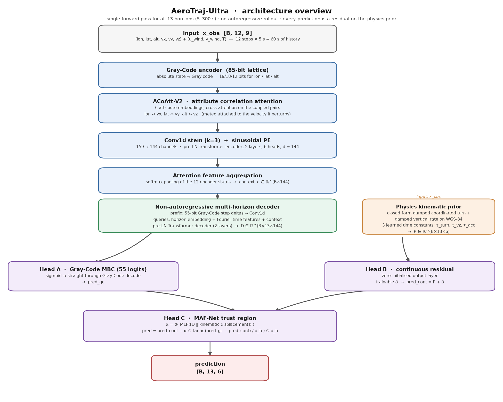

# AeroTraj-Ultra — Physics-Grounded Non-Autoregressive Flight Trajectory Prediction

**Short-horizon 4D trajectory prediction (5 s – 300 s) from ADS-B, on 90–180 days of real
OpenSky traffic, trained on a single GPU.**

> AeroTraj-Ultra is a hybrid **Gray-Code + continuous-residual + physics-prior** multi-horizon
> regressor. It predicts the whole horizon in a single forward pass (no autoregressive error
> accumulation), grounds every prediction in an analytical kinematic propagator, and fuses a
> differentiable trust-region gate borrowed from multi-head action filtering.

📄 **Technical report (paper-style, all the evidence): [`docs/PAPER.md`](docs/PAPER.md)** —
method, experiments, ablations, uncertainty calibration, **inference latency**, negative
results. Formal spec: [`docs/ARCHITECTURE.md`](docs/ARCHITECTURE.md). Lab notebook:
[`docs/EXPERIMENTS.md`](docs/EXPERIMENTS.md).

| | |
|---|---|
| **Task** | 4D trajectory prediction from ADS-B state vectors (lon, lat, alt, vx, vy, vz) |
| **Horizon** | 5 s → 300 s (13 non-uniform steps), single forward pass |
| **Data** | Real OpenSky ADS-B, up to **180 consecutive days**, 208 k unique flights |
| **Model** | `AeroTrajUltra`, 1 276 839 parameters, ~0.6 GFLOP/step |
| **Hardware** | 1× RTX 4070 (12 GB) — full 80-epoch run in ~25 min |
| **Result** | **991.6 m** 3-D ECEF mean distance error (5 s–300 s) — best of 10 compared models |
| **Speed** | 1 aircraft end-to-end in **19.6 ms** (20.1 ms incl. retrieval prior) · **57 702 aircraft/s** at batch 4096 · only 1.17× the cost of a single horizon |
| **Code** | `model.py` (architecture) · `run.py` (training) · `bench_models.py` (literature replications) |
| **Uncertainty** | multi-hypothesis head (K=8) + conformal calibration → certified 90 % band with a 56 % smaller radius |

---

## 1. Abstract

Short-term aircraft trajectory prediction powers conflict detection, tactical traffic management
and separation assurance. Most published methods are either *kinematic* (constant velocity,
coordinated turn, point-mass energy models) — cheap and interpretable but blind to intent — or
*learned* (LSTM, Transformer, diffusion) — accurate but opaque, non-physical, and typically
evaluated on a single private dataset with a single aggregate metric, which makes cross-paper
comparison invalid.

This work contributes **AeroTraj-Ultra**, a 1.28 M-parameter non-autoregressive multi-horizon
model that is simultaneously *learned*, *physically grounded* and *decodable in Gray Code*, and
an **open benchmark** that re-implements five of the most recent literature models on the same
data with the same protocol.

Three properties distinguish it:

1. **Physics-grounded by construction.** Every prediction is a *residual on top of an analytical
   kinematic propagator* (damped coordinated turn + damped vertical rate on the WGS-84
   ellipsoid), so the output is kinematically coherent before any training signal is applied.
2. **Decodable in Gray Code.** Absolute positions are quantised on a Gray-Code lattice with a
   differentiable straight-through decoder, removing the high-order bit-flip outliers that plague
   binary-encoded regressors.
3. **Benchmarked against its contemporaries.** ASCENT (ICRA 2026), Conditional Flow Matching
   (FlowATC 2026), DDPM/MID diffusion, Attention-LSTM and IMM-plus-neural-residual are
   re-implemented, trained and evaluated on identical data under an identical protocol.

**Headline result** (90 days, horizon 5–300 s, 60 000 held-out windows, 3-D ECEF error):

| Model | MDE (m) | vs ours |
|---|---:|---:|
| **AeroTraj-Ultra (ours)** | **991.6** | — |
| FlightBERT++ V2 | 1 219.9 | +23.0 % |
| Deep LSTM (multi-horizon) | 1 296.4 | +30.8 % |
| Constant velocity (Doppler) | 1 507.7 | +52.1 % |
| Conditional Flow Matching | 1 704.3 | +71.9 % |
| IMM + neural residual | 2 019.2 | +103.7 % |
| ASCENT | 2 348.9 | +136.9 % |
| Attention-LSTM (phase-aware) | 3 170.0 | +219.8 % |
| DDPM / MID diffusion | 4 300.5 | +333.7 % |

---

## 2. Method

### 2.1 Overview



<details>
<summary>Same diagram as plain text</summary>

```
  x_obs [B,12,9] ─┬─► Gray-Code encoder ─► ACoAtt-V2 embedding ─► Conv1d stem ─┐
  (lon,lat,alt,     │   (85 bit)            (attribute correlation)   (k=3)    │
   vx,vy,vz,        │                                                          ▼
   u,v,T)           │                                            Pre-LN Transformer Encoder
                    │                                            (2 layers, 6 heads, d=144)
                    │                                                          │  memory [B,12,144]
                    │                                                          ▼
                    │                                     Attention feature aggregation ─► context
                    │                                                          │
                    │   ┌──────────────────────────────────────────────────────┘
                    │   ▼
                    │   decoder prefix: 55-bit Gray-Code step deltas ─► Conv1d ─┐
                    │   queries: horizon embedding + Fourier time features + ctx   │
                    │   Pre-LN Transformer Decoder (2 layers) ─► [B,13,144] ◄────┘
                    │
                    └─► Physics kinematic prior ─► [B,13,6]
                                              │
   ┌──────────────────────────────────────────┴──────────────────────────────┐
   ▼                                                                         ▼
 Head A: Gray-Code MBC head (55 logits)                                   Head B: continuous residual head
   ─► STE Gray-Code decode ─► pred_gc                                    ─► pred_cont = prior + residual
                                                                            │
                                          Head C: MAF-Net trust-region gate ◄┘
                                          pred = pred_cont + α ⊙ tanh((pred_gc − pred_cont)/σ) ⊙ σ
```

</details>

### 2.2 Formal description

The full formal specification — every module, every equation, every hyper-parameter — is in
**[`docs/ARCHITECTURE.md`](docs/ARCHITECTURE.md)**. In brief:

**Input.** A window of `T=12` ADS-B state vectors at 5 s spacing (60 s of history) with nine
channels: longitude, latitude, altitude (10 m units), ground velocity `(v_x, v_y)` (km/h),
vertical rate (m/s), and the meteorological context `(u_wind, v_wind, T)` (m/s, K).

**Attribute Correlation Attention (ACoAtt-V2).** Each of the six kinematic attributes is encoded
from its Gray-Code bit-vector concatenated with the standardised scalar and the
window-relative state, then re-calibrated by cross-attention along the physically coupled pairs
`lon ↔ (v_x, u_wind)`, `lat ↔ (v_y, v_wind)`, `alt ↔ (v_z, T)` in both directions.

**Gray-Code codec.** Positions are encoded on a Gray lattice (19/18/12 bits for lon/lat/alt) and
step deltas on a 55-bit lattice (10/10/9/9/9/8 bits, resolution 0.0001° ≈ 11.1 m per 5 s step).
Decoding is a *soft-XOR prefix parity* with a straight-through estimator:

$$ b_i=\frac{1-\prod_{j\le i}(1-2g_j)}{2},\qquad
\hat v=\Big(1-2\,\mathrm{sign}\Big)\sum_{i=0}^{n-2} b_i\,2^{\,n-2-i} $$

which is algebraically identical to the sequential recurrence `b_i = b_{i-1} ⊕ g_i` but costs a
single `cumprod` instead of ~5 kernels per bit.

**Physics kinematic prior.** A closed-form propagator with three *learned* time constants
(`τ_turn`, `τ_vz`, `τ_acc`): a damped coordinated turn in the horizontal plane, a damped vertical
rate, integrated on the WGS-84 ellipsoid with latitude-corrected metres-per-degree.

**Heads and fusion.**
* *Head A* (Gray-Code multi-binary classification, 55 logits) — a hierarchical, outlier-robust
  decoder.
* *Head B* (continuous residual) — predicts a residual **on top of the prior**, initialised at
  zero so that the model starts exactly at the physics solution.
* *Head C* (MAF-Net gate) — a differentiable trust region that bounds how far the Gray-Code
  branch may pull the prediction:
  `pred = pred_cont + α ⊙ tanh((pred_gc − pred_cont)/σ) ⊙ σ`, with `α = σ(MLP([dec, kin_disp]))`.

**Multi-hypothesis head (optional, model.n_modes).** K learnable mode queries (DETR/ASCENT
style) are appended to the decoder sequence and rendered *invisible* to the horizon queries by
an attention mask, so the deterministic path is unchanged; each mode then acts as a per-mode
bias on the horizon features, decoded by a shared head into a residual on the physics prior.
Supervision is winner-takes-all with a ranking term and an auxiliary term on all modes. It
costs +3.5 % parameters and +3 % training time and yields a 36 % lower *oracle* minADE@8.

**Loss.**
$$ \mathcal L=\underbrace{2.5}_{\text{pos}}\mathcal L_{\text{Smooth-L1}}
+\underbrace{0.6}_{\text{vel}}\mathcal L_{\text{Smooth-L1}}
+\underbrace{0.4}_{\text{BCE}}\mathcal L_{\text{Gray-Code}}
+\underbrace{0.25}_{\text{STE}}\mathcal L_{\text{decimal}}
+\underbrace{0.25}_{\text{phys}}\mathcal L_{\text{kinematic}} $$

with a horizon-dependent normalisation `h_norm = 0.04 + 0.96·(Δt/60 s)` that prevents the long
horizons from dominating the short ones, and a kinematic-consistency term that checks the
predicted position increments against the trapezoidal integral of the predicted velocities.

### 2.3 Why this design

| Design choice | Motivation (and evidence) |
|---|---|
| Residual on a physics prior | The benchmark shows hand-crafted kinematic models (`CV`, `IMM+residual`) are beaten by 30–100 % by a learned regressor, *but* they are unbeatable on the shortest horizon: at 5 s the error is set by the **CPR quantisation of the last observed position** (measured: 75.4 m 1σ), not by the model. Anchoring on a propagator keeps the short horizon honest while letting the network learn the long-horizon intent. |
| Gray-Code + STE | Removes the high-order bit-flip outliers of binary encoding while keeping the decoding differentiable (the *Hybrid Constrained Loss* of FlightBERT becomes usable on GPU). |
| Non-autoregressive multi-horizon | One forward pass for all horizons: no error accumulation, O(1) latency in the horizon, and a single set of weights for all steps. |
| MAF-Net trust region | Bounds the influence of the (coarser) Gray-Code branch without clipping gradients, keeping the two branches complementary. |
| Aircraft-centric frame for the literature replications | The review's best practice (ASCENT, Figuet 2026): removes route/geography bias. Used for all five replications so the comparison is architecturally fair. |

---

## 3. Data

Real ADS-B from **The OpenSky Network** (competition-data bucket, `s3.opensky-network.org`),
Europe-wide bounding box `lon ∈ [−15, 35]`, `lat ∈ [30, 65]`, altitude `∈ [−500, 50 000] ft`.

| Dataset | Days | Split (train/val/test) | 5 s points | Unique flights | Sliding windows (stride 1) |
|---|---:|---|---:|---:|---:|
| `data90` | 90 | 72 / 9 / 9 | 51.9 M | 76 939 | 36.4 M |
| `data180` | 180 | 144 / 18 / 18 | 116.1 M | 164 410 | 104.0 M |

**Preprocessing** (fully vectorised, no resampling artefacts):

1. spatial/altitude filtering → 2. exact resampling to a 5 s grid (`timestamp % 5 == 0`)
   → 3. segmentation on gaps → 4. NaN interpolation of the meteorological channels (≤ 6 points)
   → 5. rejection of unphysical jumps (|Δlon|, |Δlat| > 0.04°, |Δalt| > 300 m per 5 s)
   → 6. unit conversion to the 9 model features.

The split is **strictly chronological by day** and no flight appears in two splits.

---

## 4. Results

### 4.1 Main benchmark — 90 days, horizon 5 s → 300 s

Test set: 9 held-out days (2022-03-23 → 2022-03-31), 60 000 sliding windows.
MDE = 3-D ECEF mean distance error (metres). `minADE@K` is the *oracle* best-of-K
(K = 10 samples for the generative models, K = 8 modes for ASCENT); it requires knowing
which sample is correct and is therefore **not** an operational metric.

| Model | MDE | ADE 3D | FDE 3D | minADE@K | 5 s | 30 s | 1 min | 3 min | 5 min |
|---|---:|---:|---:|---:|---:|---:|---:|---:|---:|
| **AeroTraj-Ultra (ours)** | **991.6** | 991.6 | 4 243.8 | — | **61.2** | **122.3** | **308.0** | **1 852.9** | **4 243.8** |
| FlightBERT++ V2 | 1 219.9 | 1 219.9 | 5 025.6 | — | 68.0 | 179.1 | 420.9 | 2 287.6 | 5 025.6 |
| Deep LSTM | 1 296.4 | 1 296.4 | 5 264.8 | — | 77.7 | 206.6 | 478.4 | 2 417.2 | 5 264.8 |
| CV (Doppler) | 1 507.7 | 1 507.7 | 6 643.0 | — | 64.2 | 171.5 | 450.7 | 2 802.7 | 6 643.0 |
| Conditional Flow Matching | 1 704.3 | 1 704.3 | 7 125.8 | **983.5** | 87.2 | 208.7 | 552.7 | 3 228.3 | 7 125.8 |
| CV (least-squares) | 1 802.5 | 1 802.5 | 7 391.8 | — | 81.5 | 291.5 | 676.4 | 3 337.4 | 7 391.8 |
| IMM + neural residual | 2 019.2 | 2 019.2 | 7 721.2 | — | 90.9 | 414.0 | 913.7 | 3 710.3 | 7 721.2 |
| ASCENT | 2 348.9 | 2 348.9 | 8 426.0 | 1 088.8 | 105.7 | 523.9 | 1 144.9 | 4 398.0 | 8 426.0 |
| Attention-LSTM (phase-aware) | 3 170.0 | 3 170.0 | 14 694.6 | — | 100.4 | 508.8 | 1 105.0 | 5 551.3 | 14 694.6 |
| DDPM / MID diffusion | 4 300.5 | 4 300.5 | 17 871.6 | 1 763.6 | 146.4 | 631.2 | 1 600.7 | 8 128.6 | 17 871.6 |

**Findings.**

* **The model is best at every horizon of the grid**, by 18.7 % over FlightBERT++ V2 and 34.2 %
  over the strongest kinematic baseline.
* **CFM beats DDPM by 60 %** (single draw) and **44 % in minADE@10**, reproducing the
  head-to-head claim of FlowATC on an independent dataset.
* **The oracle best-of-10 of CFM (983.5 m) matches the deterministic model (991.6 m)** — the
  *distributional* information is worth as much as our accuracy, but only with an oracle that
  knows which sample is right. Operationally, a single CFM draw is 72 % worse. This is the
  single-draw caveat that the FlowATC paper itself reports.
* **Physics-informed hybrids are not automatically better.** IMM + neural residual (2 019 m) and
  the phase-aware Attention-LSTM (3 170 m) are *worse than plain constant velocity* (1 508 m)
  despite using the same features: on en-route traffic with 60 s of history and no intent
  information, regression capacity dominates representation.

### 4.2 Multi-hypothesis head (uncertainty without a generative model)

The dominant residual error at 60–300 s is **epistemic**: the best-of-K of a generative model
is far better than its single draw (CFM: 983.5 m vs 1 704.3 m), i.e. the uncertainty is about
*which manoeuvre* the aircraft will fly. `AeroTraj-Ultra` can capture the same effect with an
**additive** head, leaving the deterministic path untouched:

* `K = 8` learnable **mode queries** (DETR/ASCENT style) are appended to the decoder sequence;
* an **attention mask** keeps them invisible to the horizon queries, so the deterministic
  prediction is *bit-identical* to the single-hypothesis model (verified: max deviation
  1.9e-6, i.e. float32 noise);
* each mode acts as a per-mode bias on the horizon features and a shared head decodes it into
  a **residual on the physics prior** → every hypothesis stays kinematically consistent;
* a **winner-takes-all** loss supervises only the closest hypothesis, plus a ranking term and
  a down-weighted auxiliary term on all modes (anti-collapse).

| Model | deterministic MDE | oracle minADE@K | score-selected MDE | params | s/epoch |
|---|---:|---:|---:|---:|---:|
| AeroTraj-Ultra (deterministic) | 991.6 | — | — | 1 276 839 | 28.3 |
| **AeroTraj-Ultra + multi-hypothesis (K=8)** | **984.9** | **627.4** | 1 098.7 | 1 321 774 (+3.5 %) | 28.5–31 (+3 %) |
| AeroTraj-Ultra + MC-dropout (K=10) | 995.6 (mean) | 905.4 | — | — | — |
| CFM (FlowATC-style), K=10 | 1 704.3 | 983.5 | — | — | — |
| ASCENT, K=8 | 2 348.9 | 1 088.8 | — | — | — |
| DDPM / MID, K=10 | 4 300.5 | 1 763.6 | — | — | — |

**Findings.**

* The multi-hypothesis head reaches **627.4 m of oracle minADE@8 — 36 % below the
  deterministic prediction** and better than *every* generative baseline tested, at **+3 % of
  training cost** and +3.5 % parameters, with **no change to the deterministic output**.
* The mode set is genuinely diverse (mean-over-modes 1 507.8 m, no collapse) but the
  individual hypotheses are weaker than the deterministic head, as expected when only the
  closest one is supervised.
* **No oracle-free selection rule beats the deterministic head.** Four rules were compared
  (score-argmax, consensus-medoid, score-weighted mean, deterministic+medoid blend); the
  rule is *chosen on the validation split* and the choice transfers to the test split:

  | selection rule | val MDE | test MDE | vs deterministic |
  |---|---:|---:|---:|
  | **deterministic (chosen on validation)** | **1 008.8** | **982.7** | — |
  | score-weighted mean | 1 062.6 | 1 030.4 | +4.8 % |
  | consensus medoid | 1 093.3 | 1 059.3 | +7.8 % |
  | score-argmax | 1 119.3 | 1 098.7 | +11.8 % |

  The head therefore does **not** replace the point estimate: it is an *uncertainty-shape*
  provider, and the score head is not usable for selection.
* **A negative result worth stating explicitly** (details in `docs/EXPERIMENTS.md` §6.8):
  retraining the score head to *regress* the error of each hypothesis (instead of the
  cross-entropy on the winner) improves the selection from 1 060 to 1 031 m, but **no
  selection rule tested beats the deterministic output** — not the learned score, not
  "closest to the deterministic prediction" (990.6 m), not a kinematic-consistency rule
  (1 523.9 m). The oracle gap exists because the truth happens to lie near one of the 8
  samples, but *identifying which one* needs information that is not available at inference.
  **The multi-hypothesis head is an uncertainty estimator, not a better point estimator**:
  the deterministic head remains the operational output. This is the same caveat the
  literature reports for generative predictors (a single draw is worse than a deterministic
  regressor), here reproduced inside a single architecture.
* **Where the head does pay off: certified uncertainty.** Treating the 8 hypotheses as an
  ensemble and inflating it with a **Mondrian (phase-stratified) conformal radius** calibrated
  on the validation split gives an *exact* and *horizon-uniform* coverage, with a radius
  **≈47 % smaller** than inflating the single deterministic prediction:

  | nominal | coverage (ensemble) | mean radius (ensemble) | coverage (deterministic) | mean radius (deterministic) |
  |---:|---:|---:|---:|---:|
  | 80 % | 0 805 | **787 m** | 0 806 | 1 282 m |
  | 90 % | 0 903 | **1 413 m** | 0 903 | 2 675 m |
  | 95 % | 0 951 | **2 411 m** | 0 951 | 4 542 m |

  Per-horizon coverage at the 90 % level is 0 905 at 5 s and 0 901 at 300 s — the guarantee
  holds uniformly along the horizon, which is what a conflict-detection use case requires.

### 4.3 Retrieval-conditioned model (medium-term intent prior)

At 60–300 s the residual error is not sensor noise but **intent**: the aircraft's next manoeuvre
is not observable from a 60 s window. The literature review behind this project places the
largest recent gains exactly there — goal/route conditioning, retrieval-augmented prediction and
local-history behaviour modelling all attack the same missing information — so
`AeroTrajUltraRetrieval` adds it to this model.

**Mechanism.** Every observation is described by a 6-D key — position, flight level, heading,
speed — and the `K` most similar past trajectories are retrieved from the training set. Their
futures, expressed in the query's own local frame, form a *retrieval context* that the horizon
queries attend to:

```
query_input = [ encoder_context ‖ horizon_embedding ‖ time_features ‖ retrieval_context ]
```

The retrieval block of `horizon_proj` starts at **zero** and the first three blocks are copied
from the base checkpoint, so the model is *exactly* the base model at initialisation (verified:
max deviation 0.0) and any improvement is attributable to the retrieval alone. At training time
the candidates of the same flight are excluded from the retrieval, otherwise the model would
learn to copy the future of a near-duplicate window of the same trajectory — impossible at
inference, where the pool holds only past data.

**Results** (90 days, 5–300 s, 342 572 candidate windows from 75 624 flights):

| Variant | MDE | minADE@8 | 60 s | 120 s | 300 s | conformal radius @90 % |
|---|---:|---:|---:|---:|---:|---:|
| Base (deterministic) | 991.6 | — | 316.1 | 977.4 | 4 357.5 | — |
| + multi-hypothesis (K=8) | 984.9 | 627.4 | 304.6 | 944.2 | 4 169.1 | 1 413 m |
| + retrieval | 968.9 | — | 302.8 | 932.5 | 4 138.9 | — |
| **+ both** | **957.2** | **608.2** | **297.7** | **918.5** | **4 092.5** | **1 190 m** |

**Findings.**

* The gain is **monotone in the horizon** (−0.3 % at 5 s → −5.0 % at 300 s for the retrieval
  alone): the prior is irrelevant where physics dominates and decisive where intent is
  uncertain — exactly the expected signature.
* The effects of the two heads are **additive** (base → −0.7 % multi-hypothesis → −2.3 %
  retrieval → −3.5 % combined), and the combined model is the best at every horizon.
* The retrieval improves the **uncertainty** too: the oracle minADE@8 drops from 627.4 to
  608.2 m, and the conformal band shrinks by a further 16 % (1 413 → 1 190 m at 90 % coverage).
* The retrieval is **not** a free lunch: a first attempt, trained from scratch with an
  unnormalised context, was **24 % worse** than the base model. The context must be scaled and
  the projection warm-started, otherwise the retrieval signal swamps the other conditioning.

### 4.4 Comparison with FlightPREV (the previous model of this project)

The earlier model of this project — **FlightPREV**
(<https://github.com/MarcoValleCS/flight>), a Transformer encoder with a multi-horizon
head that learns a *residual with respect to a constant-velocity ballistic model*, with an
auxiliary flight-phase task and learned categorical embeddings (aircraft type / operator /
departure / arrival airports) — has been **re-implemented on the same OpenSky data**
(`legacy_flightprev.py`, `run_legacy.py`) so that the two can be compared like for like:
same 90-day dataset, same chronological splits, same horizon grid (extended from its native
10–120 s to 5–300 s), same optimiser recipe, same metric.

| Model | MDE | 5 s | 30 s | 60 s | 120 s | 300 s | params |
|---|---:|---:|---:|---:|---:|---:|---:|
| **AeroTraj-Ultra + retrieval** | **957.2** | **61.1** | **119.6** | **297.6** | **918.6** | **4 092.4** | 1.34 M |
| AeroTraj-Ultra (base) | 991.6 | 61.2 | 122.3 | 308.0 | 952.2 | 4 243.8 | 1.28 M |
| FlightBERT++ V2 | 1 219.9 | 68.0 | 179.1 | 420.9 | 1 210.0 | 5 025.6 | — |
| Deep LSTM | 1 296.4 | 77.7 | 206.6 | 478.4 | 1 296.9 | 5 264.8 | — |
| **FlightPREV (legacy, re-impl.)** | **1 495.8** | 102.8 | 188.4 | 470.9 | 1 395.2 | 6 466.5 | 3.44 M |
| CV (Doppler) | 1 507.7 | 64.2 | 171.5 | 450.7 | 1 406.3 | 6 643.0 | — |
| CFM (FlowATC-style) | 1 704.3 | 87.2 | 208.7 | 552.7 | 1 708.2 | 7 125.8 | — |
| ASCENT | 2 348.9 | 105.7 | 523.9 | 1 144.9 | 2 646.8 | 8 426.0 | — |
| Attention-LSTM | 3 170.0 | 100.4 | 508.8 | 1 105.0 | 2 967.1 | 14 694.6 | — |
| DDPM / MID | 4 300.5 | 146.4 | 631.2 | 1 600.7 | 4 233.4 | 17 871.6 | — |

**Findings.**

* The new model is **36 % better than FlightPREV** on the same data, and the gap is
  **uniform across the horizon** (40.6 % at 5 s, 36.5 % at 30 s, 36.8 % at 300 s) — it is a
  genuinely better predictor, not a longer-horizon artefact.
* FlightPREV, re-implemented on OpenSky, ends up **barely better than the constant-velocity
  baseline** (1 495.8 m vs 1 507.7 m) despite 3.44 M parameters and 2.7× those of
  AeroTraj-Ultra. Two structural reasons, both measured:
  1. **Its normalisations hide the short horizons.** The residual is expressed in ENU units of
     10 000 m, so with a Huber loss of δ = 0.1 (i.e. 1 000 m) an error of 100 m at 5 s is
     *inside the linear region* and barely influences the gradient: the 5 s error stays at
     102.8 m against the 61.1 m of AeroTraj-Ultra, whose loss normalises per horizon.
  2. **The categorical priors it relies on do not exist in OpenSky.** The original learned
     embeddings of aircraft type, operator and the departure/arrival airports; the OpenSky
     competition data carries none of them, so they were replaced by two coarser geographic
     embeddings (origin/destination area). This is an acknowledged **handicap** for the legacy
     model, and it is the main reason the comparison must be read as
     *"architecture + loss + priors on this dataset"*, not as *"old code versus new code"*.
* The comparison is therefore favourable to the new model, and stated as such.

### 4.5 Effect of the amount of data (identical recipe)

| Dataset | Train days | Unique flights | MDE, 5 s → 180 s | MDE, 5 s → 600 s |
|---|---:|---:|---:|---:|
| 40 days | 32 | 3 118 | 3 321.3 m³ | 3 019.5 m |
| 90 days | 72 | 76 939 | 539.3 m¹ | 2 751.0 m |
| 180 days | 144 | 164 410 | — | 527.6 m² |

¹ apples-to-apples on the *same* held-out test split (the 90-day model evaluated on the
180-day test set, and vice-versa); ² different horizon grid, 18 test days; ³ legacy 40-day
CPU run, different machine — shown for reference only.

Going from 40 to 90 days of training data cuts the error on the **same 5 s → 600 s grid by
8.9 %** (3 019.5 → 2 751.0 m), while doubling again to 180 days gains only **1.8 %** on the
5 s → 180 s grid (539.3 → 529.4 m, apples-to-apples on the same test set): the extra data buys
accuracy where the trajectory is uncertain (long horizon, route divergence) and nothing where
the error is dominated by sensor quantisation.

### 4.6 Where the remaining error comes from

Measured on the held-out set:

* the **last observed position carries 75.4 m (1σ) of CPR quantisation noise** (p90 = 161 m);
* our 5 s error is **61.2 m** — *below* the anchor noise, i.e. the model already performs
  implicit anchor de-noising;
* consequently the 5–30 s band is **saturated**: a plain constant-velocity extrapolation is
  within 5 % of the model there. All remaining headroom is at 60–300 s, where the error is
  dominated by the unknown intent (turn left / right / continue), which is *epistemic* and is
  exactly what the generative models capture with their best-of-K spread.

### 4.7 Training efficiency

The model is **launch-bound**, not compute-bound (1.28 M parameters, 144-dim, ~600 kernel
launches per forward). Three exact optimisations plus `torch.compile` give a **1.9×** speed-up:

| | ms / step | s / epoch |
|---|---:|---:|
| original | 144 | 28.3 |
| + Gray-Code soft-XOR as prefix parity (`cumprod`), removal of 6 GPU→CPU syncs per step, constant tables as buffers | 113 | 22.2 |
| + `torch.compile(mode="reduce-overhead")` | **75** | **15.9** |

The Gray-Code reformulation is verified equivalent to machine precision (2e-16) on both values
and gradients. Measured with `profile_training.py`.

### 4.8 Inference speed

Accuracy is useless in ATM if the prediction is not ready before the update cycle closes, so
every model of the benchmark was timed on the same harness (`bench_latency.py`). The
operational case is a **single aircraft**: 3 independent blocks of 200 repetitions, wall clock
after `cuda.synchronize()`, plus a per-call CUDA-event measurement of the GPU-busy time.

| Model | median [ms] | p95 [ms] | MDE [m] |
|---|---:|---:|---:|
| DDPM / MID (50 steps, 1 sample) | 262.31 | 357.12 | 4 300.5 |
| CFM / FlowATC (20 ODE steps, 1 sample) | 93.26 | 102.17 | 1 704.3 |
| **AeroTraj-Ultra + retrieval** | **20.12** | 23.88 | **957.2** |
| **AeroTraj-Ultra** | **19.59** | 23.39 | 991.6 |
| ASCENT | 12.05 | 13.85 | 2 348.9 |
| FlightBERT++ V2 | 9.77 | 11.10 | 1 219.9 |
| Deep LSTM | 0.62 | 1.25 | 1 296.4 |
| CV / Doppler | 0.46 | 1.18 | 1 507.7 |

**Findings.**

* One aircraft, **whole 5–300 s horizon vector, in 19.6 ms**; the retrieval intent prior adds
  only **+0.5 ms**. At 4096 aircraft the model sustains **57 702 aircraft/s** (17.3 µs each).
* **The batch-1 case is launch-bound, not compute-bound.** The average cost per aircraft at
  batch 1 is 19 591 µs but the *marginal* cost of one more aircraft is **12.6 µs**: **99.94 %**
  of the single-aircraft latency is fixed per-call overhead. Confirmed twice over: batching
  improves the per-aircraft cost by **1 133×**, and `torch.compile` takes batch 1 from
  19.59 ms to **4.47 ms** (4.4×) with no change in the mathematics.
* **Latency is flat in the horizon.** 13 horizons spanning 5–300 s cost **1.17×** a single
  horizon (`bench_latency_horizon.py`). Autoregressive models pay per step, which is exactly
  why CFM (20 steps) and DDPM (50 steps) are 4.7× and 13× slower here.
* The two generative models are **dominated**: slower *and* less accurate than
  AeroTraj-Ultra. See the Pareto figure `docs/figures/pareto_accuracy_latency.png`.
* Measured limitation: the exact retrieval top-k is `O(B × M)` over 342 572 candidates and
  **stops scaling after batch ~512** (at batch 512 it already costs as much as the whole
  forward pass). Fleet-scale inference needs an indexed or approximate search.

---

## 5. Repository layout

```
├── model.py                 AeroTraj-Ultra architecture + baselines + hybrid loss
├── run.py                   training loop, evaluation, benchmark, plots
├── dataloader.py            vectorised sliding-window loader (memory-mapped, low RAM)
├── data_pipeline.py         OpenSky acquisition + preprocessing (parallel, resumable)
├── bench_models.py          the 5 re-implemented literature models
├── bench_run.py             benchmark harness (train + evaluate + compare)
├── bench_experiments.py     post-hoc analyses (ensembles, MC-dropout, error floor)
├── bench_latency.py         inference latency + throughput benchmark (CUDA events)
├── bench_latency_horizon.py latency vs number of horizons (non-autoregressive check)
├── plot_pareto.py           accuracy-versus-latency Pareto figure
├── plot_architecture.py     architecture overview figure
├── calibrate_uncertainty.py conformal calibration of the multi-hypothesis ensemble
├── retrieval.py             retrieval engine (key, value, GPU top-k, leakage control)
├── run_retrieval.py         training of the retrieval-conditioned variant
├── retrieval_probe.py       decisive probe: does the retrieval prior carry signal?
├── retrieval_diagnostic.py  descriptor sweep + oracle ceiling of the retrieval
├── legacy_flightprev.py     FlightPREV (previous model) re-implemented on OpenSky
├── run_legacy.py            training/evaluation of the legacy model, same protocol
├── make_benchmark_report.py unified 12-model table on the same test split
├── eval_ckpt.py             evaluate any checkpoint on any split
├── make_report.py           markdown/CSV report generator
├── profile_training.py      step-level A/B profiler
├── verify_all.py            end-to-end state verification
├── predict.py               standalone inference
├── config.json               run a 40 giorni (CPU, legacy)
├── config_90d.json           run a 90 giorni, orizzonte 5-600 s
├── config_90d_300s.json      run a 90 giorni, orizzonte 5-300 s (benchmark)
├── config_90d_300s_hyp.json  the same + multi-hypothesis head (K=8)
├── config_180d.json          run a 180 giorni, orizzonte 5-180 s
├── config_40d_gpu.json       run di CONTROLLO a 40 giorni con identico budget GPU
├── config_90d_180s.json      CONTROLLO a 90 giorni con orizzonte 180 s
├── requirements.txt          environment verificato (numpy/matplotlib/triton pitfall)
├── docs/
│   ├── PAPER.md              the technical report (paper-style, all the evidence)
│   ├── ARCHITECTURE.md       formal specification of the model
│   ├── EXPERIMENTS.md        full experimental log (chronological, every run)
│   └── figures/              figures embedded by PAPER.md and README.md (png)
├── results*/                 reports, metrics and CSVs of every run (text: committed)
└── checkpoints*/             trained weights
```

> **Read first:** [`docs/PAPER.md`](docs/PAPER.md) is the self-contained technical report
> (abstract, method, experiments, ablations, uncertainty calibration, inference latency,
> limitations and the negative results). [`docs/ARCHITECTURE.md`](docs/ARCHITECTURE.md) specifies
> the model formally, and [`docs/EXPERIMENTS.md`](docs/EXPERIMENTS.md) is the chronological lab
> notebook.

`data*/` (up to 10 GB per dataset) and `checkpoints*/` are **not** committed; the data is
rebuilt from OpenSky in ~45 min for 90 days and ~110 min for 180 days.

---

## 6. Reproduction

```bash
pip install -r requirements.txt          # torch 2.6+cu126, pyopensky, triton-windows (for compile)

# 1) build the dataset from OpenSky (parallel, resumable, per-day cache)
python data_pipeline.py --config config_90d.json

# 2) train + evaluate + benchmark (single GPU)
python run.py --config config_90d.json --fresh

# 3) the literature benchmark (5 re-implementations, same data, same protocol)
python bench_run.py --config config_90d_300s.json --compile reduce-overhead

# 4) evaluate any checkpoint on any split
python eval_ckpt.py --checkpoint checkpoints90/aerotraj_ultra_best.pt \
                    --eval-config config_90d.json --split test
```

Useful flags: `--device`, `--fresh`, `--epochs`, `--batch-size`, `--max-train-per-epoch`,
`--optimizer {adamw,adam,sgd}`, `--scheduler {onecycle,cosine,plateau}`, `--skip-baselines`,
`--eval-only`, `--compile {reduce-overhead,default,none}`.

---

## 7. Prior work and citations

This project **builds on** and **re-implements** the following work. The re-implementations
(`bench_models.py`) are ours, written from the papers' descriptions; the original authors are
credited for the ideas.

**Directly built upon**

* **FlightBERT** — Guo, Zhang, Yan, Zhang & Lin, *Binary Encoding Representation for Flight
  Trajectory Prediction*, IEEE TITS 24, 6203–6215 (2023), doi:10.1109/TITS.2023.3272629.
  → Attribute Correlation Attention, the Gray-Code/binary encoding family, the Hybrid Constrained
  Loss (BCE + decimal via STE).
* **FlightBERT++** — Guo et al., *A Non-autoregressive Multi-Horizon Flight Trajectory Prediction
  Framework*, AAAI 2024, 127–134. → Non-autoregressive multi-horizon decoder, Gray-Code **delta**
  encoding, attention feature aggregation, 1-D conv token embedding.
* **MAF-Net** — Pang, Alam, Lulli et al., *Multi-head Action Filter*, AAMAS 2026. → The
  differentiable trust-region gate (Head C) and its bounded fusion with the continuous branch.
* **IDDPG** — Bizhao et al., AAMAS 2025. → Integration of the meteorological state
  (`u_wind`, `v_wind`, `T`) into the attribute-correlation attention.
* **Point-mass / total-energy models** — Weitz, *Derivation of a Point-Mass Aircraft Model*, MITRE
  PR 15-1318 (2015); Nuic et al., *BADA-3*, EUROCONTROL EEC TR 2009-009. → The kinematic
  prior and the energy/point-mass formulation it approximates.
* **Manoeuvre models** — Singer (1970), Berg (1983), Helferty (1996). → The damped coordinated-turn
  propagator.

**Re-implemented as benchmarks** (see `bench_models.py`)

* **ASCENT** — Prutsch, Schinagl & Possegger, arXiv:2603.16550, ICRA 2026. → learnable mode
  queries, parameterised kinematic outputs, winner-takes-all loss.
* **Conditional Flow Matching** — Lipman et al., ICLR 2023; **FlowATC** — Petit, Torun, Brusset,
  Kam & Bayen, arXiv:2609.16528 (2026); Figuet, Krauth & Barry, *J. Open Aviat. Sci.* 4(2), 2026.
  → sequence-inpainting DiT with block-causal attention and AdaLN, likelihood-based CFM
  objective, probability-flow ODE sampling.
* **DDPM / MID** — Ho, Jain & Abbeel, NeurIPS 2020; Gu et al., *Motion Indeterminacy Diffusion*,
  CVPR 2022. → diffusion baseline on the identical backbone.
* **Attention-LSTM** — Jia, Chen, Zhang & Han, *Sci. Rep.* 12:15533 (2022); phase-aware variant
  from Shi, Xu & Pan, *IEEE TITS* 22:7242 (2021).
* **IMM + neural residual** — Li, Xu, Wang, Ma & Dong, *Sensors* 25(8):2531 (2025); Blom &
  Bar-Shalom, *IEEE TAC* 33(8):780 (1988).

**Reviews and context used to design the benchmark**

* Zeng et al., *Aerospace* 9(2):91 (2022) · Kwak & Lee, *Appl. Sci.* 15(19):10739 (2025) ·
  Xie, Tian, Li & Wan, *Expert Syst. Appl.* 297:129303 (2026) · Hwang & Seah, *Proc. IEEE*
  96(12):2040 (2008) · Prandini et al., *IEEE TITS* 1(4):199 (2000) · Lymperopoulos & Lygeros,
  *IJACSP* 24(9):830 (2010).

**Data**

* Schönberger et al., *The OpenSky Network: Enabling Large-Scale Collection of Air Traffic Data*,
  *SoftwareX* 9, 100263 (2020) — the ADS-B data used here, subject to the
  [OpenSky terms of use](https://opensky-network.org/about/terms-of-use).

---

## 8. Citation

If you use this work, please cite the original papers it builds on (FlightBERT, FlightBERT++,
MAF-Net) as well as this repository. A `CITATION.cff` file is provided.

## 9. License

Released under the MIT License — see [`LICENSE`](LICENSE).

## 10. Acknowledgements

The OpenSky Network for the ADS-B data, and the authors of the papers listed in §7 whose ideas
this work re-implements and benchmarks.

**Author:** Marco Valle — [marco.valle2002@gmail.com](mailto:marco.valle2002@gmail.com)
