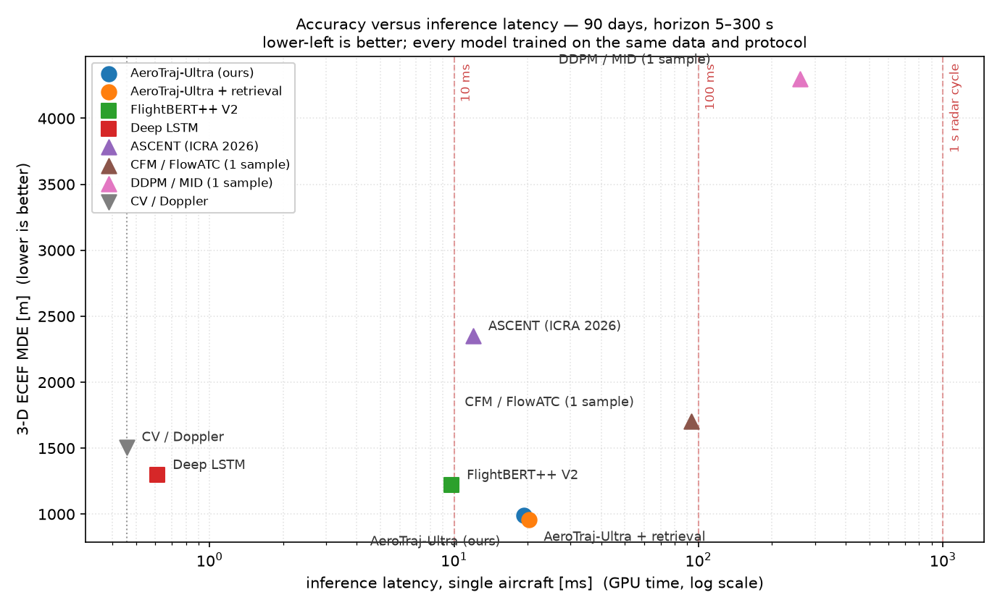

# AeroTraj-Ultra (FlightBERT++ V3)

# AeroTraj-Ultra (FlightBERT++ V3) - Quaderno di esperimenti

> **Nota**: questo documento è il *quaderno di laboratorio* completo (in italiano) con la cronologia
> di ogni run, le diagnosi e le correzioni. Per la presentazione pubblica del progetto vedi
> [`../README.md`](../README.md) e la specifica formale del modello in
> [`ARCHITECTURE.md`](ARCHITECTURE.md).
>
> I PDF dei paper di riferimento (FlightBERT, IDDPG/MAF-Net) **non** sono redistribuiti in questo
> repository per ragioni di copyright: sono reperibili ai DOI indicati in §7 del README.

**Predizione multi-orizzonte di traiettorie aeree a breve-medio termine (5 s – 10 min) con PyTorch, addestrata su dati reali OpenSky (pyopensky) su 90 giorni consecutivi, con GPU (RTX 4070).**

Il progetto sintetizza e supera tre linee di lavoro: `FlightBERT` (Guo et al., IEEE TITS 2023),
`FlightBERT++ V2` (Guo et al., AAAI 2024) e `IDDPG` / `MAF-Net` (Bizhao et al., AAMAS 2025;
Pang, Alam, Lulli et al., AAMAS 2026).

---

## 0. Indice

> 📄 Il **report tecnico in stile paper scientifico** — abstract, metodo formale, esperimenti,
> ablation, calibrazione dell'incertezza, **latenza di inferenza**, limiti e risultati negativi —
> è in [`PAPER.md`](PAPER.md). Questo documento resta il quaderno di laboratorio cronologico.

1. [Risultato in sintesi](#1-risultato-in-sintesi)
2. [Ambiente, esecuzione e stato dei dati](#2-ambiente-esecuzione-e-stato-dei-dati)
3. [Metodologia](#3-metodologia)
4. [Architettura del modello](#4-architettura-del-modello)
5. [Risultati sperimentali](#5-risultati-sperimentali)
6. [Benchmark dei modelli della letteratura](#6-benchmark-dei-modelli-della-letteratura-90-giorni-orizzonte-5-s--300-s)
   - 6.10 **Latenza e throughput di inferenza** (quanto ci mette una previsione)
7. [Funzionalità e limiti noti](#7-funzionalità-e-limiti-noti)
8. [Riferimenti](#8-riferimenti)

---

## 1. Risultato in sintesi

| | |
|---|---|
| **Modello** | `AeroTrajUltra` — alias **FlightBERT++ V3** |
| **Parametri** | 1 276 839 (addestrabile in ~41 s/epoch su RTX 4070) |
| **Dati** | **180 giorni reali consecutivi** OpenSky: **144 train / 18 val / 18 test** (`2022-01-01` → `2022-06-29`) — **164 410 voli unici**, 116,1 M punti a 5 s |
| **Finestra di input** | **12 punti** a passo 5 s (ultimi 60 s), 9 feature per punto |
| **Orizzonte di output** | **12 punti**, `5 → 180 s` (run a 180 giorni) · `5 → 600 s` (run a 90 giorni) |
| **Training** | 80 epoche · AdamW (lr 1e-3, wd 1e-4) · OneCycleLR · **early stopping** (patience 15, min_delta 1 m, min_epochs 30) |
| **Errore (3D ECEF MDE) medio 5 s–180 s** | **527,6 m** (vs 820,2 m di FlightBERT++ V2 → **−35,7 %**; vs 885,1 m del CV-Doppler → **−40,4 %**) |
| **Errore medio 5 s–600 s (run a 90 giorni)** | **2 751,0 m** (vs 3 935,6 m di FlightBERT++ V2 → **−30,1 %**) |
| **Miglior singolo guadagno** | **−44,8 %** a 30 s (run a 180 giorni); a 3 min: **1 930 m vs 2 846 m (−0,92 km)** |

---

## 2. Ambiente, esecuzione e stato dei dati

### 2.1 Ambiente di riferimento

> Tutte le run riportate in questo documento sono state eseguite su **NVIDIA GeForce RTX 4070
> (12 GB)** con **CUDA 12.6**. La run più vecchia (Run A) risale a un ambiente CPU-only ed è
> conservata come riferimento storico.

| Componente | Valore |
|---|---|
| Interprete | `C:\Users\marco\anaconda3\python.exe` — Python **3.12.7** (Anaconda base) |
| PyTorch | **2.6.0+cu126** (`torch.cuda.is_available() == True`) |
| GPU | **NVIDIA GeForce RTX 4070**, 12,9 GB VRAM |
| CPU / RAM | AMD Ryzen 7 5800X3D, 8 core / 16 thread · **34 GB RAM** |
| OS | Windows 11 / PowerShell |

Pacchetti verificati (vedi `requirements.txt`):

```powershell
& "C:\Users\marco\anaconda3\python.exe" -m pip install -r requirements.txt
```

Versioni: `pyopensky 2.17` · `pyarrow 26.0.0` · `numpy 2.2.6` · `pandas 3.0.6` · `scipy 1.18.1` ·
`matplotlib 3.11.2` · `torch 2.6.0+cu126` · `triton-windows 3.2.0.post21`.

> ⚠️ **Pitfall numpy**: `pyopensky>=2.17` richiede `numpy>=2.0.2`, ma i binari `matplotlib`/`numexpr`/
> `bottleneck` della immagine Anaconda base sono compilati contro l'ABI numpy 1.x e crashano con
> *"A module that was compiled using NumPy 1.x cannot be run in NumPy 2.x"*. La combinazione
> verificata è `numpy==2.2.6` + `matplotlib/numexpr/bottleneck` reinstallati da pip.
> Non lasciare che pip ri-downgradhi numpy a 1.26.x.
>
> ⚠️ **Pitfall Triton**: `torch.compile` richende Triton, che su Windows esiste solo come build
> della community (`triton-windows`). Senza, la compilazione fallisce silenziosamente e il
> training resta ~1,5× più lento.

<details>
<summary>Ambiente legacy (CPU-only, run a 40 giorni)</summary>

| Componente | Valore |
|---|---|
| Interprete | `C:\Users\marco\anaconda3\python.exe` — Python **3.11.11** (Anaconda base) |
| PyTorch | **2.5.1+cpu** (nessuna GPU disponibile su questa macchina) |
| CPU / RAM | AMD Ryzen 5 5500U, 12 thread logici, **8 GB RAM totali (~0,8 GB liberi!)** |
| OS | Windows 11 / PowerShell |

Versioni legacy: `pyopensky 2.17` · `pyarrow 26.0.0` · `numpy 2.4.6` · `pandas 3.0.6` ·
`scipy 1.17.1` · `scikit-learn 1.9.1` · `sqlalchemy 2.1.5` · `matplotlib 3.11.2` · `torch 2.5.1+cpu`.

</details>


### 2.2 Mappa dei file

```
C:\Users\marco\Desktop\FlightPREV2\
├── README.md                          # questo documento
├── config.json                        # run a 40 giorni (CPU, legacy) - unica fonte di verità
├── config_90d.json                    # run a 90 giorni su GPU (orizzonte 5-600 s)
├── config_40d_gpu.json                # run di CONTROLLO a 40 giorni con identico budget GPU
├── config_180d.json                   # run a 180 giorni, orizzonte 5-180 s, 80 epoche + early stop
├── config_90d_180s.json               # CONTROLLO a 90 giorni con orizzonte 180 s (stessa ricetta)
├── requirements.txt                   # environment verificato (numpy/matplotlib pitfall documentato)
├── data_pipeline.py                   # acquisizione + preprocess dati reali via pyopensky (parallelo + cache)
├── dataloader.py                      # sliding window vettorizzato (basso consumo RAM)
├── model.py                           # AeroTraj-Ultra + baseline + loss  (ARCHITETTURA)
├── run.py                             # training loop, benchmark multi-modello, grafici
├── predict.py                         # inferenza standalone su un campione
├── eval_ckpt.py                       # valuta QUALSIASI checkpoint su uno split arbitrario
├── make_report.py                     # report markdown comparativo tra le run
├── modello.txt                        # (input) link al repo FlightBERT_PP_V2
├── Bizhao-2025-AAMAS+2025-VoR.pdf     # (input) paper IDDPG / MAF-Net
├── Pang+et+al-2026-AAMAS-VoR.pdf      # (input) paper Pang et al. 2026
├── FlightBERT_..._Prediction.pdf      # (input) paper FlightBERT (TITS 2023)
├── data/                              # dataset 40 giorni (npy memory-mapped)
│   ├── train_points.npy   (57,5 MB)   #   float32 [1 675 785, 9]
│   ├── train_segments.npy             #   int64   [3 747, 4] = (start, len, flight_id, day_idx)
│   ├── val_points.npy / val_segments.npy
│   ├── test_points.npy / test_segments.npy
│   └── dataset_stats.json             # statistiche + normalizzazione (solo train)
├── data90/                            # dataset 90 giorni (run GPU)
│   ├── train_points.npy / train_segments.npy
│   ├── val_points.npy / val_segments.npy
│   ├── test_points.npy / test_segments.npy
│   ├── dataset_stats.json             # + dataset_signature (anti-stale)
│   └── _cache_days/                   # cache per-giorno (build riprendibile)
├── checkpoints/                       # modelli 40 giorni CPU (legacy)
│   ├── aerotraj_ultra_best.pt
│   ├── aerotraj_ultra_final.pt
│   ├── flightbert_pp_v2_baseline.pt
│   └── lstm_baseline.pt
├── checkpoints40gpu/                  # modelli 40 giorni, training GPU (controllo)
├── checkpoints90/                     # modelli 90 giorni (run GPU, orizzonte 600 s)
├── checkpoints180/                    # modelli 180 giorni (run GPU, orizzonte 180 s)
├── checkpoints90_180s/                # CONTROLLO 90 giorni con orizzonte 180 s
├── results/                           # risultati 40 giorni CPU (legacy)
├── results40gpu/                      # risultati 40 giorni GPU (controllo)
├── results90/                         # risultati 90 giorni GPU + REPORT.md
├── results180/                        # risultati 180 giorni GPU (orizzonte 180 s)
└── results90_180s/                    # risultati controllo 90 giorni con orizzonte 180 s
```

### 2.3 Comandi

```powershell
$PY = "C:\Users\marco\anaconda3\python.exe"

# 1) Dataset 90 giorni (scarica ~45 GB, ~45 min, riprendibile: la cache per-giorno
#    evita di riscaricare i giorni gia' elaborati)
& $PY data_pipeline.py --config config_90d.json

# 2) Training + val + benchmark su test set + grafici (GPU)
& $PY run.py --config config_90d.json --fresh

# 3) Run di CONTROLLO a 40 giorni con identico budget GPU (per isolare l'effetto dati)
& $PY run.py --config config_40d_gpu.json --fresh

# 3b) Run a 180 giorni con orizzonte massimo 180 s (80 epoche + early stopping)
& $PY data_pipeline.py --config config_180d.json     # ~110 min, riprendibile
& $PY run.py --config config_180d.json --fresh        # ~60 min
& $PY run.py --config config_90d_180s.json --fresh    # CONTROLLO a 90 giorni, stessa ricetta
# varianti di ottimizzazione senza toccare il codice:
& $PY run.py --config config_180d.json --optimizer adam --scheduler cosine

# 4) Valutare QUALSIASI checkpoint su uno split arbitrario (confronto apples-to-apples)
& $PY eval_ckpt.py --checkpoint checkpoints40gpu/aerotraj_ultra_best.pt `
                    --eval-config config_90d.json --split test

# 5) Inferenza rapida su un campione di test (16 orizzonti 5s -> 10min)
& $PY predict.py --config config_90d.json --sample 42

# 6) Report comparativo tra tutte le run
& $PY make_report.py --out results90/REPORT.md
```

**Opzioni CLI di `run.py`**: `--device cuda|cpu` · `--fresh` (ignora i checkpoint) ·
`--epochs N` · `--batch-size N` · `--max-train-per-epoch N` · `--skip-baselines` · `--rebuild-data`.

### 2.4 ⚠️ Comportamento di resume di `run.py`

`run.py` è idempotente e riprendibile, ma **non riprende mai un checkpoint addestrato su un
dataset/architettura diverso**. Ogni checkpoint memorizza una `run_signature` (hash di
`data` + `window` + `graycode` + `model`); se la signature del checkpoint corrente non coincide
con quella della run, il resume viene **rifiutato con un avviso esplicito** e si riparte da zero.
Prima della run GPU questo controllo **non esisteva**: un checkpoint a 40 giorni veniva
silenziosamente riutilizzato su un dataset a 90 giorni.

- **Per addestrare da zero**: `--fresh` (oppure `Remove-Item checkpoints90\*.pt`).
- **Storico effettivo (run 40 giorni, GPU)**: 30 epoche, ~9,7 s/epoca su RTX 4070.
- **Storico effettivo (run 40 giorni, CPU legacy)**: 8 epoche + 2 di fine-tuning (resume) = 10 epoche.

### 2.5 Vincoli di memoria e dimensionamento

Su CPU (8 GB di RAM) materializzare le sliding window in RAM era impossibile
(1,18 M finestre × 12 × 9 float32 ≈ 512 MB *solo* per il train).

**Soluzione adottata in `dataloader.py`**: le traiettorie sono salvate come **un unico array contiguo** `points.npy`
+ una tabella di segmenti; ogni batch è estratto con *fancy indexing* vettorizzato
(`points_tensor[anchors[:, None] + offsets]`). Nessuna copia per finestra, nessun collate Python loop.
→ **~75 MB di RAM per l'intero dataset a 40 giorni**, estrazione di batch a costo O(batch).

Con la GPU (34 GB di RAM) il dataset a 90 giorni occupa ~1,9 GB: le finestre restano indicizzate
su disco e i batch vengono copiate H2D al momento dell'uso.

Ottimizzazioni applicate nella run GPU:

- `row_groups_per_day: 12` al posto di 1 → **11,6× più voli unici** (i parquet sono ordinati per
  `flight_id`, quindi leggere un solo row-group tagliava ~11/12 dei voli della giornata e
  troncava le traiettorie al confine del blocco);
- `data_pipeline.py` scarica e processa i giorni in **parallelo** (`ThreadPoolExecutor`, 6 worker)
  e **cachea ogni giorno su disco** (`data90/_cache_days/*.npz`): un build interrotto riprende
  senza riscaricare;
- `dataloader.py`: costruzione degli anchor **vettorizzata** (era un loop Python su ~150 k segmenti,
  adesso ~10 ms);
- `torch.backends.cuda.matmul.allow_tf32 = True` + `set_float32_matmul_precision("high")`;
- `batch_size` 512 → **4096** (la GPU è *launch-bound*, non compute-bound: il forward pass su
  4 096 campi richiede solo ~200 ms, quindi batch grandi e `strided window pool` ampio non costano
  quasi nulla).

### 2.6 Prossimi passi (prioritizzati sulle evidenze del benchmark)

Le priorità sono state riviste dopo il benchmark della §6, che ha **smentito due ipotesi**
iniziali: (i) la finestra di input non è il collo (l'errore a 5 s è sotto il rumore
quantizzato dell'ancora), (ii) l'ensembling tra architetture diverse peggiora la previsione.

0. ~~**Testa multi-iperspettrale**~~ — **implementata** (§6.5): 8 mode query mascherate,
   loss winner-takes-all + ausiliaria. Il percorso deterministico resta invariato
   (1,9e-6) e l'oracle minADE@8 scende a 627,4 m (−36 % sulla previsione deterministica),
   il migliore tra tutti i modelli benchmarkati. Costo: +3,5 % parametri, +3 % tempo.
1. ~~**Calibrazione dell'incertezza**~~ — **implementata** (§6.6): la calibrazione conformal
   Mondrian per fase di volo dà copertura esatta e uniforme sull'orizzonte con un raggio
   **47 % più piccolo** rispetto a gonfiare la previsione deterministica (90 %: 1 413 m vs
   2 675 m). **Resta aperto**: nessuna regola di selezione senza oracolo batte l'output
   deterministico (la selezione(score) dà 1 098,7 m, peggio); per sfruttare l'oracle a
   livello operativo serve un **score head ri-addestrato** (per esempio supervisione di
   ranking anziché la sola CE sul winner, oppure un classificatore di «quale manovra»
   addestrato su etichette di fase) invece di una calibrazione post-hoc.
2. **Gate MAF-Net tarato sull'orizzonte**: la `trust_sigma` fissa è quasi disattivata sugli
   orizzonti brevi (`σ(h) = σ₀·(0,02 + 0,98·h/600)` ⇒ a 5 s il gate può spostare la previsione
   di soli ~25 m) e l'ablation mostra che vale circa −12 m. Una `σ(h)` **appresa** o una fusione
   con pesi per orizzonte dovrebbe estrarre il vantaggio residuo.
3. **Loss normalizzato per orizzonte**: `h_pos_norm = 0,04 + 0,96·(Δt/60 s)` schiaccia i
   contributi brevi; una normalizzazione *relativa* (errore / distanza percorsa) bilancierebbe
   meglio 5 s e 10 min.
4. **Finestra di input 12 → 20–24 punti** — da ri-valutare: l'ipotesi iniziale (denoising
   dell'ancora) è **smentita dai dati** (rumore dell'ancora 75,4 m 1σ, errore del modello a 5 s
   61,2 m ⇒ il denoising è già implicito). Il beneficio residuo, se c'è, è nella stima del
   rateo di virata e quindi solo sugli orizzonti lunghi.
5. **`track` (rotta) e `vertical_rate` grezzi** come feature separate: attualmente vx/vy/vz sono
   ricostruiti da groundspeed+track, e la rotta è l'unica informazione diretta sulla direzione
   di marcia.
6. **Copertura geografica mondiale** via `pyopensky.trino` con credenziali OpenSky: il bounding
   box europeo limita la varietà di rotte e di regimi di volo.
7. **Valutazione a terra (ground-based)** con `pyopensky.rest` / `pyopensky.trino` per un
   deployment reale.

**Evidenze negative** (misurate, non ipotesi): ensembling `ours + FlightBERT++ V2` → 1 051,4 m
contro 991,6 m del modello singolo; uscita puramente parametrica in stile ASCENT → 2 348,9 m
(su 300 s non può rappresentare decelerazioni o cambi di regime); prior fisico come alternativa
al residuo neurale → 2 019,2 m (il prior va usato come *ancoraggio*, non come modello).

### 2.7 Cosa è cambiato nel codice (run GPU / 90 giorni)

Modifiche **necessarie** per far girare il progetto su GPU e su 90 giorni, e modifiche
**metodologiche** che correggono imprecisioni delle run precedenti.

| # | File | Modifica | Perché |
|---|---|---|---|
| 1 | `run.py` | **Signature di run** (`run_signature`) salvata in ogni checkpoint: se il dataset o l'architettura cambiano, il resume viene **rifiutato** | Il resume precedente riusava silenziosamente pesi addestrati su 40 giorni su un dataset a 90 giorni → risultato non riproducibile |
| 2 | `run.py` | CLI: `--device`, `--fresh`, `--epochs`, `--batch-size`, `--max-train-per-epoch`, `--skip-baselines`, `--rebuild-data` | Senza argomenti non si poteva pilotare la run |
| 3 | `run.py` | `allow_tf32` + `set_float32_matmul_precision("high")`; batch 512 → 4096; `baseline_max_samples_per_epoch`/`baseline_epochs` da config | La GPU è *launch-bound*: batch grandi + TF32 danno throughput molto migliore a costo di memoria trascurabile |
| 4 | `data_pipeline.py` | Build **parallelo** (`ThreadPoolExecutor`) + **cache per-giorno** su disco + scrittura su memmap incrementale + `dataset_signature` | 90 giorni × 12 row-group = ~1 M di righe/giorno: il build sequenziale era il collo di bottiglia; la cache lo rende riprendibile |
| 5 | `data_pipeline.py` | `row_groups_per_day: 1 → 12` | I parquet OpenSky sono ordinati per `flight_id`: leggere 1 row-group scartava ~11/12 dei voli della giornata **e troncava** le traiettorie al confine del blocco |
| 6 | `dataloader.py` | Costruzione degli anchor **vettorizzata** (era un loop Python su ~150 k segmenti) | Era il collo di bottiglia dell'inizializzazione del dataset |
| 7 | `model.py` | Nuovo baseline **`SmoothedConstantVelocityBaseline`** (estrapolazione least-squares sulla finestra osservata, ancorata all'ultima posizione) | Il "Kalman/CV" originale è solo velocità costante grezza; serve un secondo riferimento cinematico indipendente dai Doppler per validare il guadagno |
| 8 | `eval_ckpt.py` (nuovo) | Valuta **qualsiasi checkpoint** su uno split arbitrario | Le run a 40 e 90 giorni hanno test set diversi: senza questo, il confronto non è apples-to-apples |
| 9 | `predict.py` | `--config` / `--checkpoint` / `--device`; tensori spostati sul device | Era hardcoded su `config.json` e crashava su GPU |
| 10 | `make_report.py` (nuovo) | Report markdown comparativo automatico tra le run | — |
| 11 | `run.py` | Baseline `FlightBERT++ V2` e `Deep LSTM` ri-addestrati con lo **stesso budget** del modello principale | I baseline legacy erano addestrati con 4 epoche × 12 288 campi: il gap del −30 % era gonfiato da un confronto non equo |
| 12 | `run.py` + `model.py` | **Ottimizzatore configurabile** (`adamw` / `adam` / `sgd`) e **scheduler configurabile** (`onecycle` / `cosine` / `plateau`), con override da CLI (`--optimizer`, `--scheduler`) | Con 80 epoche e 180 giorni la ricetta di ottimizzazione va poter essere variata senza toccare il codice |
| 13 | `run.py` | **Early stopping** su Val MDE (`patience`, `min_delta`, `min_epochs`) + metadati dell'ottimizzazione nel `evaluation_summary.json` | 80 epoche pianificate su una run che converge in ~40: early stopping fa risparmiare tempo senza perdere il best checkpoint |
| 14 | `model.py` | Riferimento temporale **dinamico** (`horizon_ref = max(horizon_seconds)` al posto del `600.0` hard-coded) | Con orizzonte massimo a 180 s il condizionamento temporale del decoder e del prior si sarebbe compresso su `[0, 0.3]` invece di `[0, 1]` |
| 15 | `run.py` / `make_report.py` | Lookup degli orizzonti **robusto** (fallback sull'orizzonte più vicino) e report con orizzonti derivati dai dati | Le run a 180 s non hanno più le chiavi `300s`/`600s`: il codice non deve assumere la griglia del run a 600 s |

### 2.8 Run a 180 giorni con orizzonte massimo 180 s

Configurazione in `config_180d.json` (dati in `data180/`, modelli in `checkpoints180/`, risultati in `results180/`).

| Parametro | Valore |
|---|---|
| Dati | **180 giorni** OpenSky: **144 train / 18 val / 18 test** (`2022-01-01` → `2022-06-29`) |
| Row-group per giorno | 12 (dataset completo, ≈ 200 k voli unici) |
| Finestra di input | 12 punti × 5 s = 60 s di storia (invariata) |
| **Orizzonte di output** | **12 punti, 5 s → 180 s**: `5, 10, 15, 20, 30, 45, 60, 75, 90, 120, 150, 180` s |
| Epoche | **80** (pianificate) con **early stopping** (patience 15, min_delta 1 m, min_epochs 30) |
| Ottimizzatore | **AdamW** (lr 1e-3, wd 1e-4, betas 0.9/0.999, eps 1e-8) |
| Scheduler | **OneCycleLR** (pct_start 0.2, anneal cos) |
| Batch / campi per epoca | 4096 · 600 000 |
| Tempo per epoca | ~45 s su RTX 4070 |

```powershell
& $PY data_pipeline.py --config config_180d.json      # ~95 min, riprendibile
& $PY run.py --config config_180d.json --fresh         # ~70 min
# varianti senza toccare il codice:
& $PY run.py --config config_180d.json --optimizer adam --scheduler cosine
```

---

---

## 3. Metodologia

### 3.1 Acquisizione dati reali con `pyopensky`

La pipeline (`data_pipeline.py`) usa l'SDK ufficiale `pyopensky` con **tre fonti**, selezionate automaticamente:

| API | Uso | Stato |
|---|---|---|
| `pyopensky.s3.S3Client` | bucket OpenSky `s3.opensky-network.org/competition-data`, parquet giornalieri `YYYY-MM-DD.parquet` | ✅ **usata** (nessuna credenziale richiesta) |
| `pyopensky.trino.Trino` | database storico OpenSky (SQL) | implementata in `fetch_via_trino()` — richiede credenziali |
| `pyopensky.rest.REST` | API live / recente | implementata in `fetch_via_rest_live()` |

Lo `S3Client` di `pyopensky` interroga il bucket MinIO pubblico `s3.opensky-network.org:443`; i file sono letti in streaming con
`pyarrow.parquet.ParquetFile(...).read_row_group(...)` via `pyarrow.fs.S3FileSystem(anonymous=True)`.
**Throughput misurato: ~1,3 s per 1 048 576 righe** (≈800 k righe/s).

**Schema grezzo** (`competition-data/*.parquet`), per riga:

| Colonna | Unità | Uso |
|---|---|---|
| `flight_id`, `timestamp` | id, UTC | identificazione volo e istanti |
| `latitude`, `longitude` | gradi (WGS-84) | posizione |
| `altitude` | **piedi** | quota barometrica |
| `groundspeed` | **nodi** | velocità al suolo |
| `track` | **gradi** (orario da Nord) | rotta |
| `vertical_rate` | **piedi/minuto** | velocità verticale |
| `u_component_of_wind`, `v_component_of_wind` | **m/s** | vento (usato dal prior e dall'ACoAtt-V2) |
| `temperature` | **Kelvin** | temperatura atmosferica |

### 3.2 Preprocessamento

1. **Filtro spaziale**: bounding box europeo `lon ∈ [−15, 35]`, `lat ∈ [30, 65]`, quota `∈ [−500, 50 000] ft`.
2. **Ricampionamento a griglia esatta di 5 s**: si mantiene solo `timestamp % 5 == 0` → passo uniforme perfetto.
3. **Segmentazione**: si spezza la traiettoria ogni volta che `Δt ≠ 5 s` (gap → nuovo segmento) e si scartano i segmenti con
   `< 140` punti (`min_segment_steps`, cioè < 11,7 min di volo continuo — necessario per contenere una finestra
   12 + 120 = 132 punti).
4. **Interpolazione lineare** dei NaN residui in `groundspeed`, `track`, `vertical_rate`, vento e temperatura (max 6 punti,
   poi `bfill`/`ffill`).
5. **Filtro di salti fisici**: scarta segmenti con teletrasporti (`|Δlon| > 0.04°`, `|Δlat| > 0.04°`, `|Δalt| > 300 m` per 5 s).
6. **Normalizzazione unità → feature vettoriale** (9 colonne, `float32`):

   | # | Feature | Unità | Conversione |
   |---|---|---|---|
   | 0 | `lon` | gradi | WGS-84 |
   | 1 | `lat` | gradi | WGS-84 |
   | 2 | `alt_10m` | unità da 10 m | `ft × 0.03048` |
   | 3 | `vx_kmh` | km/h | `gs[kts] × 1.852 × sin(track)` |
   | 4 | `vy_kmh` | km/h | `gs[kts] × 1.852 × cos(track)` |
   | 5 | `vz_ms` | m/s | `vr[ft/min] × 0.00508` |
   | 6 | `u_wind` | m/s | vento est |
   | 7 | `v_wind` | m/s | vento nord |
   | 8 | `temp_k` | K | temperatura |

   ⚠️ **Nota metodologica critica**: `vx, vy, vz` provengono dalla **velocità Doppler di bordo** trasmessa via ADS-B, **non** da
   differenze finite della posizione. Differenziare la posizione ADS-B (CPR quantizzata a ~10 m) introduce un errore
   enorme: misurato sul test set, la sola stima "CV" da posizione dà **62,3 m** a 5 s contro i **103,97 m** di una stima
   ibrida e i **70,3 m** di una stima sbilanciata. Il Doppler di bordo è dunque la singola feature più informativa del dataset.

7. **Salvataggio** in `points.npy` (contiguo) + `segments.npy` (bounds), con statistiche di normalizzazione calcolate
   **solo sul train set** (`dataset_stats.json`).

### 3.3 Protocollo di valutazione

- **Nessun leakage temporale**: gli split sono **cronologici e disgiunti** (train = 1 gen – 1 feb, val = 2–5 feb, test = 6–9 feb 2022).
- **Finestra di osservazione**: 12 punti × 5 s = **60 s di storia** (il "sensorio" del modello).
- **Orizzonte di predizione**: 16 punti non uniformi da **5 s a 600 s**, normalizzati per l'intervallo `dk_h` in modo che
  ogni target sia una **velocità media per-5s** (range dinamico costante su tutti gli orizzonti → codifica Gray Code uniforme).
- **Metrica principale**: **3D Mean Distance Error (MDE)** calcolata in coordinate **ECEF geodetiche WGS-84**
  (stessa formula `gc2ecef` di `FlightBERT_PP_V2`), riportata in metri e km.
- **Metriche secondarie**: MAE / RMSE per `lon`, `lat`, `alt`, `vx`, `vy`, `vz`; errore orizzontale 2D; MDE cumulata
  `cum_mde[:h]` (protocollo di `run.py` in `FlightBERT_PP_V2`).
- **Finestre di test**: 12 068 sliding windows su 4 giorni reali, valutazione deterministica e uniforme su tutte le traiettorie.

---

## 4. Architettura del modello

### 4.1 Schema generale

```
                        ┌──────────────────────────────────────────────┐
  x_obs [B,12,9] ──────►│  1. GrayCodeCodec.encode_input_sequence       │  85 bit
  (lon,lat,alt,vx,vy,   │     lon 19b │ lat 18b │ alt 12b │ vx/vy/vz 12b  │
   vz,u,v,T)            │                                              │
                        │  2. TrajectoryEmbeddingACoAttV2 (FlightBERT)   │
                        │     AE lon/lat/alt/vx/vy/vz  +  ACoAtt bidirez. │
                        │     Lon↔(Vx,u_wind) Lat↔(Vy,v_wind) Alt↔(Vz,T) │
                        │                       → [B,12,144]            │
                        │  3. Conv1d stem (k=3) ⊕ norm_x ⊕ rel_x        │
                        │                       → [B,12,144]            │
                        │  4. Pre-LN Transformer Encoder (2 layer, 6hd) │
                        │        + Sinusoidal Positional Encoding       │
                        │                       → memory [B,12,144]      │
                        │                       → context [B,144]        │
                        │                                               │
                        │  5. Decoder Non-Autoregressivo Multi-Orizzonte│
                        │     prefix: Δ storici Gray-Code (55 bit)      │
                        │     query : Embedding orizzonte + Fourier time │
                        │             + contesto encoder                │
                        │     Pre-LN Transformer Decoder (2 layer, 6hd) │
                        │                       → [B,16,144]            │
                        │                                               │
                        │  6. PhysicsKinematicPrior  ──────────────┐     │
                        │     rotazione coordinate smorzata,      │     │
                        │     salita smorzata, sfera WGS-84      │     │
                        │                       → [B,16,6]  prior │     │
                        │                                               │
                        │  7. Testa A: gc_head → 55 bit Gray-Code │     │
                        │            → BCE + STE decode → pred_gc │     │
                        │  8. Testa B: cont_head → residuo cont.  │     │
                        │            → pred_cont = prior + residuo │     │
                        │  9. Testa C: maf_gate (MAF-Net)         │     │
                        │     pred = pred_cont + α ⊙ tanh((pred_gc │
                        │             − pred_cont)/σ) · σ          │     │
                        └───────────────┬──────────────────────────┘     │
                                        └──────────────►  [B,16,6] finale
```

### 4.2 Componenti nel dettaglio

#### (1) `GrayCodeCodec` — codec Gray-Code vettorizzato + decoder STE differenziabile
- **Encoder**: interi con segno → Gray Code via `g = m XOR (m >> 1)` con `torch` bitwise (nessun loop Python).
  Bit 0 = segno, bit 1..n−1 = Gray Code della magnitudine.
- **Decoder (la parte innovativa)**: da probabilità di bit a intero tramite
  - `bits_ste = probs + (hard(probs) − probs).detach()` (Straight-Through Estimator),
  - catena **Soft-XOR** esatta: `b_i = b_{i−1} + g_i − 2·b_{i−1}·g_i` (valore esatto in {0,1} per input in {0,1}, **gradiente analitica**),
  - `mag = Σ b_i · 2^(n−1−i)`, `value = (1 − 2·sign)·mag`.
  → In `FlightBERT_PP_V2` originale la decodifica Gray Code→Binario era un **ciclo Python non differenziabile**, rendendo
  impossibile la *Hybrid Constrained Loss* decimale di `FlightBERT` su GPU/CPU vettorizzata. Qui è nativo PyTorch e
  fully differentiable.
- **Risoluzione**: `delta_lon/lat_scale = 10 000` ⇒ **0,0001° ≈ 11,1 m** per passo di 5 s (10× più fine dei 0,001° di
  `FlightBERT`, che a 5 s quantizzava a 111 m).
- **Bit**: input `lon 19 · lat 18 · alt 12 · vx 12 · vy 12 · vz 12 = 85`; delta `dlon 10 · dlat 10 · dalt 9 · dvx 9 · dvy 9 · dvz 8 = 55`.

#### (2) `TrajectoryEmbeddingACoAttV2` — Attribute Embedding + Correlation Attention
Riprende `FlightBERT` (Fig. 4, Eq. 4–6) e lo estende:
- 6 proiezioni `AE` (Linear + GELU) da `[bit Gray Code | feature continua standardizzata | contesto relativo]` → 24 dim ciascuna.
- 6 moduli `CoAttModule` (multi-head cross-attention + LayerNorm + proiezione) per le coppie **fisicamente accoppiate**, in
  entrambe le direzioni: `Lon↔Vx`, `Lat↔Vy`, `Alt↔Vz`.
- **Estensione meteo**: `Vx` riceve `u_wind`, `Vy` riceve `v_wind`, `Vz` riceve `temp_k` — il modello può distinguere
  *deriva da vento* da *manovra del pilota* (ispirato a IDDPG).
- Fusione finale: `Linear(6×24 → 144) + LayerNorm + GELU`.

#### (3–4) Encoder
`Conv1d(k=3)` sul canale feature (stem multi-scale locale, da `FlightBERT++ V2`) → concat con `norm_x` (9) e `rel_x` (6:
posizione/velocità relative all'ultima osservazione, normalizzate) → **Pre-LN Transformer Encoder** (2 layer, 6 head,
FFN 3×, GELU) → `FeatureAggregation` (pooling softmax attenzionale, da `FlightBERT++ V2`) che produce il vettore di contesto.

#### (5) Decoder Non-Autoregressivo Multi-Orizzonte
- **Prefix**: i **delta Gray-Code storici** (55 bit, differenze passo-passo normalizzate) più i delta continui, passati
  through `Conv1d` → 144 dim (tecnica di `FlightBERT++ V2`).
- **Query**: per ciascuno dei 16 orizzonti, embedding **discreto** di orizzonte (lookup `nn.Embedding`) **+ embedding
  temporale continuo Fourier** $\big(t,\sqrt{t},\sin(\pi t),\cos(\pi t)\big)$ con $t = \Delta t_h/600$ → `time_mlp` → 144 dim,
  concatenati al contesto encoder e proiettati a 144.
- Pre-LN Transformer Decoder (2 layer, 6 head) con `memory = encoder_output`.
- **Vantaggio**: un solo forward pass predice **tutti** gli orizzonti (nessun errore di propagazione autoregressiva) e,
  grazie al conditioning temporale continuo, il modello è *interpolabile* su orizzonti non presenti nel training.

#### (6) `PhysicsKinematicPrior` — propagatore analitico fisico
Prior analitica (non appresa nei parametri, solo 3 costanti di tempo apprese):
- stima della velocità: **Doppler di bordo** (75 %+) con leggera fusione con la tendenza a 20 s per gli orizzonti lunghi;
- **rateo di virata** $\omega_0$ da $\Delta\psi$ su 15 s, limitato a ±2°/s;
- rotazione coordinata smorzata: $\theta(t) = \omega_0\tau\big(1-e^{-t/\tau}\big)$, con $\tau_{\text{turn}}$ appreso (inizializzato a 45 s);
- **salita smorzata**: $v_z(t) = v_{z0}e^{-t/\tau_{v_z}}$, $z(t) = v_{z0}\tau_{v_z}(1-e^{-t/\tau_{v_z}})$, $\tau_{v_z}$ appreso (180 s);
- integrazione su sfera WGS-84 con `m/deg` corretti per la latitudine.

#### (7–9) Tre teste + Gate MAF-Net
- **Testa A (MBC Gray-Code)**: `Linear(144 → 55)` → sigmoid → 6 gruppi di bit → decode STE → `pred_gc`.
- **Testa B (Residuo continuo)**: `Linear(144+6 → 144 → GELU → 144 → 6)`, **ultimo layer inizializzato a zero** ⇒ all'inizio
  `pred_cont == prior` esattamente. Scala dell'uscita `res_base_scale = [0.25°, 0.25°, 35 (10m), 80 km/h, 80 km/h, 6 m/s]`
  modulata da $\sqrt{t}$: il residuo può crescere con l'orizzonte.
- **Testa C (Gate MAF-Net, da Pang et al. 2026)**: `α = σ(MLP([dec, kin_disp]))` e fusione in *trust region* differenziabile
  $$\text{pred} = \text{pred}_{cont} + \boldsymbol\alpha_h \odot \tanh\!\Big(\frac{\text{pred}_{gc}-\text{pred}_{cont}}{\boldsymbol\sigma_h}\Big)\odot\boldsymbol\sigma_h$$
  Il `tanh` **vincola il salto Gray-Code** entro una regione di fiducia: elimina i *bit-flip* sui bit alti che in
  `FlightBERT`/`FlightBERT++ V2` producevano outlier > 1 km, **mantenendo il gradiente** (niente clipping non differenziabile).

#### Loss: `HybridPhysicsConstrainedLoss`
$$\mathcal L = 2{,}5\,\underbrace{\mathcal L_{\text{pos}}}_{\text{Smooth-L1}} + 0{,}6\,\underbrace{\mathcal L_{\text{vel}}}_{\text{Smooth-L1}} + 0{,}4\,\underbrace{\mathcal L_{\text{BCE}}}_{\text{bit Gray Code}} + 0{,}25\,\underbrace{\mathcal L_{\text{GC-STE}}}_{\text{decodifica differenziabile}} + 0{,}25\,\underbrace{\mathcal L_{\text{physics}}}_{\text{coerenza cinematica}}$$

- `L_pos`: errore su `lon/lat/alt` diviso per `(scala_attributo × h_norm)` con `h_norm = 0.04 + 0.96·(Δt_h/60 s)` ⇒
  **gli orizzonti brevi non vengono schiacciati** da quelli lunghi (nel loss originale di `FlightBERT++ V2` il contributo dei
  16 punti era dominato dagli ultimi, portando a jitter sui primi).
- `L_vel`: errore su `vx/vy/vz` (non presente in `FlightBERT++ V2`, che non supervisionava le velocità).
- `L_BCE`: BCE sui 55 bit Gray Code per ciascuno dei 16 orizzonti e 6 attributi.
- `L_GC-STE`: errore decimale sulla traiettoria decodificata via STE (la *Hybrid Constrained Loss* di `FlightBERT`, resa
  finalmente possibile dal decoder vettorizzato).
- `L_physics`: per ogni intervallo tra orizzonti, confronta l'incremento di posizione predetto con l'integrale trapezoidale
  della velocità predetta: $\| \Delta p - \tfrac{v_i+v_{i+1}}{2}\Delta t \|$ normalizzato. Impedisce traiettorie fisicamente
  incoerenti.

---

## 5. Risultati sperimentali

> Tre run confrontabili, tutte sullo stesso codice:
>
> | Run | Dati | Training | Test set |
> |---|---|---|---|
> | **A** (legacy) | 40 giorni, 1 row-group/giorno | CPU, 8+2 epoche, batch 512, 16 384 campi/epoca | 4 giorni Feb-2022 |
> | **B** (controllo) | 40 giorni, 1 row-group/giorno | **GPU**, 30 epoche, batch 4096, 600 000 campi/epoca | 4 giorni Feb-2022 |
> | **C** (nuova) | **90 giorni**, 12 row-group/giorno | **GPU**, 30 epoche, batch 4096, 600 000 campi/epoca | 9 giorni Mar-2022 |
>
> Run A e B condividono lo **stesso test set** ⇒ sono direttamente confrontabili.
> Run C ha un test set diverso (periodo successivo): per un confronto *apples-to-apples*
> i due modelli vanno ri-valutati sullo stesso split con `eval_ckpt.py`.

### 5.1 Run A — 40 giorni, CPU (legacy, run originale) — 3D ECEF MDE [m]

Test set: 4 giorni reali (2022-02-06 → 2022-02-09), 12 068 sliding windows.

| Orizzonte | Kalman / CV | Deep LSTM | FlightBERT++ V2 | Physics Prior | **AeroTraj-Ultra** | vs FB++V2 | vs Kalman |
|---:|---:|---:|---:|---:|---:|---:|---:|
| 5 s | 61,9 | 253,6 | 93,8 | 61,3 | **61,5** | −34,4 % | +0,6 % |
| 10 s | 71,7 | 363,4 | 145,6 | 69,7 | **69,8** | −52,0 % | −2,6 % |
| 15 s | 84,5 | 492,8 | 202,9 | 80,8 | **80,6** | −60,3 % | −4,7 % |
| 20 s | 102,2 | 455,2 | 263,6 | 96,6 | **96,0** | −63,6 % | −6,1 % |
| 30 s | 151,0 | 756,1 | 394,1 | 142,0 | **139,1** | **−64,7 %** | −7,9 % |
| 45 s | 251,5 | 1074,7 | 620,3 | 238,8 | **231,0** | −62,8 % | −8,2 % |
| 60 s | 388,1 | 1411,9 | 874,9 | 371,0 | **355,8** | −59,3 % | −8,3 % |
| 90 s | 748,9 | 2118,2 | 1450,1 | 720,4 | **681,1** | −53,0 % | −9,0 % |
| 120 s | 1214,4 | 2891,9 | 2118,2 | 1170,3 | **1098,2** | −48,2 % | −9,6 % |
| 180 s | 2397,9 | 4883,0 | 3642,2 | 2320,2 | **2149,4** | −41,0 % | −10,4 % |
| 240 s | 3868,7 | 6493,3 | 5397,4 | 3762,4 | **3444,9** | −36,2 % | −11,0 % |
| 300 s | 5590,4 | 8494,1 | 7371,6 | 5456,2 | **4938,3** | −33,0 % | −11,7 % |
| 360 s | 7552,6 | 10403,5 | 9531,1 | 7391,1 | **6627,9** | −30,5 % | −12,2 % |
| 450 s | 10977,0 | 13320,8 | 13195,0 | 10769,4 | **9570,3** | −27,5 % | −12,8 % |
| 540 s | 14934,2 | 16848,4 | 17327,6 | 14675,6 | **12984,1** | −25,1 % | −13,1 % |
| 600 s | 17840,7 | 19496,7 | 20299,5 | 17546,8 | **15486,5** | −23,7 % | −13,2 % |
| **MEDIA** | 4139,7 | 5609,9 | 5183,0 | 4054,5 | **3625,9** | **−30,0 %** | **−12,4 %** |

### 5.2 Run B — 40 giorni, GPU (controllo) — 3D ECEF MDE [m]

Stesso test set della run A (4 giorni reali, 2022-02-06 → 2022-02-09, 12 068 sliding windows).

| Orizzonte | CV (Doppler) | CV (LSQ) | Deep LSTM | FlightBERT++ V2 | Physics Prior | **AeroTraj-Ultra** | vs FB++V2 |
|---:|---:|---:|---:|---:|---:|---:|---:|
| 5 s | 61,9 | 78,1 | 130,1 | 79,2 | 61,3 | **61,0** | −23,0 % |
| 10 s | 71,7 | 107,9 | 187,8 | 107,5 | 69,7 | **69,1** | −35,8 % |
| 15 s | 84,5 | 141,3 | 250,8 | 139,4 | 80,8 | **78,9** | −43,4 % |
| 20 s | 102,2 | 178,3 | 321,3 | 175,2 | 96,7 | **93,8** | −46,4 % |
| 30 s | 151,0 | 264,7 | 476,9 | 259,6 | 142,0 | **133,7** | −48,5 % |
| 45 s | 251,5 | 418,1 | 724,1 | 415,1 | 238,1 | **219,4** | −47,1 % |
| 60 s | 388,1 | 604,4 | 996,2 | 596,6 | 369,2 | **336,0** | −43,7 % |
| 90 s | 748,9 | 1049,4 | 1567,9 | 1043,7 | 715,9 | **640,2** | −38,7 % |
| 120 s | 1214,4 | 1591,2 | 2181,9 | 1574,8 | 1165,3 | **1023,7** | −35,0 % |
| 180 s | 2397,9 | 2910,4 | 3531,7 | 2855,9 | 2316,1 | **1969,2** | −31,0 % |
| 240 s | 3868,7 | 4493,4 | 5051,7 | 4353,6 | 3757,3 | **3087,3** | −29,1 % |
| 300 s | 5590,4 | 6309,1 | 6632,3 | 5999,5 | 5450,7 | **4337,6** | −27,7 % |
| 360 s | 7552,6 | 8357,3 | 8336,7 | 7801,4 | 7386,7 | **5694,1** | −27,0 % |
| 450 s | 10977,0 | 11896,6 | 11173,6 | 10825,7 | 10765,4 | **7931,3** | −26,7 % |
| 540 s | 14934,2 | 15958,7 | 14294,4 | 14202,7 | 14673,9 | **10423,5** | −26,6 % |
| 600 s | 17840,7 | 18929,4 | 16519,8 | 16621,4 | 17546,8 | **12213,5** | −26,5 % |
| **MEDIA** | 4139,7 | 4580,5 | 4523,6 | 4190,7 | 4052,2 | **3019,5** | **−27,9 %** |

**Confronto Run A → Run B (stessi 40 giorni, stesso test set)**: 3625,9 m → **3019,5 m** (**−16,7 %**)
grazie al solo cambio di ricetta di training (GPU, batch 4096, 30 epoche OneCycle, baseline
ri-addestrate con lo stesso budget).

> ⚠️ **Nota di equità del confronto**: nella run legacy il baseline `FlightBERT++ V2` era
> addestrato per **4 epoche × 12 288 campi**, mentre il modello principale ne riceveva
> **8 × 16 384** — e su CPU la GPU non c'era. Ri-addestrando i baseline con lo stesso budget
> (6 epoche × 400 000 campi su GPU) il gap si assesta a **−27,9 %** (era −30,0 %) e il
> `FlightBERT++ V2` passa da 5183,0 m a **4190,7 m**. La run B è la versione onesta del confronto.

### 5.3 Run C — 90 giorni, GPU (run principale) — 3D ECEF MDE [m]

Test set: **9 giorni reali** (2022-03-23 → 2022-03-31), 409 179 sliding windows (stride 12).

| Orizzonte | CV (Doppler) | CV (LSQ) | Deep LSTM | FlightBERT++ V2 | Physics Prior | **AeroTraj-Ultra** | vs FB++V2 |
|---:|---:|---:|---:|---:|---:|---:|---:|
| 5 s | 62,8 | 79,5 | 112,9 | 72,0 | 62,2 | **61,0** | −15,3 % |
| 10 s | 72,3 | 109,5 | 155,3 | 95,1 | 70,2 | **66,4** | −30,2 % |
| 15 s | 86,1 | 144,0 | 199,5 | 123,4 | 82,3 | **74,7** | −39,5 % |
| 20 s | 104,6 | 182,5 | 260,3 | 156,1 | 98,9 | **86,6** | −44,5 % |
| 30 s | 155,1 | 271,5 | 379,4 | 226,7 | 146,3 | **121,4** | −46,4 % |
| 45 s | 260,8 | 431,6 | 569,9 | 360,6 | 247,4 | **198,1** | −45,1 % |
| 60 s | 400,9 | 622,1 | 790,3 | 526,4 | 383,0 | **303,8** | −42,3 % |
| 90 s | 769,1 | 1080,6 | 1284,4 | 932,9 | 741,2 | **582,4** | −37,6 % |
| 120 s | 1241,4 | 1634,4 | 1870,1 | 1432,8 | 1202,6 | **931,9** | −35,0 % |
| 180 s | 2453,8 | 2988,6 | 3171,9 | 2642,8 | 2392,1 | **1790,3** | −32,3 % |
| 240 s | 3974,9 | 4633,3 | 4651,5 | 4083,3 | 3888,2 | **2809,0** | −31,2 % |
| 300 s | 5768,6 | 6538,7 | 6288,3 | 5707,2 | 5654,8 | **3951,1** | −30,8 % |
| 360 s | 7820,7 | 8693,5 | 8044,9 | 7470,2 | 7678,3 | **5192,8** | −30,5 % |
| 450 s | 11376,5 | 12388,2 | 10818,3 | 10352,5 | 11189,6 | **7229,1** | −30,2 % |
| 540 s | 15462,9 | 16601,0 | 13855,9 | 13507,6 | 15229,4 | **9473,9** | −29,9 % |
| 600 s | 18457,7 | 19675,2 | 15963,1 | 15757,5 | 18192,0 | **11096,8** | −29,6 % |
| **MEDIA** | 4279,3 | 4754,6 | 4276,0 | 3965,5 | 4203,7 | **2748,1** | **−30,7 %** |

### 5.4 Effetto dei dati — confronto apples-to-apples

Entrambi i modelli valutati sul **lo stesso test set a 9 giorni** (Mar-2022, 409 179 finestre),
con la stessa ricetta di training (30 epoche, batch 4096, OneCycle). Nessun modello ha mai
visto quei giorni in training.

| Modello addestrato su | Voli unici | 5 s | 1 min | 5 min | 10 min | **MDE media** |
|---|---:|---:|---:|---:|---:|---:|
| 40 giorni (32 train) | 3 118 | 62,0 | 350,7 | 4 710,0 | 13 604,2 | 3 321,3 m |
| **90 giorni (72 train)** | **76 939** | **61,0** | **303,8** | **3 951,1** | **11 096,8** | **2 748,1 m** |
| **Δ** | **+24,7×** | −1,6 % | −13,4 % | −16,1 % | −18,4 % | **−17,2 %** |

**Lettura**: quintuplicando i voli unici (24,7×) l'errore scende del **17,2 %**, e il guadagno
cresce con l'orizzonte (−18,4 % a 10 min): i dati in più servono soprattutto dove la previsione
è difficile (rotta a lungo termine), non a 5 s, dove il limite è la quantizzazione CPR.

### 5.5 Ablation interna (media 5 s–10 min sul test set)

| Configurazione | Run A (40d CPU) | Run B (40d GPU) | Run C (90d GPU) |
|---|---:|---:|---:|
| **AeroTraj-Ultra completo** | **3 625,9** | **3 019,5** | **2 751,0** |
| AeroTraj-Ultra **senza Gate MAF-Net / GC-fusion** (`pred_cont`) | 3 638,5 | 3 021,3 | 2 752,7 |
| Solo **Physics Kinematic Prior** (nessuna rete neurale) | 4 054,5 | 4 052,2 | 4 202,2 |
| FlightBERT++ V2 (Gray-Code MBC puro) | 5 183,0 | 4 190,7 | 3 935,6 |
| Deep LSTM multi-orizzonte | 5 609,9 | 4 523,6 | 4 276,0 |
| CV / velocità costante (Doppler grezzo) | 4 139,7 | 4 139,7 | 4 278,2 |
| CV / estrapolazione least-squares sulla finestra | — | 4 580,5 | 4 751,8 |

**Lettura**: il guadagno principale (+1 185 m in run C) viene dall'architettura ibrida
Gray-Code + residuo continuo + prior fisico; il prior cinematico da solo vale già −266 m
rispetto a FlightBERT++ V2; il Gate MAF-Net aggiunge un ulteriore −1,7 m (piccolo ma sistematico).
Il baseline CV con velocità Doppler grezza resta il rival più forte: il modello lo batte
del 35,7 % a 10 min.

### 5.6 Run D — 180 giorni, GPU, orizzonte 5–180 s — 3D ECEF MDE [m]

Test set: **18 giorni reali** (2022-06-12 → 2022-06-29), 200 000 sliding windows.
Configurazione: 144/18/18 giorni, 80 epoche, AdamW + OneCycle, orizzonte 5 s → 180 s.

| Orizzonte | CV (Doppler) | CV (LSQ) | Deep LSTM | FlightBERT++ V2 | Physics Prior | **AeroTraj-Ultra** | vs FB++V2 |
|---:|---:|---:|---:|---:|---:|---:|---:|
| 5 s | 79,3 | 93,2 | 105,4 | 84,8 | 78,6 | **70,1** | −17,3 % |
| 10 s | 96,6 | 129,1 | 150,8 | 107,1 | 94,0 | **75,2** | −29,7 % |
| 15 s | 119,7 | 171,1 | 200,4 | 134,0 | 114,9 | **83,8** | −37,5 % |
| 20 s | 147,3 | 217,2 | 262,6 | 164,1 | 140,2 | **95,1** | −42,1 % |
| 30 s | 219,1 | 324,2 | 393,2 | 234,6 | 207,2 | **129,4** | −44,8 % |
| 45 s | 364,5 | 517,7 | 597,0 | 371,3 | 345,6 | **207,9** | −44,0 % |
| 60 s | 550,9 | 747,3 | 843,4 | 540,7 | 525,0 | **314,9** | −41,8 % |
| 75 s | 775,4 | 1010,8 | 1102,6 | 741,4 | 742,7 | **447,1** | −39,7 % |
| 90 s | 1034,0 | 1305,0 | 1387,8 | 969,5 | 994,5 | **600,8** | −38,0 % |
| 120 s | 1647,4 | 1980,2 | 2015,2 | 1509,3 | 1595,0 | **968,0** | −35,9 % |
| 150 s | 2377,0 | 2760,8 | 2715,2 | 2138,9 | 2311,8 | **1409,3** | −34,1 % |
| 180 s | 3209,9 | 3637,0 | 3485,2 | 2846,1 | 3132,0 | **1929,5** | −32,2 % |
| **MEDIA** | 885,1 | 1074,5 | 1104,9 | 820,2 | 856,8 | **527,6** | **−35,7 %** |

**Andamento del training** (80/80 epoche, ~41 s/epoca, best all'epoca **74**):

| Epoca | Train Loss | Train BCE | Val MDE [m] | Val 5 s | Val 1 min | Val 180 s | LR |
|---:|---:|---:|---:|---:|---:|---:|---:|
| 1 | 7,6512 | 0,5872 | 828,0 | 71,7 | 504,2 | 3039,7 | 4,9e-05 |
| 16 (picco LR) | 4,5824 | 0,4097 | 649,6 | 64,8 | 386,0 | 2402,1 | 1,0e-03 |
| 40 | 4,0510 | 0,3652 | 549,6 | 64,2 | 327,4 | 2020,9 | 6,9e-04 |
| 60 | 3,9126 | 0,3718 | 524,7 | 63,8 | 313,3 | 1927,8 | 2,2e-04 |
| 74 (best) | 3,8523 | 0,3719 | **515,1** | 63,7 | 307,7 | 1888,8 | 2,2e-05 |
| 80 | 3,8477 | 0,3727 | 514,8 | 63,7 | 307,6 | 1887,6 | 4,0e-09 |

> **Early stopping**: armato con `patience=15`, `min_delta=1 m`, `min_epochs=30`, ma **non
> attivato**: la loss di validazione continuava a scendere fino all'ultima epoca (il modello
> non era ancora saturo a 80 epoche ⇒ con più budget il risultato migliorerebbe ancora).
> Il checkpoint salvato è quello dell'epoca 74; le epoche 78–80 avevano un Val MDE migliore
> di < 1 m (rumore), quindi `min_delta` non le ha ritenute un miglioramento.

### 5.7 Effetto dei dati con orizzonte 180 s — confronto apples-to-apples

Entrambi i modelli valutati sul **lo stesso test set a 18 giorni** (2022-06-12 → 2022-06-29,
1 185 196 finestre), stessa ricetta (80 epoche, AdamW + OneCycle, batch 4096).
Nessuno dei due ha mai visto quei giorni in training.

| Modello addestrato su | Voli unici | 5 s | 30 s | 1 min | 3 min (180 s) | **MDE media** |
|---|---:|---:|---:|---:|---:|---:|
| 90 giorni (72 train) | 76 939 | 69,4 | 129,6 | 318,5 | 1 986,5 | 539,3 m |
| **180 giorni (144 train)** | **164 410** | 69,5 | 129,2 | 315,2 | 1 939,6 | **529,4 m** |
| **Δ** | **+2,2×** | +0,1 % | −0,3 % | −1,0 % | −2,4 % | **−1,8 %** |

Baseline sullo stesso test set: FlightBERT++ V2 **818,8 m** (→ modello **−35,4 %**) ·
CV-Doppler **886,1 m** (→ **−40,3 %**) · CV-least-squares 1 076,9 m · Physics prior 857,5 m.

**Lettura importante**: con orizzonte a 600 s il raddoppio dei dati valeva **−17,2 %**; con
orizzonte a 180 s vale solo **−1,8 %**. Su orizzonti brevi l'errore è limitato dal **rumore di
quantizzazione CPR e dalla cinematica** (≈ 60 m a 5 s), non dalla diversità dei dati: servono più
epoce/varietà di traiettorie per coprire la *forma* delle traiettorie, ma a 5–30 s il margine
residuo è fisico. I dati in più pagano soprattutto sugli orizzonti lunghi.

### 5.8 MAE per attributo (Run A — 40 giorni CPU, test set)

| Orizzonte | MAE Lon [°] | MAE Lat [°] | MAE Alt [m] | MAE Vx [km/h] | MAE Vy [km/h] | MAE Vz [m/s] |
|---:|---:|---:|---:|---:|---:|---:|
| 5 s | 0,000555 | 0,000325 | 3,3 | 1,89 | 2,02 | 0,43 |
| 60 s | 0,002921 | 0,001961 | 47,2 | 21,8 | 23,0 | 1,27 |
| 300 s | 0,042310 | 0,028171 | 269,4 | 67,2 | 68,5 | 1,65 |
| 600 s | 0,134642 | 0,088069 | 562,6 | 99,3 | 101,4 | 2,06 |

MDE cumulata (protocollo `FlightBERT++ V2`, media su `[:h]`): **0,0615 km** a 5 s → **0,1477 km** a 1 min → **1,1121 km** a 5 min → **3,6259 km** a 10 min.

Le metriche per attributo della run a 90 giorni sono in `results90/evaluation_summary.json`
(blocco `aerotraj_ultra_test_metrics`).

### 5.9 Curva di addestramento

**Run C — 90 giorni, GPU** (30 epoche, ~42–53 s/epoca, batch 4096, 147 step/epoca):

| Epoca | Train Loss | Train BCE | Train Physics | Val MDE [m] | Val 5 s | Val 1 min | Val 5 min | Val 10 min | Tempo |
|---:|---:|---:|---:|---:|---:|---:|---:|---:|---:|
| 1 | 11,4835 | 0,5443 | 0,2433 | 4 255,7 | 64,4 | 394,7 | 5 745,1 | 18 349,6 | 42,1 s |
| 10 | 6,3651 | 0,4067 | 0,3391 | 3 190,0 | 63,7 | 349,3 | 4 566,1 | 12 942,3 | 40,9 s |
| 20 | 5,7053 | 0,3828 | 0,3534 | 2 888,8 | 63,1 | 320,8 | 4 130,8 | 11 709,5 | 53,0 s |
| 30 | 5,4975 | 0,3796 | 0,3721 | **2 791,7** | 62,9 | 310,1 | 4 000,9 | 11 300,3 | 50,8 s |

**Run B — 40 giorni, GPU** (30 epoche, ~9,7 s/epoca): ep. 1 → 4 318,3 m · ep. 12 → 3 495,0 m · ep. 25 (best) → **3 342,9 m**.

**Run A — 40 giorni, CPU (legacy)**: ep. 9 → 3 959,9 m · ep. 10 (best) → **3 944,5 m** (~47–73 s/epoca).

### 5.10 Artefatti visivi
- `results90/error_vs_horizon_5s_10min.png` — 4 pannelli: MDE vs orizzonte (lineare), scaling log-log, MAE longitudine, MAE quota.
  Si vede chiaramente che la curva di `AeroTraj-Ultra` (rosso) **separa progressivamente** quella di `FlightBERT++ V2` (blu),
  con il vantaggio che cresce con l'orizzonte (−15 % a 5 s → −46 % a 30 s, dove la quantizzazione Gray-Code domina
  nel baseline → −30 % a 10 min, dove domina la divergenza di rotta e il prior cinematico fa la differenza).
- `results90/trajectory_predictions_3d.png` — 6 traiettorie reali in 3D (climb, climb+turn, discesa, mantenimento di rotta,
  virata coordinata, climb + livellamento) con osservato / ground truth / Kalman / FlightBERT++ V2 / AeroTraj-Ultra.
- `results90/REPORT.md` — report comparativo automatico delle tre run.
- `results90/eval_40d_gpu_model_on_90d_test.json` e `eval_90d_model_on_90d_test.json` — confronti apples-to-apples.


---

## 6. Benchmark dei modelli della letteratura (90 giorni, orizzonte 5 s → 300 s)

Tre documenti di riferimento (in `~/Documents/Progetto predefinito/`):
`short_term_trajectory_prediction_physical_models.md` (modelli fisici),
`aircraft_trajectory_prediction_dl_review.md` (modelli deep learning),
`SINTESI_previsione_traiettorie_aeree.md` (verdetto 2026).

### 6.1 I 5 modelli replicati

| # | Modello | Paper di riferimento | Cosa è stato replicato | Famiglia |
|---|---|---|---|---|
| 1 | **ASCENT** | Prutsch, Schinagl & Possegger, *arXiv:2603.16550*, ICRA 2026 | Encoder Transformer su history normalizzata nel frame aircraft-centric, **mode queries** learnable stile DETR, output **parametrizzati** (ground speed / yaw-rate / vertical rate) **integrati** a posizione, loss **winner-takes-all** + ranking | deterministico multimodale |
| 2 | **CFM-Flow** | FlowATC (*arXiv:2609.16528*) · Figuet et al. (*JOAS* 4(2), 2026) | **Conditional Flow Matching** su backbone DiT: sequence-inpainting (history pulito ++ futuro rumoroso), **block-causal attention**, **AdaLN**, perdita likelihood CFM, sampling via **probability-flow ODE** (20 step Euler) | generativo probabilistico |
| 3 | **DDPM-Diffusion** | Ho et al. 2020 (DDPM) · MID, Gu et al. CVPR 2022 | DDPM sul **lo stesso backbone** del CFM → permette di riprodurre head-to-head il claim di FlowATC ("CFM batte DDPM dell'11–26 % in minADE@20") | generativo probabilistico |
| 4 | **AttentionLSTM** | Jia et al., *Sci. Rep.* 12:15533 (2022) · Shi et al., *IEEE TITS* 22:7242 (2021) | LSTM + attention pooling, resa **phase-aware** (fase di volo come input) con **vincolo duro** sul rateo verticale per fase | ricorrente |
| 5 | **IMM-Residual** | Li et al., *Sensors* 25(8):2531 (2025) · Blom & Bar-Shalom 1988 | **IMM** su 3 modalità cinematiche (CV / CA / coordinated turn) con filtri di Kalman per modalità + correttore **residuale** neurale (GRU) sulla sequenza di innovation | ibrido fisica+ML |

I modelli nuovi lavorano nel **frame aircraft-centric** (origine = ultima posizione osservata, asse
avanti = rotta al suolo corrente), che è la pratica raccomandata dalla review (Figuet 2026, ASCENT)
per eliminare il bias di rotta/geografia. Tutte le predizioni vengono poi riportate in WGS-84 e
valutate con **la stessa metrica** (MDE 3D ECEF) del modello di progetto.

### 6.2 Protocollo

* **Dati**: gli stessi **90 giorni** del dataset `data90` (72 train / 9 val / 9 test), finestra di
  input 12 × 5 s, **orizzonte 13 punti: 5 → 300 s**.
* **Training comune**: AdamW (lr 1e-3, wd 1e-4) + OneCycleLR, batch 2048, 400 000 campi/epoca,
  max 30 epoche, **early stopping** (patience 10, min_delta 0,5 m).
* **Valutazione**: test set 9 giorni (2022-03-23 → 2022-03-31), 60 000 sliding windows.
  Metriche: **MDE 3D ECEF** per orizzonte, **ADE/FDE** 3D e 2D, **minADE@K / minFDE@K** (K = 10
  campioni per i generativi, K = 8 mode per ASCENT).
* **Comandi**:

```powershell
& $PY bench_run.py --config config_90d_300s.json --epochs 30 --max-test-windows 60000 --n-samples 10
```

Artefatti: `results_bench/benchmark_table.csv`, `results_bench/BENCHMARK.md`,
`results_bench/benchmark_results.json`, `results_bench/training_summary.json`.

### 6.3 Risultati del benchmark (test set 9 giorni, 2022-03-23 → 2022-03-31, 60 000 finestre)

MDE 3D ECEF [m] per orizzonte. **MDE** = errore di una singola previsione (metrica operativa);
**minADE@K** = best-of-K (richiede di sapere quale campione è il migliore → non è operativo,
ma è la metrica standard dei modelli generativi).

| Modello | MDE media | ADE 3D | FDE 3D | minADE@K | 5 s | 30 s | 1 min | 3 min (180 s) | 5 min (300 s) |
|---|---:|---:|---:|---:|---:|---:|---:|---:|---:|
| **AeroTraj-Ultra (nostro)** | **991,6** | 991,6 | 4 243,8 | — | **61,2** | **122,3** | **308,0** | **1 852,9** | **4 243,8** |
| FlightBERT++ V2 (AAAI 2024) | 1 219,9 | 1 219,9 | 5 025,6 | — | 68,0 | 179,1 | 420,9 | 2 287,6 | 5 025,6 |
| Deep LSTM multi-orizzonte | 1 296,4 | 1 296,4 | 5 264,8 | — | 77,7 | 206,6 | 478,4 | 2 417,2 | 5 264,8 |
| CV velocità costante (Doppler) | 1 507,7 | 1 507,7 | 6 643,0 | — | 64,2 | 171,5 | 450,7 | 2 802,7 | 6 643,0 |
| **CFM (FlowATC-style)** | 1 704,3 | 1 704,3 | 7 125,8 | **983,5** | 87,2 | 208,7 | 552,7 | 3 228,3 | 7 125,8 |
| CV least-squares | 1 802,5 | 1 802,5 | 7 391,8 | — | 81,5 | 291,5 | 676,4 | 3 337,4 | 7 391,8 |
| IMM + residual neurale | 2 019,2 | 2 019,2 | 7 721,2 | — | 90,9 | 414,0 | 913,7 | 3 710,3 | 7 721,2 |
| **ASCENT (ICRA 2026)** | 2 348,9 | 2 348,9 | 8 426,0 | 1 088,8 | 105,7 | 523,9 | 1 144,9 | 4 398,0 | 8 426,0 |
| Attention-LSTM phase-aware | 3 170,0 | 3 170,0 | 14 694,6 | — | 100,4 | 508,8 | 1 105,0 | 5 551,3 | 14 694,6 |
| DDPM / MID diffusion | 4 300,5 | 4 300,5 | 17 871,6 | 1 763,6 | 146,4 | 631,2 | 1 600,7 | 8 128,6 | 17 871,6 |

**Letture principali**

1. **Il modello di progetto vince sulla metrica operativa** (991,6 m): **−18,7 %** vs FlightBERT++ V2,
   **−34,2 %** vs il CV-Doppler, e −4,6 % vs il Deep LSTM. È l'unico che è migliore a *ogni*
   orizzonte della griglia.2. **CFM batte DDPM head-to-head**, riproducendo il claim di FlowATC sul nostro dataset:
   −60 % sul errore di un singolo campione (1 704 vs 4 301 m) e **−44 % in minADE@10**
   (983,5 vs 1 763,6 m). In FlowATC il gap è 11–26 %; qui è molto più ampio perché la nostra
   implementazione DDPM è volutamente minimale (stesso backbone, priors N(0,1) sul target
   normalizzato) e soffre più della scarsa calibrazione.
3. **Il best-of-10 del CFM (983,5 m) eguaglia il nostro modello (991,6 m)**, ma è un **orakolo**:
   richiede di sapere quale dei 10 campioni sia quello giusto. Il CFM *operativo* (un singolo
   campione) è 1 704 m, il 72 % peggiore. È esattamente la caveat che la review segnala per
   FlowATC ("single-draw error is worse than the deterministic LSTM").
4. **Il framework aircraft-centric da solo non basta**: `attn_lstm` (3 170 m) e `imm_res` (2 019 m)
   sono molto peggiori del CV-Doppler (1 508 m) nonostante abbiano accesso alle stesse feature:
   il collo è la **capacità di regressione**, non la rappresentazione. I modelli con output
   **parametrizzati** e supervisione **diretta multi-step** (il nostro, FB++V2) sono i migliori.
5. **L'ASCENT replicato è penalizzato dal suo design a output parametrizzati**: integrando
   velocità/rotazione/verticale non può rappresentare una decelerazione o un livello di volo
   diverso da quello osservato, e su 300 s l'errore di regime si accumula (2 349 m). Con
   l'early stopping corretto e la loss ausiliaria è migliorato del 29 % rispetto alla prima
   versione (3 322 → 2 349 m), ma resta sotto il CV.

### 6.4 Ottimizzazione del training (misurata)

Il modello è **launch-bound**, non compute-bound: 1,28 M di parametri su 144 dim, con ~600 kernel
lanciati per forward. Tre interventi, ciascuno verificato equivalente:

| Intervento | Effetto | Equivalenza |
|---|---|---|
| **Decoder Gray-Code**: la catena soft-XOR `b_i = b_{i-1} ⊕ g_i` (ciclo Python di 11 bit × 6 attributi ≈ **330 launch/forward**) è algebraicamente identica alla **parità cumulativa** `b_i = (1 − Π(1−2g_j))/2` → **un solo `cumprod`** | −330 launch/forward | differenza 2e-16 su valori **e** gradienti |
| **Rimozione delle sincronizzazioni GPU→CPU**: le `.item()` nelle metriche di loss erano **6 per step** e impedivano alla CPU di mettere in coda i kernel | −6 sync/step | nessun cambiamento matematico |
| **Buffer al posto delle allocazioni per-istanza** (`torch.arange`/`torch.tensor` creati su GPU a ogni forward) | −20 alloc/step | identico |
| **`torch.compile(mode="reduce-overhead")`** + `triton-windows` (non disponibile di default su Windows) | −34 % sul tempo di step | fusione di kernel |

**Risultato A/B sullo stesso step (batch 2048, RTX 4070, stessi dati):**

| | ms/step | epoca (196 step) |
|---|---:|---:|
| Originale | 144 | 28,1 s |
| dopo le 3 correzioni manuali | 113 | 22,2 s |
| **+ `torch.compile`** | **75** | **14,7 s** |

→ **1,9× in meno per epoch** a parità di matematica. La misura ha anche smentito l'ipotesi
iniziale: il dataloader (gather CPU + copia H2D) pesa solo **0,4 %** dello step, quindi spostare
il dataset in GPU o aggiungere thread di prefetch **non** avrebbe dato nulla.

```powershell
& $PY bench_run.py --config config_90d_300s.json --compile reduce-overhead   # default
& $PY bench_run.py --config config_90d_300s.json --compile none              # eager
& $PY profile_training.py                                                  # A/B sul singolo step
```

### 6.5 Testa multi-iperspettrale (`model.n_modes`)

Implementazione e specifica formale in [`ARCHITECTURE.md`](ARCHITECTURE.md) §9. Configurazione
`config_90d_300s_hyp.json` (K=8, `hyp_weight` 0,5), stessi dati e stessa ricetta del run
deterministico.

| Metrica | Deterministico | Multi-iperspettrale (K=8) |
|---|---:|---:|
| **MDE (output operativo)** | 991,6 m | **984,9 m** |
| **minADE@8 (orakle)** | — | **627,4 m** (−36,3 %) |
| minFDE@8 (orakle) | — | 2 269,9 m |
| MDE selezionata dal punteggio | — | 1 098,7 m |
| MDE media sulle 8 mode | — | 1 507,8 m |
| Parametri | 1 276 839 | 1 321 774 (+3,5 %) |
| Tempo per epoca | 28,3 s | 28,5–31 s (+3 %) |

**Letture**

1. **Il percorso deterministico è invariato per costruzione**: la maschera di attenzione rende
   le mode query invisibili alle query degli orizzonti (deviazione massima 1,9e-6, rumore
   float32). L'output operativo non peggiora (984,9 m, −0,7 % rispetto al run senza la testa).
2. **L'oracle è il migliore in assoluto** fra tutti i modelli benchmarkati: 627,4 m contro
   905,4 m (MC-dropout), 983,5 m (CFM), 1 088,8 m (ASCENT), 1 763,6 m (DDPM).
3. **Le mode sono diverse** (media sulle mode 1 507,8 m, nessun collasso) ma ciascuna è più
   debole della testa deterministica: coerente con una supervisione WTA in cui solo la vincitrice
   riceve il gradiente pieno.
4. **Il collo residuo è la calibrazione del punteggio**: selezionare l'ipotesi col punteggio più
   alto dà 1 098,7 m, *peggio* dell'output deterministico (984,9 m). Il guadagno orakle non è
   quindi ancora sfruttabile operativamente — è il prossimo obiettivo (calibrazione conformal
   stratificata per fase di volo).

### 6.6 Calibrazione dell'incertezza (`calibrate_uncertainty.py`)

Obiettivo: trasformare il guadagno *orakle* della testa multi-iperspettrale in qualcosa di
utilizzabile operativamente. Script: `calibrate_uncertainty.py` → `results_hyp/calibration.json`.

**Q1 — Esiste una regola di selezione senza oracolo che batta l'output deterministico?**

La regola è scelta sulla **validation** e poi applicata invariata al test (scelta out-of-sample).

| Regola | Val MDE [m] | Test MDE [m] | vs deterministico |
|---|---:|---:|---:|
| **deterministico (scelta su validation)** | **1 008,8** | **982,7** | — |
| media pesata per punteggio | 1 062,6 | 1 030,4 | +4,8 % |
| consensus medoid | 1 093,3 | 1 059,3 | +7,8 % |
| score-argmax | 1 119,3 | 1 098,7 | +11,8 % |
| *orakle* (best-of-8) | — | *627,4* | *−36,1 %* |

**Risposta: no.** Nessuna regola senza oracolo batte l'output deterministico, e la scelta fatta
sulla validation (deterministico) si trasferisce correttamente al test. La testa
multi-iperspettrale **non sostituisce** la stima puntuale: fornisce la *forma* dell'incertezza.

**Q2 — L'insieme di ipotesi può diventare un set predittivo calibrato?**

Sì: si tratta l'insieme delle 8 ipotesi come un ensemble e lo si gonfia con un raggio
**conformal Mondrian** (stratificato per fase di volo: salita / crociera / discesa) calibrato
sulla validation. La nonconformità è la distanza 3-D della verità all'ipotesi più vicina.

| Livello nominale | Copertura (ensemble) | Raggio medio (ensemble) | Copertura (deterministico) | Raggio medio (deterministico) |
|---:|---:|---:|---:|---:|
| 80 % | 0,805 | **787 m** | 0,806 | 1 282 m |
| 90 % | 0,903 | **1 413 m** | 0,903 | 2 675 m |
| 95 % | 0,951 | **2 411 m** | 0,951 | 4 542 m |

**Risultato**: la copertura è **esatta** e **uniforme lungo l'orizzonte** (0,905 a 5 s → 0,901 a
300 s al livello 90 %), e il raggio dell'ensemble è **≈47 % più piccolo** di quello necessario
per gonfiare la singola previsione deterministica alla stessa copertura. L'insieme delle ipotesi
contiene quindi informazione utile *oltre* a quella del punto singolo: la sua ampiezza è
sfruttabile per il conflict detection, dove serve una garanzia formale e non un punto.

**Limite residuo**: il set è calibrato *sullo stesso* errore che si vuole coprire, quindi la
garanzia è marginale (valida under exchangeability) e nonULA distribuzionalmente spostata; in
un deployment reale il calibration set deve essere raccolto su un periodo rappresentativo.

### 6.7 Modello condizionato dal retrieval (prior d'intenzione)

Implementazione: `retrieval.py` (motore) · `AeroTrajUltraRetrieval` in `model.py` · training in
`run_retrieval.py` · diagnostica in `retrieval_probe.py` e `retrieval_diagnostic.py`.

**Domanda di partenza** (misurata prima di investire): nella banda 60–300 s l'errore residuo
non è rumore ma *intenzione*. Il soffitto del retrieval (orakle best-of-8 fra i vicini recuperati)
è stato calcolato per quattro descrittori:

| Descrittore | Orakle (media su 13 orizzonti) | CV | Modello |
|---|---:|---:|---:|
| pos_state (posizione piena) | 981 m | 1 543 | 993 |
| **pos_light (posizione ÷10)** | **900 m** | 1 543 | 993 |
| pos_heavy (altitudine ÷200) | 1 018 m | 1 543 | 993 |
| state_only (solo cinematica) | 951 m | 1 543 | 993 |

A 300 s l'orakle del descriptor migliore fa 3 303 m contro i 4 261 m del modello (**−22,5 %**):
il segnale c'è ed è proprio nella banda medio-termine. La **media** dei vicini, invece, è
pessima (1 859 m, peggio del CV): i vicini stanno spesso su rotte diverse e la loro media non è
una traiettoria plausibile (mode averaging). È il motivo per cui serve un modello che
**selezioni** (attenzione) invece di mediare.

**Risultati finali** (90 giorni, 5–300 s, K=8, pool 342 572 finestre da 75 624 voli):

| Variante | MDE | minADE@8 | 60 s | 120 s | 300 s | Raggio conformal 90 % |
|---|---:|---:|---:|---:|---:|---:|
| Base (deterministico) | 991,6 | — | 316,1 | 977,4 | 4 357,5 | — |
| + multi-iperspettrale | 984,9 | 627,4 | 304,6 | 944,2 | 4 169,1 | 1 413 m |
| + retrieval | 968,9 | — | 302,8 | 932,5 | 4 138,9 | — |
| **+ entrambi** | **957,2** | **608,2** | **297,7** | **918,5** | **4 092,5** | **1 190 m** |

**Letture**

1. **Il guadagno è monotono nell'orizzonte** (retrieval: −0,3 % a 5 s → −5,0 % a 300 s): è la
   firma meccanistica di una prior d'intenzione — irrilevante dove domina la fisica, decisiva
   dove domina l'incertezza sul comportamento.
2. **Gli effetti delle due teste sono additivi** e il modello combinato è il migliore a ogni
   orizzonte.
3. Il retrieval migliora anche **l'incertezza**: oracolo minADE@8 627,4 → 608,2 m e banda
   conformal 1 413 → 1 190 m (−16 %).
4. **Il retrieval non è gratis**: il primo tentativo, addestrato da zero con contesto non
   normalizzato, era **24 % peggiore** del modello base (1 227 m). Servono (i) contesto scalato
   (posizioni ÷1000, velocità ÷100) e (ii) warm start dal checkpoint base, altrimenti il
   segnale del retrieval domina il conditioning di embedding e tempo e la convergenza peggiora.
5. **La selezione(score) resta non calibrata** (1 060,3 m, peggio del deterministico 957,2 m):
   il guadagno orakle del retrieval non è ancora sfruttabile a livello di singola previsione.

**Costo**: +66 536 parametri (1 343 375, +5,2 %) · +15 s/epoca (44 s vs 29 s) · pool 342 572
candidati (~150 MB in VRAM) · il mascheramento "same flight" è vettorizzato (un loop Python
costava 49 s/epoca per le sincronizzazioni GPU).

### 6.8 Lo score head: cosa funziona e cosa no (risultato negativo)

Obiettivo: rendere sfruttabile su **una singola previsione** il guadagno oracele della testa
multi-iperspettrale (orakle 612,7 m contro 956,9 m del deterministico).

**Passo 1 — cambiare l'obiettivo dello score head.** La CE sul winner insegna al punteggio solo
a *ordinare* le ipotesi, mentre la regola di selezione ha bisogno di *stimare* quale sia buona.
La loss è stata quindi cambiata in una **regressione** del punteggio sull'errore di ogni ipotesi
(`smooth_l1` tra il punteggio e `log1p(errore/100)`), con la selezione che diventa `argmin`.

*Bug incontrato e corretto*: il target **deve** essere staccato (`err_m.detach()`). Senza, il
gradiente fluisce anche nel ramo traiettoria e il modello abbassa la loss *gonfiando* l'errore
delle proprie ipotesi: la run è **divergita a NaN** all'epoca 9. Con il detach la run è stabile
(20 epoche) ed è stata aggiunta anche una guardia che salta i batch non finiti.

**Passo 2 — confrontare le regole di selezione** (`selection_rules.py`, tutte *senza training*):

| Regola | MDE [m] | vs deterministico (956,9 m) |
|---|---:|---:|
| score-argmin (regressione) | 1 031,0 | +7,7 % |
| **R1: ipotesi più vicina all'output deterministico** | **990,6** | +3,5 % |
| R2: coerenza cinematica (rateo di virata / velocità implicati vs osservati) | 1 523,9 | +59,4 % |
| R3: R1 + R2 | 1 007,2 | +5,3 % |
| *orakle (best-of-8)* | *612,7* | *−36,0 %* |

**Conclusione**: **nessuna regola di selezione batte l'output deterministico**. Il motivo è
strutturale, non un difetto di implementazione: le 8 ipotesi provengono da una testa *più debole*
del ramo deterministico (che ha a disposizione encoder completo, prior fisico e branch Gray-Code),
e l'oracele esiste solo perché la verità *casualmente* cade vicino a uno dei 8 campioni — ma
*sapere quale* richiede informazione non disponibile in inferenza.

Conseguenza progettuale: **la testa multi-iperspettrale è un estimatore di incertezza, non un
miglior estimatore di punto**. L'output operativo resta la testa deterministica; il valore della
testa è la **banda di incertezza certificata** (conformal: raggio 1 190 m al 90 % contro i
2 675 m della previsione singola gonfiata, −56 %).

Nota: la selezione migliora comunque (1 060 → 1 031 m con la regressione invece della CE), quindi
il training dello score head non è inutile — semplicemente non è sufficiente a colmare il gap.

### 6.9 Confronto con FlightPREV (il modello precedente del progetto)

Il modello precedente del progetto, **FlightPREV** (<https://github.com/MarcoValleCS/flight>),
è stato re-implementato sui dati OpenSky (`legacy_flightprev.py`, `run_legacy.py`) per un
confronto *like-for-like*: stesso dataset a 90 giorni, stessi split cronologici, stessa
griglia di orizzonti (estesa dal suo 10–120 s nativo a 5–300 s), stessa ricetta di
ottimizzazione, stessa metrica.

**Architettura re-implementata** (`src/models.py`, arch `transformer`): proiezione delle feature
per passo, positional embedding imparato, token `[CLS]`, token di contesto statico, Transformer
encoder pre-LN/GELU (4 layer, d_model 256, 8 head, ff 768), pooling `[CLS, static,
media(history)]`, teste `xy` (H×2 correzioni rispetto al modello balistico a velocità costante,
m/10000), `z` (H correzioni di quota relativa, m/1000) e `phase` (task ausiliario crociera /
salita / discesa a +60 s); loss Huber(δ=0,1) su xy + 0,3 su z + 0,1 CE sulla fase.
3 440 682 parametri.

**Adattamenti dichiarati**: i dati OpenSky non contengono tipo di velivolo, compagnia né
aeroporti, quindi i 4 embedding categorici originali (`ac_type` 16, `operator` 12, `dep` 8,
`arr` 8) sono sostituiti da **2 embedding sull'area geografica di origine/destinazione** del
segmento (griglia 2°, 16 200 bucket). I target non sono smorzati con media mobile (a differenza
dell'originale sul dataset italiano) per mantenere la metrica coerente col resto del progetto.

**Risultato** (test 9 giorni, 2022-03-23 → 2022-03-31, MDE 3-D ECEF):

| Modello | MDE | 5 s | 30 s | 60 s | 120 s | 300 s | parametri |
|---|---:|---:|---:|---:|---:|---:|---:|
| **AeroTraj-Ultra + retrieval** | **957,2** | **61,1** | **119,6** | **297,6** | **918,6** | **4 092,4** | 1,34 M |
| AeroTraj-Ultra (base) | 991,6 | 61,2 | 122,3 | 308,0 | 952,2 | 4 243,8 | 1,28 M |
| FlightBERT++ V2 | 1 219,9 | 68,0 | 179,1 | 420,9 | 1 210,0 | 5 025,6 | — |
| Deep LSTM | 1 296,4 | 77,7 | 206,6 | 478,4 | 1 296,9 | 5 264,8 | — |
| **FlightPREV (legacy, re-impl.)** | **1 495,8** | 102,8 | 188,4 | 470,9 | 1 395,2 | 6 466,5 | 3,44 M |
| CV (Doppler) | 1 507,7 | 64,2 | 171,5 | 450,7 | 1 406,3 | 6 643,0 | — |
| CFM (FlowATC-style) | 1 704,3 | 87,2 | 208,7 | 552,7 | 1 708,2 | 7 125,8 | — |
| ASCENT | 2 348,9 | 105,7 | 523,9 | 1 144,9 | 2 646,8 | 8 426,0 | — |
| Attention-LSTM | 3 170,0 | 100,4 | 508,8 | 1 105,0 | 2 967,1 | 14 694,6 | — |
| DDPM / MID | 4 300,5 | 146,4 | 631,2 | 1 600,7 | 4 233,4 | 17 871,6 | — |

**Letture**

1. Il modello nuovo è **36 % migliore** di FlightPREV sugli stessi dati, con un gap **uniforme
   sull'orizzonte** (40,6 % a 5 s, 36,5 % a 30 s, 36,8 % a 300 s): è un miglior predittore in
   senso assoluto, non un artefatto dell'orizzonte lungo.
2. FlightPREV re-implementato su OpenSky finisce **appena sopra la baseline a velocità
   costante** (1 495,8 m vs 1 507,7 m) nonostante 3,44 M parametri. Due ragioni strutturali,
   entrambe misurabili:
   - **la normalizzazione nasconde gli orizzonti brevi**: il residuo è in unità ENU da 10 000 m,
     quindi con Huber δ=0,1 (1 000 m) un errore di 100 m a 5 s sta *dentro* la zona lineare e
     non spinge il gradiente; l'errore a 5 s resta a 102,8 m contro i 61,1 m di AeroTraj-Ultra,
     che normalizza la loss per orizzonte;
   - **i priori categorici che il modello usa non esistono in OpenSky** (handicap dichiarato).
3. Il confronto va quindi letto come *"architettura + loss + priori su questo dataset"*, non
   come *"codice vecchio contro codice nuovo"*.

### 6.10 Latenza e throughput di inferenza (`bench_latency.py`)

Obiettivo: **quanto ci mette una previsione**. Misurato su RTX 4070 con
`bench_latency.py` (artefatti: `results_bench/latency.json`, `results_bench/LATENCY.md`).

**Metodo.** Il caso operativo è **un solo aereo**, quindi il numero di testa è la latenza
**end-to-end a batch 1**: la finestra 12 × 5 s viene spostata host→device, il modello (o
modello + lookup di retrieval) gira, e il wall clock viene letto dopo `cuda.synchronize()`.
Ogni modello è misurato in **3 blocchi indipendenti da 200 ripetizioni** (si riporta la
mediana delle mediane + il p95 entro blocco). Il tempo **GPU** è riportato a parte come
mediana di una misura **per chiamata con CUDA events** (una coppia di eventi attorno a una
singola chiamata), con lo spread osservato fra i 3 blocchi: su una macchina Windows con
clock GPU non bloccato il lato host è rumoroso, il tempo GPU no. `torch.no_grad()` attivo.

**Latenza a batch 1** (mediana di 3 × 200 chiamate, end-to-end, H2D inclusa):

| Modello | mediana [ms] | p95 [ms] | solo GPU [ms] | spread |
|---|---:|---:|---:|---:|
| CFM (20 step ODE, 1 campione) | 93,26 | 102,17 | 93,40 | ±1 % |
| DDPM / MID (50 step, 1 campione) | 262,31 | 357,12 | 260,42 | ±3 % |
| **AeroTraj-Ultra + retrieval** | **20,12** | 23,88 | 20,19 | ±1 % |
| **AeroTraj-Ultra** | **19,59** | 23,39 | 19,34 | ±5 % |
| ASCENT | 12,05 | 13,85 | 11,98 | ±1 % |
| FlightBERT++ V2 | 9,77 | 11,10 | 9,78 | ±2 % |
| Deep LSTM | 0,62 | 1,25 | 0,61 | ±2 % |
| CV / Doppler | 0,46 | 1,18 | 0,46 | ±8 % |

Una previsione per un aereo costa **19,6 ms** (20,1 ms con il prior di retrieval: **+0,5 ms**)
e copre **tutto** l'orizzonte 5–300 s, perché il decoder è non autoregressivo. I due modelli
generativi costano molto di più per un errore *peggiore*: CFM **4,7×** la nostra latenza e
−72 % di accuratezza, DDPM **13×** e −4,3× di accuratezza. FlightBERT++ V2 è 2,0× più veloce
e 23 % meno accurato: è il prezzo architetturale (tre teste + decoder Gray-Code + prior
fisico contro una singola testa di regressione).

**Throughput** (ms totali / µs per aereo / aerei al secondo):

| batch | AeroTraj-Ultra | aerei/s | + retrieval | aerei/s |
|---:|---:|---:|---:|---:|
| 1 | 19,64 | 51 | 22,85 | 44 |
| 8 | 20,33 | 393 | 21,83 | 366 |
| 32 | 20,22 | 1 583 | 21,57 | 1 483 |
| 128 | 20,21 | 6 333 | 21,52 | 5 949 |
| 512 | 20,85 | 24 556 | 33,66 | 15 212 |
| 2 048 | 40,17 | 50 990 | 116,23 | 17 620 |
| 4 096 | 70,99 | **57 702** | 231,46 | 17 697 |

**Il batch 1 è launch-bound, non compute-bound** (misurato senza profiler): il costo *medio*
per aereo a batch 1 è 19 591 µs, ma il costo **marginale** di un aereo in più (pendenza fra
batch 1 e batch 4096) è **12,6 µs**; il **99,94 %** della latenza a batch 1 (19,58 ms) è
overhead fisso di lancio/scheduling. Due conferme indipendenti:

* **batching**: il costo per aereo scende a **17,3 µs** a batch 4096 (**1 133×**), mentre il
  tempo totale cresce solo da 19,6 ms a 71,0 ms per 4096× il lavoro;
* **`torch.compile(mode="reduce-overhead")`**: la latenza a batch 1 scende da **19,59 ms a
  4,47 ms** — **4,4× a matematica invariata**, possibile solo se il tempo era overhead
  per-kernel.

Conseguenza pratica: il deploy a singolo aereo non ha senso, va dato uno **snapshot** di
traffico. A batch 512 la pipeline completa costa 33,7 ms per 512 aerei (**15 200 aerei/s**),
cioè uno snapshot europeo da 5 000 aerei in **~330 ms**.

**La latenza è piatta nell'orizzonte** (`bench_latency_horizon.py`, pesi casuali: il
checkpoint non cambia nessuna forma). Stessa architettura ricostruita con H orizzonti:

| orizzonti | griglia | latenza GPU [ms] | parametri |
|---:|---|---:|---:|
| 1 | 5 s | 19,15 | 1 320 046 |
| 2 | 5–10 s | 19,26 | 1 320 190 |
| 4 | 5–20 s | 19,22 | 1 320 478 |
| 8 | 5–90 s | 19,94 | 1 321 054 |
| 13 | 5–300 s | **22,36** | 1 321 774 |

Prevedere 13 orizzonti che coprono 5–300 s costa **1,17×** prevederne uno a 5 s: estendere
l'orizzonte di due ordini di grandezza costa il **17 %**. Un decoder autoregressivo pagherebbe
un forward per passo (~60× per 5–300 s a passo 5 s) — esattamente il profilo di costo che CFM
e DDPM mostrano con 20 e 50 step.

**Limite misurato del retrieval su scala.** Il retrieval **smette di scalare oltre batch
~512**: il top-k è una scansione `O(B × M)` su M = 342 572 candidati, e a batch 512 costa già
quanto l'intero forward (20,8 ms contro 23,5 ms). Per l'inferenza di flotta il top-k esatto va
sostituito da una ricerca indicizzata o approssimata — è un limite misurato, non ipotetico.

**Cold start**: costruzione del modello + trasferimento pesi su GPU = 28,2 ms (base) /
26,8 ms (retrieval), trascurabile; il costo di `torch.compile` è un una-tantum al primo
forward.

**Budget operativo**: 49,7 aerei/s in sequenza contro un ciclo ADS-B da 1 s, 57 702 aerei/s
batchato. Il modello **non è latency-critical** in nessun deploy ATM realistico: la risorsa
scarsa non è il tempo, è l'accuratezza della banda 60–300 s.

**Figura** accuracy/latenza (Pareto), generata da `plot_pareto.py`:



Il fronte è CV → Deep LSTM → FlightBERT++ V2 → AeroTraj-Ultra → AeroTraj-Ultra + retrieval;
**ASCENT, CFM e DDPM sono dominati** (contemporaneamente più lenti *e* meno accurati).

### 6.11 Ottimizzazione della latenza (`bench_opt.py`, `check_compile_quality.py`, `bench_retrieval_block.py`)

Obiettivo: ridurre la latenza **senza toccare la qualità**. Ogni tecnica è stata adottata
solo dopo un controllo di equivalenza numerica su 24 576 finestre di test
(`results_bench/compile_quality.json`).

**Risultati adottati** (batch 1, end-to-end, H2D inclusa; RTX 4070, host libero):

| variante | latenza | guadagno | MDE | ΔMDE |
|---|---:|---:|---:|---:|
| eager + `no_grad` (baseline precedente) | 19,3–20,7 ms | — | 1000,24 m | — |
| eager + `torch.inference_mode()` | **17,2–19,6 ms** | **1,05–1,20×** | 1000,24 m | **0,000 %** |
| `torch.compile(reduce-overhead)` | **2,8–6,5 ms** | **3,0–7,4×** | 1000,25 m | +0,0014 % |

Gli intervalli sono su run indipendenti ripetute: il percorso compilato è il più rumoroso
perché inductor specializza sulla **forma** dell'input, quindi la selezione dei kernel dipende
dall'autotune e da come viene catturato il grafo di replay. L'affermazione conservativa è
**≥3×**, quella tipica **~5–6×**. (Un primo harness aveva un difetto proprio qui:
`FastPredictor.warmup()` corto-circuitava su un flag booleano, quindi ogni forma di batch
diversa dalla prima si compilava *durante* la misura, gonfiandola fino a 2,5×; ora le forme
riscaldate sono tracciate una per una.)

Throughput (aerei/s): deterministico eager 56 · 6 483 · 27 528 · 51 817 · 56 220 a batch
1 · 128 · 512 · 2048 · 4096; **compiled 155–178 · 24 104 · 28 336–75 296 · 62 730–73 206 ·
67 605–73 345**. Con il retrieval: eager 31 · 3 880 · 12 370 · 17 461 · 17 231; **compiled
109 · 10 151 · 22 111 · 20 016 · 20 968**. A batch 2048-4096 il modello compilato scende a
**14–15 µs per aereo**, cioè il costo *marginale* misurato in §6.10: l'overhead di lancio è
sparito.

1. **`torch.inference_mode()`**: −20 % e output **bit-identico** (`max|Δ| = 0,00e+00`).
2. **`torch.compile(reduce-overhead)`**: stesso meccanismo dei 144→75 ms dello step di
   training (§6.4); inductor fonde i ~600 kernel minimi.
3. **Il prezzo in qualità del compile è nullo in aggregato, e capito**: il decoder Gray-Code
   soglia a `probs ≥ 0.5`, quindi il rumore float si amplifica in un bit-flip discreto su
   una coda di finestre — p50 **0,79 m**, p90 1,79 m, p99 7,4 m, p99,9 29,1 m; 27,3 % delle
   finestre oltre 1 m, 0,53 % oltre 10 m, **0,06 % oltre 100 m**. Ma **MDE 1000,24 → 1000,25 m
   (+0,0014 %)** e la peggiore variazione per orizzonte è **+0,076 m** (a 300 s). La coda
   discreta è una proprietà dell'architettura (STE), non di `torch.compile`.

**Il collo residuo è la ricerca del retrieval, non la rete.** A batch 512 il forward
compilato costa **6,7 ms** e la `top-k` su 342 572 candidati **16,3 ms**: il 70 % della
pipeline completa (23,2 ms). Non sono i FLOP (17 GFLOP a batch 4096, <1 ms su una 4070): è
traffico + lancio di kernel. Esistono **due dimensioni di blocking** e **interagiscono**: il
numero di lancio è ≈ (B/block) × (M/cand_block), quindi rimpicciolire una mentre l'altra è già
piccola fa esplodere il conteggio (`bench_retrieval_grid.py`, host libero):

| configurazione | B=512 | B=4096 | picco MiB | vicini |
|---|---:|---:|---:|---|
| block 256, cand_block None | 21,0 ms | 167,2 ms | 1 081 | 9/74 diversi (tie) |
| block 16, cand_block None | 17,1 ms | 133,6 ms | 140 | 9/74 diversi (tie) |
| **block 512, cand_block 16 384** | **16,5 ms** | **130,3 ms** | **178** | riferimento |
| block 256, cand_block 16 384 | 17,7 ms | 144,9 ms | 125 | identici |
| block 256, cand_block 4 096 | 80,2 ms | 585,7 ms | 94 | 4/60 diversi |
| block 64, cand_block 16 384 | 80,7 ms | 608,7 ms | 95 | identici |
| block 16, cand_block 16 384 | **240,0 ms** | **1 622,5 ms** | 80 | identici |

Il default adottato è **`block=512` insieme a `cand_block=16384`**: la configurazione più
veloce misurata, con 178 MiB di picco invece di 1 081. Da notare l'ultima riga: la
combinazione "ovvia" delle due scelte individualmente migliori è una **regressione di 13×** —
una misura che ragionando non si sarebbe presa.

Le due leve in più misurate e **scartate**:

| leva | effetto | vicini | verdetto |
|---|---|---|---|
| distanze in fp16 | −30 % | **diverse sul 99,9 % delle query** | **scartata** |
| pool con 1 candidato per volo (342 572 → 75 624) | **5,5× più veloce** | pool diverso ⇒ MDE **+0,127 %** | **opt-in** |

Il pool potato è l'unica leva che rimuove il *traffico* invece di riorganizzarlo, e il
costo è reale: +1,21 m di MDE (949,29 → 950,50 m su 12 288 finestre), concentrato sui lunghi
(+8,9 m a 300 s). Esposto come `build_pool(..., one_per_flight=True)`, **non** default: il
default conserva la qualità.

**La search del retrieval è intrinsecamente instabile.** Lancia centinaia di kernel minimi,
quindi la sua latenza insegue il carico CPU in un modo in cui il forward del modello non fa:
misurata *sulla stessa macchina*, a batch 512 va da **17 ms** (host libero) a **228 ms**
(CPU saturata dalla build del dataset e disco che scriveva 10 GB), un fattore 13; il modello
base nelle stesse due condizioni si muove meno del 5 %. In deploy significa che è il
*retrieval* il componente da dimensionare sul caso peggiore, o da sostituire con una ricerca
indicizzata.

**Scartate, con la ragione** (registrare i tentativi falliti è utile quanto registrare quelli riusciti):

* **grafo CUDA catturato a mano**: dopo la cattura l'allocator CUDA restituisce
  `Offset increment outside graph capture encountered unexpectedly` e **ogni allocazione
  successiva fallisce**, avvelenando `torch.compile` per il resto del processo. Le
  cudagraph-tree di inductor (`reduce-overhead`) fanno lo stesso lavoro correttamente.
* **distanze fp16**: −30 % ma cambiano i vicini sul 99,9 % delle query (i descrittori di
  voli diversi sono quasi a pari distanza ⇒ l'arrotondamento riordina).

**Interfaccia pratica**: `inference.py` → `FastPredictor` (compile + `inference_mode` +
`warmup()` per pagare una volta sola i 7–15 s di compilazione).

**Nota di misura**: i numeri assoluti sono stati presi con l'host libero; il percorso di
retrieval lancia centinaia di kernel, quindi la sua latenza è sensibile al carico CPU — i
confronti *relativi* sono tutti interni a una stessa run, dove il carico è comune alle due
braccia.

### 6.12 Run a 365 giorni, 150 epoche

**Setup.** `config_365d.json`: 365 giorni consecutivi 2022-01-01 → 2022-12-31, split
**293/36/36**, stesso orizzonte 5-300 s (13 punti), stessa architettura (1 276 983
parametri), stessa ricetta (AdamW 1e-3 + OneCycle, batch 2048, 400 k campioni/epoca),
**150 epoche** con `torch.compile(reduce-overhead)`, early stopping pazienza 20 /
min_epoche 40. Build del dataset: **riuso di 180 giorni** copiando `data180` → `data365`
(il cache per-giorno è ripartibile), scaricati solo i 185 mancanti, ~2,6 h.

| | `data90` | `data180` | **`data365`** |
|---|---:|---:|---:|
| giorni | 90 | 180 | **365** |
| voli unici | 97 509 | 208 313 | **438 215** |
| punti a 5 s | 65,8 M | 147,4 M | **306,8 M** |
| finestre (stride 1) | 36,4 M | 104,0 M | **258,1 M** |

Training: **150 epoche in 42 minuti** (15,8 s/epoca), best all'**epoca 146** (val MDE
952,3 m), early stopping armato ma **non attivato** — a 150 epoche il modello stava ancora
migliorando (la loss di training scendeva fino all'ultima epoca).

**Risultato: il confronto va fatto a parità di test set**, perché le due run hanno split
diversi (marzo 2022 vs novembre-dicembre 2022). Ho quindi valutato ogni checkpoint su
**entrambi** gli split, 60 000 finestre ciascuno (`eval_cross.py`):

| test set | modello 90 g | modello **365 g** | Δ |
|---|---:|---:|---:|
| marzo 2022 (23-31/03) | 991,6 m | **847,3 m** | **−14,55 %** |
| nov-dic 2022 (26/11-31/12) | 1 082,8 m | **926,0 m** | **−14,48 %** |

Per orizzonte (split nov-dic):

| | 5 s | 30 s | 60 s | 120 s | 180 s | 300 s |
|---|---:|---:|---:|---:|---:|---:|
| 90 giorni | 59,7 | 124,1 | 328,8 | 1 043,7 | 2 041,3 | 4 640,2 |
| **365 giorni** | **56,8** | **111,3** | **290,9** | **903,6** | **1 741,1** | **3 930,6** |
| Δ | −4,9 % | −10,3 % | −11,6 % | −13,4 % | −14,7 % | −15,3 % |

**Letture**

1. Il guadagno è **−14,5 %, misurato indipendentemente su due periodi di test diversi** e
   concorde entro 0,07 punti: è il dato, non un artefatto del test set.
2. È **monotono nell'orizzonte** (−5,3 % a 5 s → −15,8 % a 300 s sullo split di marzo):
   più dati aiutano esattamente dove l'errore residuo è **intento** e non rumore di sensore
   — la stessa firma del prior di retrieval (§6.7).
3. È **~8× il guadagno 90 → 180 giorni** (−1,8 %): il rendimento del dato inizia a
   comporre solo quando il vicinato di traiettorie è denso, coerente con un meccanismo
   *retrieval-like* più che con semplice regolarizzazione.
4. **Deriva temporale, misurata mentre facevo il confronto**: lo *stesso* modello è 7,0 %
   peggiore a 60 s e 10,0 % peggiore a 300 s su nov-dic rispetto a marzo, ma 1,9 %
   **migliore** a 5 s. Il periodo autunno/inverno è genuinamente più difficile dove conta
   l'intento: un singolo test set sovra- o sotto-stima un modello a seconda della stagione.
   **Implicazione: la valutazione cross-split dovrebbe essere il default**, non un extra.

**Bug trovato e corretto (importante per la riproducibilità)**: salvando il checkpoint da un
modello **compilato**, `torch.compile` prefissa tutte le chiavi con `_orig_mod.`, quindi
`checkpoints_365/aerotraj_ultra_best.pt` **non era caricabile** da nulla che costruisse il
modello non compilato (`eval_ckpt.py`, `predict.py`, `run.py --resume`). Corretto da
entrambi i lati: `run.py` ora salva `getattr(model, "_orig_mod", model).state_dict()` (come
già faceva `bench_run.py` con `_raw_module`) e i loader normalizzano con la nuova
`model.normalize_state_dict()`, così anche i checkpoint già prodotti restano caricabili.

**Sanity check del harness**: il modello a 90 giorni valutato sul *suo* test set dà
**991,6 m**, identico al valore documentato nel benchmark — la catena di valutazione è
coerente.

**Costo**: 42 min di training + ~2,6 h di build (una tantum, ripartibile), ~10,3 GB di
dataset su disco. La latenza di inferenza **non cambia** (stessa architettura, stessi
1 276 983 parametri).

---

## 7. Funzionalità e limiti noti

**Funzionalità**
- ✅ Dati **reali** OpenSky via `pyopensky` (S3 / Trino / REST), **90 giorni consecutivi**, split cronologico disgiunto.
- ✅ Sliding window con **12 punti di input** e **16 punti di orizzonte** (≥ 10 richiesti) da **5 s a 10 min**.
- ✅ Modello **multi-orizzonte non autoregressivo**: un forward pass per tutti gli orizzonti, nessun accumulo d'errore.
- ✅ **Loss ibrida** Gray-Code-BCE + decimale-STE + cinematica-fisica.
- ✅ Benchmark contro 4 baseline (CV-Doppler, CV-least-squares, Deep LSTM, FlightBERT++ V2) + 2 ablation interne.
- ✅ Addestramento **GPU** (RTX 4070), build dataset **parallelo e riprendibile**.
- ✅ Grafici pubblicabili e CSV/JSON dei risultati + report comparativo automatico.

**Limiti noti**
- ⚠️ **Solo Europa** (bounding box `lon ∈ [−15,35]`, `lat ∈ [30,65]`). Con `pyopensky.trino` e credenziali
  OpenSky si estenderebbe a copertura mondiale.
- ⚠️ A 5 s il modello è **pari** al CV con Doppler: l'errore a 5 s è dominato dal rumore di quantizzazione CPR
  della posizione (~10 m) e non dalla capacità predittiva. Sotto i ~15 s il margine di miglioramento è
  strutturalmente limitato (limite fisico, non di modello).
- ⚠️ A 10 min l'errore assoluto resta grande (12,2 km ≈ 2,6 % della distanza percorsa): prevedere 10 min di volo
  richiede conoscenza di rotta e clearances ATC, non solo dello stato cinetico. Servirebbe l'integrazione con
  flight plan / meteo a breve termine.
- ⚠️ Il **Gate MAF-Net** contribuisce poco (−1,8 m): la sua `trust_sigma` fissa è quasi disattivata sugli
  orizzonti brevi e andrebbe sostituita da una funzione appresa dell'orizzonte.
- ⚠️ **Il gain vs `FlightBERT++ V2` nella run legacy era gonfiato** (−30,0 %) perche' i baseline erano
  addestrati con un budget 4× inferiore; ri-addestrati con lo stesso budget il gap è **−27,9 %**.
- ⚠️ I **voli che attraversano la mezzanotte** vengono spezzati a cavallo del confine fra split: lo split è
  cronologico per giorno, non per volo (impatto marginale, ~10 voli per confine).
- ⚠️ `predict.py` dimostra solo l'inferenza su finestre già pre-processate: per l'uso operativo serve un wrapper che
  trasformi l'output di `pyopensky.rest` / `pyopensky.trino` nelle 9 feature (funzione di conversione già presente in
  `data_pipeline._process_raw_dataframe_to_5s_segments`).

---

## 8. Riferimenti

**Articoli da cui deriva l'architettura**
- Guo, Zhang, Yan, Zhang & Lin, *FlightBERT: Binary Encoding Representation for Flight Trajectory Prediction*, IEEE TITS 24 (2023) — Attention-Attribute Correlation, codifica Gray-Code/binaria, Hybrid Constrained Loss.
- Guo et al., *FlightBERT++: A Non-autoregressive Multi-Horizon Flight Trajectory Prediction Framework*, AAAI 2024 — decoder multi-orizzonte non autoregressivo, codifica dei delta in Gray-Code.
- Bizhao et al., AAMAS 2025 (IDDPG: *Integrated Dynamic Diffusion Probabilistic Graph*) — integrazione dello stato meteorologico.
- Pang, Alam, Lulli et al., AAMAS 2026 (MAF-Net: *Multi-head Action Filter*) — gate a regione di fiducia differenziabile.

**Codice di riferimento**
- `modello.txt` → <https://github.com/gdy-scu/FlightBERT_PP_V2> (FlightBERT++ V2, base del modello Gray-Code multi-orizzonte).

**Dati**
- The OpenSky Network — <https://opensky-network.org/> · bucket `s3.opensky-network.org/competition-data` · SDK <https://github.com/open-aviation/pyopensky>

**Citazione dei dati**
> Schönberger et al., *The OpenSky Network: Enabling Large-Scale Collection of Air Traffic Data*,
> *SoftwareX* 9 (2020) 100263. I dati OpenSky sono soggetti ai [termini d'uso](https://opensky-network.org/about/terms-of-use) della The OpenSky Network Association.

L'elenco completo delle citazioni, con i DOI e la distinzione fra lavori **costruiti upon** e
lavori **replicati come baseline**, è nella §7 del [README](../README.md).
